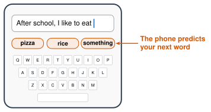

# Explore More: Where AI Came From {.unnumbered}

This page goes with Unit 1. Read it on your own, if you want to learn more. Nothing here is homework. Each section goes with one lesson.

## From Lesson 1.1: What Is AI? {#explore-1-1}

### Why Scientists Stopped Writing Rules

For many years, scientists tried to build AI with rules. A person wrote every rule. Rules worked for some jobs, like playing chess. Rules didn't work well for seeing, hearing, or language. Think about the cat rule from class: every time you fix it, a new picture breaks it.

So scientists started showing computers **examples** instead. That is . You'll learn this whole story in Lessons 1.4 and 1.5.

### AI Makes Predictions

Finish this sentence:

> *After school, I like to eat ...*

You didn't know the answer from the sentence. You made a ****. You used patterns from your own life.

AI makes predictions too.

{width="600px" fig-align="center" fig-alt="A phone keyboard. The message says 'After school, I like to eat'. Above the keys, the phone suggests three words: pizza, rice, something."}

- A phone keyboard predicts your next word.
- A video app predicts the next video you'll like.
- A chatbot predicts the next word of its answer. Then it predicts the next one. It does this again and again, very fast.

:::{.gotcha title="A prediction can be wrong"}
AI doesn't *know* the answer. It makes its best guess from patterns. Most of the time, the guess is good. Sometimes it's very wrong. In Unit 4, you'll learn how to catch it.
:::

**Try it at home:** Open a text message on a phone. Type "I am going to" and tap the middle word the phone suggests, again and again. What sentence does your phone write? Is it like you?

### More to Try

- [Quick, Draw! The Data](https://quickdraw.withgoogle.com/data){target="_blank"}: Pick one word. Look at hundreds of drawings of it. What do most people draw?
- [AutoDraw](https://www.autodraw.com/){target="_blank"}: Draw something fast and messy. AI guesses what you wanted and gives you a clean picture.
- [Teachable Machine](https://teachablemachine.withgoogle.com/){target="_blank"}: Teach a computer to know your own pictures or sounds. We'll use it in Unit 2.

***

## From Lesson 1.2: Can a Machine Think? {#explore-1-2}

### Who Was Alan Turing?

- Alan Turing was born in London in 1912. He was a mathematician.
- In 1936, he wrote about a machine that could do any calculation if you gave it the right steps. Every computer today uses this idea.
- In World War II, he helped break the secret code of the German military.
- Today, his face is on the British 50 pound bank note.

### Turing's Prediction

:::{.remember title="Turing's prediction (1950)"}
Turing said: in about 50 years, a judge will pick the right player **70 times out of 100, or less**. The judge gets 5 minutes of questions.

So a machine passes if it fools the judge at least 30 times out of 100.
:::

It took longer than 50 years. But by 2025, some chatbots could do it.

### The 2025 Study

In 2025, scientists at the University of California, San Diego played Turing's game. Almost 300 people were judges. Each judge chatted with a person and a chatbot **at the same time**, for 5 minutes. Then the judge picked: **Which one is the human?**

- GPT-4.5 with a persona was picked as the human **73%** of the time. That's more often than the real humans were picked!
- ELIZA, a chatbot from 1966, was picked 23% of the time. (You meet ELIZA in Lesson 1.3.)
- GPT-4o with **no** persona was picked only 21% of the time.

:::{.think title="Why did the persona help the chatbot?"}
A normal chatbot writes long, perfect answers. Real teenagers write short answers. They make spelling mistakes. They use slang.

The long, perfect answers were a clue. The persona hid the clue.
:::

**Try it:** In the imitation game, ask "What is 4,567 × 89?" A person needs a long time. Does the AI answer fast? Hard math answered very fast is another clue.

## From Lesson 1.3: The First Chatbot {#explore-1-3}

### The Man Who Made ELIZA

- **Joseph Weizenbaum** was born in Berlin, Germany, in 1923. His family was Jewish.
- In 1936, his family escaped from the Nazis. They came to the United States.
- He became a professor at **MIT**, a university near Boston.
- In 1966, he shared ELIZA with the world. It was one of the first chatbots ever made.

### Why Weizenbaum Worried

Weizenbaum's secretary asked him to leave the room so she could talk to ELIZA alone. Many other people felt that ELIZA understood them too.

Weizenbaum was shocked. He became worried about computers. Later he wrote that some jobs shouldn't be given to computers, **even if a computer can do them**.

**Think about it:** Which jobs shouldn't be given to a computer, even if it can do them? Why?

### ELIZA and the Turing Test

Remember the Turing test from Lesson 1.2. In 2025, judges picked ELIZA as the human **23%** of the time. A program from 1966 with no learning still fooled some people!

### Why ELIZA Did Not Know Your Language

If you added a rule in your home language, ELIZA answered you. Before that, it couldn't. Nobody wrote rules in your language. ELIZA can only do what its rules say. A rule-based program knows **nothing** that a person didn't write down.

### More to Try

- [ELIZA Terminal](https://www.masswerk.at/elizabot/eliza.html){target="_blank"}: Chat with a version of ELIZA that works like the 1966 program. It looks like an old computer screen.

***

## From Lesson 1.4: Rules Win at Games {#explore-1-4}

### A New Name, Big Dreams

In 1955, four scientists wrote a plan for a summer meeting at Dartmouth College. In the plan, they used a new name: **artificial intelligence**. The meeting was in 1956. AI had a name.

The scientists had big dreams. They thought smart machines were only a few years away. Governments and companies gave them a lot of money.

### One More Promise

In 1965, the scientist **Herbert Simon** made a promise too. He said: *"Within 20 years, machines will be able to do any work a person can do."* It didn't come true by 1985. Today, some people say AI is getting close. Other people strongly disagree.

### Toy or Electricity?

Some new inventions change the world. Others are forgotten in a few years. At the start, it's very hard to tell which is which. Smart people get it wrong in **both** directions.

**People who laughed, and were wrong:**

- **1998:** A famous economist wrote that by 2005, the internet would matter to the economy no more than the fax machine. Ten years later, he won the Nobel Prize in economics.
- **2007:** The leader of Microsoft laughed at the new iPhone. He said it cost too much, and business people wouldn't want a phone with no keyboard. Today, most people in the world use a phone like it.

**People who were excited, and were wrong:**

- **2001:** The Segway was a two-wheeled scooter that balanced by itself. People said it would change how everyone moves around cities. In 2020, the company stopped making it.
- **2021:** Someone paid $2.9 million for an NFT of the first tweet ever. (An NFT is a digital record that says you own something online.) In 2022, the owner tried to sell it. The best offer was about $280.

How can you tell which kind of invention you're looking at? Ask two questions:

1. Do many people use it every day, for real work?
2. Does it get better every year?

The internet and the iPhone passed both tests. The Segway and NFTs didn't.

:::{.think title="Try it on AI"}
Ask the two questions about AI. Then ask them about something you think is only a toy. What do you notice?

In 50 years, students will read what people said about AI in 2026. Which people will look wrong?
:::

:::{.project title="Ask your family"}
Ask someone in your family: *"When you were young, what new invention did people say was a toy, or a waste of time? Did it catch on?"* Many families saw the first cell phones, the internet, or TV arrive. Then ask: *"Do you think AI is a toy, or something bigger? Why?"* Bring one answer to class.
:::

### Rules for Business, and the Second Winter

In the 1980s, companies paid for AI built from rules. Experts wrote thousands of rules for jobs like checking orders or finding problems in machines. These programs were expensive. They broke when something new happened. Then came the second .

### How Do We Know the Rule Bot Never Loses?

Tic-tac-toe is a small game. There are only a few thousand ways a game can go. A computer played **every possible game** against the rule bot, with all 8 rules on. The bot never lost. A small world can be checked completely. The real world can't.

### Challenge: Rules for Rock, Paper, Scissors

Write rules for a rock, paper, scissors bot. Then play against a partner who knows your rules. Can a bot that follows rules ever win at this game? Why or why not?

***

## From Lesson 1.5: Data Changes Everything {#explore-1-5}

### Fei-Fei Li

- Fei-Fei Li was born in Beijing, China, in 1976.
- At 16, she moved to New Jersey with her mother to join her father.
- Her family ran a dry-cleaning shop. She worked there on weekends in high school and in college.
- She studied physics at Princeton University. Then she became an AI scientist.

### How ImageNet Was Labeled

From 2008 to 2010, 49,000 people in 167 countries labeled ImageNet online. Each person saw a word, like *chair*, and a group of pictures. They clicked every picture that showed a chair.

People disagreed, just like in class. So the workers got instructions, and several people labeled each picture. If most people agreed, the label stayed.

### Better Than People?

Look at the contest chart in Lesson 1.5 again. By 2015, the best AI made fewer mistakes than a person on this test! (On this test only. A person still knows much more about the world than the AI.)

### AlphaGo and Move 37

AlphaGo first learned from 160,000 games played by people. Then it played millions of games against itself.

In game 2 against Lee Sedol, AlphaGo made a move that surprised the experts. At first, they thought it was a mistake. It helped AlphaGo win. People still talk about **move 37**.

[AlphaGo, the full film (2017)](https://www.youtube.com/watch?v=WXuK6gekU1Y){target="_blank"}: Google DeepMind made a film about the match. Watch the part about move 37 and how Lee Sedol felt. At school, [watch it on yout-ube.com](https://yout-ube.com/watch?v=WXuK6gekU1Y){target="_blank"}.

### The Test That Trains AI

 is short for "Completely Automated Public **Turing test** to tell Computers and Humans Apart." It's the Turing test from Lesson 1.2, turned around. A computer gives the test, and it tries to find out if **you** are a person.

In 2003, Luis von Ahn, a young computer scientist from Guatemala, and his teachers at Carnegie Mellon University named the CAPTCHA. Then he had a second idea. People solved millions of CAPTCHAs every day. Could that work do something useful?

In 2007, his team made **reCAPTCHA**. It showed two words. The computer knew one word. The other word came from an old book or newspaper, and the computer couldn't read it. Your answer helped turn old pages into text a computer can search. Google bought reCAPTCHA in 2009. (Later, von Ahn started another company, to teach languages for free: Duolingo.)

### What the CAPTCHAs Asked For

From 2012, the pictures came from photos of streets: house numbers, signs, traffic lights, crosswalks, buses. Google said this work helps to "improve maps, and solve hard AI problems."

Some people think the street pictures also trained self-driving cars. In 2021, Google said no: the answers were only used to improve Google Maps. What do you think? How could you check? (Use lateral reading, Lesson 3.4.)

### AI Beats the Test

A CAPTCHA works only if computers can't solve it. In 2024, researchers at ETH Zurich, a university in Switzerland, made an AI that solved Google's picture CAPTCHAs every time.

So today, many websites check you without a puzzle. They watch how you move the mouse and how you type, and guess if you're a person.

The test made to stop computers helped train them. Now the computers pass it.

:::{.think title="Look closely"}
Next time you see a CAPTCHA, look at what it asks you to find. What could an AI learn from your answer? Show someone in your family. Did they know?
:::

### More to Try

- [Quick, Draw! The Data](https://quickdraw.withgoogle.com/data){target="_blank"}: Pick a word. Look at how thousands of people drew it. Would you label every drawing the same way?

***

## From Lesson 1.6: Transformers and ChatGPT {#explore-1-6}

### AI Wins Nobel Prizes (2024)

The Nobel Prize is one of the biggest prizes in science. In 2024, two Nobel Prizes went to AI.

- **Physics:** John Hopfield and Geoffrey Hinton, for early discoveries that made neural networks possible.
- **Chemistry:** Demis Hassabis and John Jumper, for **AlphaFold**. It's an AI that predicts the shape of proteins (the tiny machines inside your body). They shared the prize with David Baker, who designs new proteins.

**Think about it:** Why would the shape of a protein matter to a doctor who makes medicine?

### Why "Attention" Was Such a Big Idea

Before 2017, AI read a sentence one word at a time, from left to right. By the end of a long sentence, it had trouble remembering the start.

A transformer looks at **every word at the same time**. That made it much faster to train on huge amounts of text. It could use many GPUs at once (the video game chips from Lesson 1.5). Bigger training made better chatbots. This is why the paper *Attention Is All You Need* became one of the most famous papers in AI.
