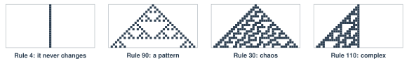
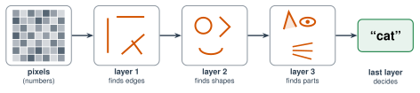

# Explore More: Brains and Neural Networks {.unnumbered}

This page goes with Unit 2. Read it on your own, if you want to learn more. Nothing here is homework. Each section goes with one lesson.

## From Lesson 2.1: Simple Rules, Complex Behavior {#explore-2-1}

### Different Cards, Different Pictures

A rule card has 8 answers, and each answer is black or white. So there are $2^8 = 256$ different rule cards. Wolfram gave each one a number from 0 to 255.

Different cards make very different pictures. All four of these start with **one black square**:

{width="760px" fig-align="center" fig-alt="Four pictures. Rule 4: a single straight line that never changes. Rule 90: a triangle pattern that repeats. Rule 30: a triangle full of messy chaos. Rule 110: a complex pattern that grows on one side."}

- **Rule 4** never changes.
- **Rule 90** makes a pattern that repeats: triangles inside triangles.
- **Rule 30** makes chaos.
- **Rule 110** makes shapes that move and crash into each other. Scientists proved that Rule 110 can do **any** calculation a computer can do. It only needs the right starting row.

Try them yourself with the rules tool in Lesson 2.1.

### Rule 30 in the Real World

- **Random numbers.** *Mathematica* used Rule 30 to make random numbers.
- **A sea snail.** The cone snail in Lesson 2.1 is called *Conus textile*. See more photos: [Conus textile (Wikipedia)](https://en.wikipedia.org/wiki/Conus_textile){target="_blank"}. Does every shell look like Rule 30?
- **A train station.** Cambridge North station in England has Rule 30 patterns on its walls.

{target="_blank"}, Geograph, via Wikimedia Commons)](/images/Unit_2/explore_cambridge_north.jpg){width="560px" fig-align="center" fig-alt="The sign Cambridge North on top of a station wall made of metal panels. The panels are full of small square holes in a pattern of triangles and lines."}

### A Big Book About Simple Rules

In 2002, Stephen Wolfram wrote a very big book about simple rules, called *A New Kind of Science*. It has more than 1,000 pages of pictures like Rule 30. He argues that simple rules can explain many things in nature: shells, plants, snowflakes, and maybe even physics. Many scientists liked the pictures but didn't agree with all of his ideas. You can decide for yourself.

## From Lesson 2.2: Your Brain Is Made of Cells {#explore-2-2}

### Brain Numbers

- About **86 billion** neurons.
- Hundreds of **trillions** of synapses (connections). One neuron can connect to thousands of others.
- Signals move from about **0.5** to **120 meters per second**. The fastest signals are as fast as a race car. The slowest are slower than walking.
- Your whole brain runs on about **20 watts** of power. That's less than an old light bulb.

### Slow Parts, Fast Brain

A computer chip does billions of steps every second. One neuron can fire only a few hundred times a second. So how can a brain recognize a friend's face in less than half a second?

The answer is **at the same time**. Billions of neurons work together, all at once. A computer chip does one step after another, very fast. A brain does many small steps side by side. Remember the GPU race in Lesson 1.5: many slow workers together can beat one fast worker.

### Try It: Measure the Speed of a Signal

Use the squeeze chain from Lesson 2.2. Measure how far a signal travels: from one hand, up the arm, to the brain, and down the other arm. That's about 1.5 meters. Divide that distance by the time for one person. Is your answer close to 120 meters per second? Why not? (Hint: the brain has to decide to squeeze. That takes time too.)

## From Lesson 2.3: How Brains Learn {#explore-2-3}

### The Taxi Drivers Whose Brains Grew

To drive a taxi in London, a driver must learn about 25,000 streets by heart. It takes 3 or 4 years. The test is called "The Knowledge."

In 2000, scientists in London used brain scans on taxi drivers. One part of the brain helps with places and maps. It's called the **hippocampus**. In taxi drivers, the back of it was bigger than in other people. Drivers with more years on the job had bigger ones.

The brain isn't fixed. Practice changes it, even its size, at any age.

### Learning Without Trying

Pavlov's dogs didn't try to learn. Their brains connected the sound and the food by themselves, because the two happened together again and again.

Think about your phone. Does a sound make you reach for it before you think? Apps and games are built to make sounds and pictures that you learn to react to. Now you know how that works, and you can notice it.

## From Lesson 2.4: The Artificial Neuron {#explore-2-4}

### The First Neuron Machine

In 1943, Warren McCulloch and Walter Pitts showed that a neuron could be written as math: multiply, add, compare. In 1958, Frank Rosenblatt built the **Mark I Perceptron**, a machine as big as a room. It had a camera made of 400 light sensors, in a 20 by 20 grid. Its weights were real knobs, turned by small motors when it learned.

The newspapers were very excited. One story said the Navy expected it to walk, talk, see, and even be conscious one day. (You read about this in Lesson 1.4.)

### A Neuron That Sees

The Mark I looked at pictures. Here's a tiny version. This neuron looks at a 3 by 3 picture. Each square is an input: **1** if it's black, **0** if it's white. Each square has its own **weight**. The neuron says **X** if the total is more than the threshold. Otherwise it says **O**.

1. Draw an X. All the weights are 0. What does the neuron say? Why?
2. Change the weights with **+** and **−**. Try to get **6 out of 6** right on the test pictures.
3. Stuck? Ask: which squares are black in an X but white in an O?



:::{.think title="Look at your weights. Do they make a picture?"}
They often do! Squares that are **only black in an X** (like the center) get **positive** weights. Squares that are **only black in an O** (like the sides) get **negative** weights. The weights are a picture of what the neuron is looking for.
:::

:::{.project title="A Neuron for a Letter"}
Make the picture bigger in your head: 5 by 5 squares. On grid paper, choose weights that tell a **T** from an **L**. Test your weights on a partner's T and L.
:::

## From Lesson 2.5: Train a Human Neural Network {#explore-2-5}

### Why the Fix Rule Works

Say a neuron should have fired, but it didn't. Its total wasn't more than its threshold. The fix rule says **ADD**: +1 to the weight of each input that was 1, and threshold −1.

What happens for that same card? Each input that was 1 adds 1 more to the total. And the threshold drops by 1. So the gap between the total and the threshold shrinks by **at least 1**. The fix always pushes that neuron **toward the right answer** for that card. SUBTRACT works the same way, in the other direction.

**Try it with Hidden 1 and card T2, Pasir** (inputs 0 and 1). Before the fix, the weights were $-1$ and $+1$, and the threshold was 1. The total was 1: not more than 1. After ADD, the weights are $-1$ and $+2$, and the threshold is 0. Now the total is 2: more than 0. It fires!

### Who's to Blame, for Real

Your class's rule is a simple version of **MADALINE Rule II**, made by Bernard Widrow and Rodney Winter in 1988. Its big idea: change the neuron that was **least sure**, because that changes the network as little as possible.

Today's networks use **backpropagation** instead. It became famous in 1986, from a paper by David Rumelhart, Geoffrey Hinton, and Ronald Williams. Two things make it different:

1. Each neuron gives a **smooth** answer, like "0.8 sure", not only yes or no. So the computer can work out **how much** each weight caused the mistake.
2. Every weight changes, a little, after every pass. The blame starts at the answer and goes **back** through the layers, one at a time. That's where the name comes from.

### Will It Always Finish?

For **one** neuron, mathematicians proved something surprising in the 1960s. If **any** straight line can split the training cards into two groups, the fix rule will always find one. It makes a limited number of mistakes, and then it stops.

For a **network**, there's no promise like that. Start C in the Lesson 2.5 tool gets stuck forever. Real networks can get stuck too. Computer scientists fix this with more neurons, random starting weights, and lots of practice runs.

## From Lesson 2.6: Build a Real AI {#explore-2-6}

### The Secret Recipe

The creatures in Lessons 2.4, 2.5, and 2.6 are made up. A computer made them from this recipe:

| Type | How many | Strength | Magic | Size |
|---|:---:|:---:|:---:|---|
| Fighter | 70 | about 66 | about 40 | about 1.5 meters tall |
| Wizard | 70 | about 40 | about 66 | about 1.5 meters tall |
| Giant | 60 | about 82 | about 82 | about 3 meters tall |
| Mini | 100 | about 24 | about 24 | about half a meter tall |

- Each creature's numbers are **spread out** around these, so some Fighters have lots of Magic, and some Wizards are strong.
- **Speed** and **Toughness** are about 50 for every type. They say nothing about the type.
- **Weight** comes from height: taller creatures are heavier.
- **Home** (Forest, Mountain, or Lake) was picked **at random**.

Now you can check the networks against the truth. For *Fighter or Wizard?*, the best rule is "more Strength than Magic: Fighter." It gets **128 of 140** right, about 91%. Even a perfect AI can't do better, because some Fighters and Wizards overlap. For *Where does it live?*, even a perfect AI can't beat guessing.

Real data is different: **nobody** knows the recipe. That's why scientists need AI to find patterns, and why they need test data to check them.

### How a Network Draws a Curved Border

The class neuron in Lesson 2.4 had one rule: one straight line.

A network has **hidden neurons** between the inputs and the answer. Each hidden neuron draws its own line. The output neurons look at all of their answers together. Two lines can make a band, like the club in Run 2. Many short lines, put together, can make a curved border.

Try it with the tool in Lesson 2.6. Choose *Which type?* Train with **0** hidden neurons and look at the colored map. Then train with **16**. How is the border different?

### Three Piles, Not Two

In class, the data was split into two piles: training and test. Real data scientists often use **three** piles:

1. **Training data:** the network learns its weights from it.
2. **Checking data** (scientists call it *validation data*): people use it to make choices, like how many hidden neurons to use.
3. **Test data:** used only once, at the very end.

Why three? Say you try 10 network sizes, and you keep the one with the best test score. Then you used the test data to make a choice. The test score isn't a fair check anymore. A third pile stays a fair check.

### The Data Behind the AI

The creature data has 300 creatures. That's tiny for AI. A big image AI learns from millions or billions of pictures. A chatbot learns from a huge amount of text. The steps are the same six steps you saw in class. Only the size is different.

## From Lesson 2.7: Train Your Own AI {#explore-2-7}

### Why Teachable Machine Learns So Fast

The creature AI in Lesson 2.6 started from nothing. Teachable Machine doesn't. It starts with a network that **already learned** from millions of pictures, like the ImageNet pictures in Lesson 1.5. That network already knows about edges, shapes, and colors (you'll see how in Lesson 2.8).

So Teachable Machine only learns the **last step** from your pictures: which shapes go with "rock." That's why it needs only about 50 pictures and a few seconds.

This is called : starting from an AI that already learned something, then teaching it a new job. It's like learning a new sport when you already know how to run and catch.

### Transfer Learning Everywhere

Most AI today uses transfer learning. A company trains one very big network, for a very long time, at a high cost. Then many people teach it new jobs with a small number of examples. A chatbot is one big network that learned from a huge amount of text. Then it's taught to follow instructions and have conversations.

**Think about it:** what if the first big network learned something unfair? Then every AI built on top of it can have the same problem. (You'll study this in Unit 4.)

## From Lesson 2.8: How AI Sees {#explore-2-8}

### Layers: From Edges to a Cat

In Lesson 2.8, a filter found edges, and a second layer found corners. But a corner isn't a cat. How does a network get from edges to "cat"?

A vision network has many layers of neurons. Each layer builds on the one before.

{width="740px" fig-align="center" fig-alt="Five steps from left to right. Pixels, which are numbers. Layer 1 finds edges. Layer 2 finds shapes like circles and corners. Layer 3 finds parts like an ear, an eye, and whiskers. The last layer decides: cat."}

Nobody tells the network to look for edges or ears. It learns its own filters during training, from millions of labeled pictures (like ImageNet in Lesson 1.5).

### Filters on Top of Filters

Layer 1 uses filters on the **picture**, like the filters in Lesson 2.8. Layer 2 uses filters on the **answers of layer 1**. Where layer 1 found a curved edge next to another curved edge, layer 2 finds a circle. Layer 3 uses filters on layer 2's answers. A circle with a dark spot in the middle could be an eye.

Each layer is only multiply and add, like one neuron. But many layers, one after another, can find very complicated things.

### See It for Yourself

The pictures in Lesson 2.8 come from an article called "[Feature Visualization](https://distill.pub/2017/feature-visualization/){target="_blank"}" (Distill, 2017). It has many more. Its appendix shows a picture for **every** neuron in GoogLeNet, layer by layer. Scroll from the first layer to the last and watch stripes turn into eyes, wheels, and faces.

## From Lesson 2.9: How Chatbots Work {#explore-2-9}

### Why Not Just a Bigger Table?

The tiny chatbot in Lesson 2.9 keeps a **table of counts**. It looks back only 1 word. Could a real chatbot just use a much bigger table?

Try it. To look back 2 words, the table needs a row for every **pair** of words. A language has tens of thousands of words, so there are hundreds of millions of pairs. To look back 1,000 words, there are more rows than atoms in the universe. And most long sentences have **never** been written before, so the table would have no count for them.

So a real chatbot doesn't store a table. It stores what it learned as **weights** in a neural network: billions of numbers, like the weights in Lesson 2.4. The network learns patterns, not exact sentences. It can make a good guess about a sentence it has never seen.

| | The tiny chatbot | A real chatbot |
|---|---|---|
| **Stores what it learned as** | a table of counts | billions of **weights** in a neural network |
| **When it sees something new** | it has no count, so it stops | it still makes a guess |
