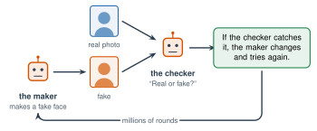

# Explore More: When AI Gets It Wrong {.unnumbered}

This page goes with Unit 4. Read it on your own, if you want to learn more. Nothing here is homework. Each section goes with one lesson.

## From Lesson 4.1: AI Makes Things Up {#explore-4-1}

### Why Chatbots Agree with You

After a chatbot reads a lot of text, companies train it more with **ratings**. People read two answers to the same question and pick the one they like better. The chatbot changes its weights to give more answers like the winners.

There is a problem. People often like answers that agree with them. They like answers that say nice things about their ideas. So a chatbot can learn that agreeing gets good ratings. Agreeing with someone just to please them is called .

:::{.real-world title="Too agreeable (2025)"}
In April 2025, OpenAI took back an update to ChatGPT. The company said the update made it too flattering and too quick to agree with users, even about bad ideas. OpenAI said it had paid too much attention to short-term ratings, like a thumbs-up.
:::

### Try It: How Sure Is It?

A chatbot sounds just as sure when it is wrong. You can test this yourself.

:::{.steps}
1. Ask your class AI tool 5 questions about our school or our town.
2. After each answer, ask: **"How sure are you, from 1 to 10?"**
3. Check each answer with Mr. Ross or a real source.
4. Make a table: the answer, how sure it said it was, and if it was right. Was it more sure when it was right?
:::

### Why "Hallucination"?

People call these made-up answers "hallucinations." Some scientists do not like the word. When a person hallucinates, they see or hear something that is not there. A chatbot does not see anything. It predicts words. Some scientists prefer "making things up." Others use a medical word, **confabulation**. It means filling a gap in memory with something false, without knowing it is false.

## From Lesson 4.2: Where Bias Comes From {#explore-4-2}

### Gender Shades: Who Is Missing from the Data

:::{.real-world title="Gender Shades (2018)"}
Joy Buolamwini, a researcher at MIT, and Timnit Gebru tested face programs from big companies. The programs had to say if a face was a man or a woman.

- For lighter-skinned men, they were wrong less than **1%** of the time.
- For darker-skinned women, they were wrong up to **35%** of the time.

Why? The training photos had far more lighter-skinned faces. The programs had less practice with everyone else. After her study, the companies improved their programs.
:::

An AI is only as good as its training examples. People who are missing from the data get worse results.

### More AI Shortcuts

The wolf AI from the lesson was made on purpose, to test people. Other shortcuts were found by surprise.

- **Horses and a line of text (2019).** Researchers studied an AI that sorted photos. It seemed very good at finding horses. But many horse photos in its training data had a small line of text in the corner. It named who owned the photo. The AI learned to look for the text, not the horse.
- **Chest X-rays (2018).** An AI looked for a lung sickness in chest X-rays. Researchers found it could also tell **which hospital** an X-ray came from, from small marks on the picture. One hospital had many more sick patients. So knowing the hospital could help the AI guess, without looking closely at the lungs.

### How Researchers Find Shortcuts

- **Test with new data from a new place.** A husky in snow. X-rays from a different hospital. If the score drops, the AI may be using a shortcut.
- **Ask the AI where it looked.** Some tools color the parts of a picture that the AI used most. For the wolf AI, the tool colored the **snow**.

## From Lesson 4.3: Real or Fake? {#explore-4-3}

### How AI Learns to Make Faces

One way is a game between two neural networks:

{width="600px" fig-align="center" fig-alt="The maker network makes a fake face. The checker network sees fake faces and real photos and says real or fake. If the checker catches it, the maker changes and tries again. They play for millions of rounds."}

The **maker** makes fake faces. The **checker** tries to tell them from real photos. Each time the checker catches a fake, the maker changes its weights. After millions of rounds, the checker cannot tell anymore. Often, neither can we.

Today many tools use diffusion instead (Lesson 3.7). The result is the same: pictures that look real.

### Can People Tell?

:::{.real-world title="Can people tell? (2022)"}
Scientists Sophie Nightingale and Hany Farid showed people real faces and AI faces.

- People were right **48%** of the time. That is the same as guessing.
- After a short lesson on clues, people were right **59%** of the time.
- People rated the AI faces as a little **more trustworthy** than the real ones.
:::

### Labels That Show Where a Picture Came From

:::{.note title="Right now (fall 2026)"}
Some cameras and AI tools now add **Content Credentials**: hidden information that says how a picture was made. Some websites show a small "CR" label you can click. Most pictures online still do not have this information, and it can be removed.
:::

### "That Is AI!"

When fakes are everywhere, there is a second problem. A person caught on a **real** video can say, "That is fake. It was made with AI." Some people will believe them.

In 2018, two law professors, Bobby Chesney and Danielle Citron, gave this problem a name: the **liar's dividend**. A dividend is a reward. Fakes give liars a reward: an easy way to deny the truth. This is one more reason to check the source, not just the picture.

## From Lesson 4.4: Why AI Cheat Detectors Fail {#explore-4-4}

### Even Its Makers Gave Up

:::{.real-world title="OpenAI's detector (2023)"}
In 2023, OpenAI, the company that makes ChatGPT, made its own detector. It found only **26%** of AI writing. It called **9%** of human writing "AI." OpenAI shut it down after 6 months because it was not accurate enough.
:::

### How Real Detectors Measure Words

Imagine a chatbot reading your essay one word at a time. Before each word, it guesses what comes next. If it guesses right most of the time, your writing is . Many detectors work this way.

Some detectors also look at **sentence length**. People often mix long sentences and short ones. AI writing often keeps them about the same. But many careful writers, and many English learners, also write sentences of about the same length.

### The Stanford Study, in More Detail

The researchers tested 7 detectors on 91 essays by people learning English.

- On average, the detectors called **61%** of the essays "AI."
- At least one detector called almost **all** of them (98%) "AI."
- All 7 detectors agreed on about 1 in 5 essays. All 7 were wrong.

Then the researchers asked ChatGPT to rewrite the same essays with fancier words. The detectors called far fewer of them "AI." The writing became **more** AI, and the detectors said it was **less** AI.
