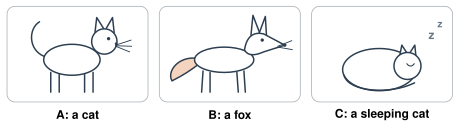
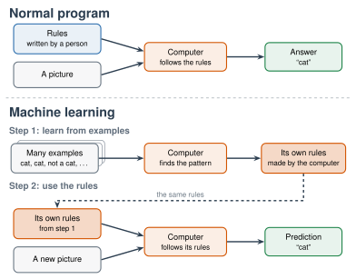
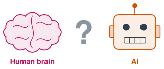

# 1.1 - What Is AI? {.unnumbered}

Your phone opens when it sees your face. A video app knows what you want to watch next. A  writes a story in two seconds.

All of these use **AI**. But what is AI? How is it different from a normal computer program? And is it like a human brain?

Today you sort things into AI and not AI. You try to teach a computer what a cat is. Then you play a drawing game against an AI.

:::{.agenda}
**Today's Plan** (40 minutes)

- [🔥]{.icon} **Warm Up** AI or not? [7 min]{.time}
- [👥]{.icon} **Learn Together** A rule for "cat" [13 min]{.time}
- [🛠️]{.icon} **Try It** Quick, Draw! [10 min]{.time}
- [🧠]{.icon} **The Big Question** Is AI like a brain? [10 min]{.time}
:::

:::{.objectives}
- [ ] I can name things in my life that use AI.
- [ ] I can explain how AI is different from a normal computer program.
- [ ] I can explain how AI learns from examples.
- [ ] I can give my first answer to the big question: Is AI like a human brain?
:::

::::{.vocab}
:::{.word-cards}
- [🤖]{.icon} : a computer program that does things that usually need human thinking
- [📏]{.icon} : an exact instruction, like "If this happens, do that."
- [🗂️]{.icon} : information, like pictures, words, or numbers
- [📚]{.icon} : a computer finds patterns in many examples
:::
::::

:::{.guided-notes-link}
[Printable lesson sheet](/handouts/Unit_1/1.1_What_Is_AI.pdf){target="_blank"} - the sheet you write on today.
:::

:::{.teacher title="Before class"}
Keep every student's Big Question answer. You hand them back in Lesson 6.6.
:::



Look at these 10 things. Which ones use AI?

Press a choice on each card: **AI**, **Not AI**, or **Not sure**. Talk with a partner. You don't need to agree.



:::{.think title="Look at the things that are AI. What do they have in common?"}
They all **learn from examples**, and they all **make guesses**.

The calculator and the alarm clock don't learn. They only follow rules that a person wrote.
:::



### 1.1.1 - What Does "AI" Mean?

AI means . **Artificial** means made by people. **Intelligence** means the ability to learn, understand, and solve problems.

So AI is a computer program that does things that usually need human thinking. AI can see faces, understand speech, translate languages, and write. Most AI today does these things in a new way. It **learns from examples**. Let's see why.

***

### 1.1.2 - Can You Write a Rule for "Cat"?

A normal  follows . A person writes every rule.

| Program | A rule a person wrote |
|---|---|
| 🔢 Calculator | If someone presses 2 + 3 =, show 5. |
| ⏰ Alarm clock | If the time is 7:00, ring. |

These rules are easy to write. Now try a hard one.

:::{.you-try-m title="Write a rule for “cat”"}
A computer gets a picture. Write a rule that tells the computer: **Is this a cat?**

Start like this: *"It is a cat if it has ..."*

Write your rule on your sheet. Then test your rule on these three pictures. Does your rule give the right answer for each one?

{width="720px" fig-align="center" fig-alt="Three simple drawings: A is a cat standing, B is a fox standing, C is a cat sleeping curled up in a ball."}
:::

:::{.think title="Did your rule work for all three pictures?"}
Probably not. Many students write: *"It is a cat if it has pointy ears, whiskers, and four legs."*

- **Picture B** is a fox. It has pointy ears, whiskers, and four legs. The rule says "cat." That's wrong.
- **Picture C** is a cat. It's sleeping, so you can't see its legs. The rule says "not a cat." That's wrong too.

You can fix the rule. But then a new picture breaks it again.
:::

So scientists tried a different idea:

1. Don't write the rules.
2. Show the computer many **examples**. Each example has the right answer.
3. Let the computer find the  by itself.

This idea is called . The examples are called .

{width="760px" fig-align="center" fig-alt="Two diagrams. Normal program: rules written by a person and a picture go into a computer, which gives an answer. Machine learning: many examples go into a computer, which finds the pattern and makes its own rules. Then a new picture and its own rules give a prediction."}

:::{.remember}
- **Normal program:** a person writes the rules. The computer follows them.
- **Machine learning:** a person gives examples. The computer makes its own rules.
:::



### 1.1.3 - Quick, Draw!

Quick, Draw! is a game made by Google. You draw. An AI tries to guess what you're drawing.

The AI learned from about **50 million** drawings. People from all over the world made them.

[✏️ Open Quick, Draw!](https://quickdraw.withgoogle.com/){.btn .btn-primary .tool-link target="_blank"}

:::{.steps}
1. Click **Let's Draw!**
2. The game shows a word. Draw it. You have **20 seconds**. (If you don't know the word, ask a partner.)
3. Play all **6 rounds**.
4. Write your results on your sheet. Did the AI guess? About how many seconds did it take?
:::

:::{.gotcha title="The game saves your drawings"}
The game saves your drawings and your country. Google shares the drawings with scientists around the world. Don't write your name or anything private in a drawing.
:::

:::{.think title="Sometimes the AI guessed before you finished. How did it do that?"}
The AI learned from millions of drawings. Your first lines looked like the start of drawings it saw before. So it made a : a best guess. It didn't wait for the whole picture.
:::



{width="460px" fig-align="center" fig-alt="A drawing of a human brain, a question mark, and a robot head labeled AI."}

We'll come back to this question on the last day of class. You don't need to know the answer today. Use what you saw: the cards, the cat rule, and the drawing game.

:::{.big-question}
[Is AI like a human brain?]{.bq}

1. On your sheet, circle one: **Yes**, **A little**, or **No**.
2. Write one reason.
3. Tell a partner your answer and your reason.
4. Your teacher keeps your answer. You'll read it again in the last lesson of the class.
:::

:::{.frames}
- I think AI **is** / **is not** / **is a little** like a human brain because ...
- AI and my brain both ...
- My brain can ... , but AI can't.
- I agree with ___ because ...
- I disagree with ___ because ...
:::



:::{.project title="Day 2: Beat the Machine"}
1. Play Quick, Draw! again. Find a word that the AI never guesses from your drawings.
2. At the end of the game, click that drawing. What did the AI guess?
3. Look at how other people drew the same word. How is your drawing different?
4. Talk with a partner: AI learns what is **common** in its data. When a drawing is rare or different, AI often guesses wrong. (You'll see this problem again in Unit 4, when we study **bias**.)
:::

:::{.project title="AI Detective"}
For one day, write down every time you see or use AI, at school and at home. At home, look at your phone and your apps. Look at games, stores, and cars too. Bring your list to class. Who found the most?
:::

:::{.explore-link}
🔭 **Explore More:** [how AI makes predictions, and more drawing tools](/chapters/Explore/explore-unit-1.qmd#explore-1-1). Read it on your own, if you want to learn more.
:::
