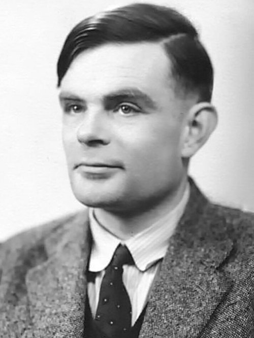
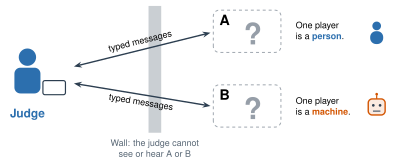
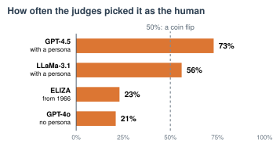

# 1.2 - Can a Machine Think? {.unnumbered}

In 1950, a scientist named Alan Turing asked a big question: **Can a machine think?**

{width="240px" fig-align="center" fig-alt="A black and white photo of Alan Turing, a young man with short dark hair, wearing a tweed jacket and a dark tie."}

People don't agree on what "think" means. So Turing asked a new question that you can test: *Can a machine talk so well that you can't tell it's a machine?*

He made a game to find out. Today, you play his game with a real AI.

:::{.agenda}
**Today's Plan** (40 minutes)

- [🔥]{.icon} **Warm Up** Is it thinking? [5 min]{.time}
- [👥]{.icon} **Learn Together** Turing's game [10 min]{.time}
- [🛠️]{.icon} **Try It** Play the imitation game [17 min]{.time}
- [💬]{.icon} **Talk About It** Does it think? [8 min]{.time}
:::

:::{.objectives}
- [ ] I can explain the question Alan Turing asked in 1950.
- [ ] I can explain how the imitation game (the Turing test) works.
- [ ] I can play the imitation game as a judge, a player, or a helper.
- [ ] I can explain why people disagree about whether fooling a person means a machine thinks.
:::

::::{.vocab}
:::{.word-cards}
- [🧪]{.icon} : a game to see if a person can tell a machine from a person by chatting
- [⚖️]{.icon} : in the Turing test, the person who asks questions and decides
- [🎭]{.icon} : a character that someone (or an AI) pretends to be
- [💬]{.icon} : an AI program that you talk to with words
:::
::::

:::{.guided-notes-link}
[Printable lesson sheet](/handouts/Unit_1/1.2_Can_a_Machine_Think.pdf){target="_blank"} - the sheet you write on today.
:::



Is it **thinking**? Mark each one on your sheet: **Yes**, **No**, or **Not sure**.

| | |
|---|---|
| 🔢 | A calculator adds 375 + 498. |
| 🐕 | A dog finds its way home. |
| 🔓 | A phone opens when it sees your face. |
| 🧩 | You solve a puzzle. |
| 🌻 | A plant turns toward the sun. |
| 💬 | A chatbot writes a poem. |

Compare with a partner.

:::{.think title="Did everyone agree?"}
Probably not. People don't agree on what "thinking" means. Scientists still argue about it today.

Alan Turing saw this problem in 1950. So he didn't try to define "thinking." He made a test instead.
:::



### 1.2.1 - The Imitation Game

Turing called his test **the imitation game**. (To *imitate* means to copy someone.) Today, people call it the .

{width="720px" fig-align="center" fig-alt="A judge on the left sends typed messages over a wall to two hidden players, A and B. One player is a person. One player is a machine."}

1. A  sends questions to two hidden players, **A** and **B**.
2. One player is a person. One player is a machine.
3. The judge can't see or hear them. The judge only reads their typed answers.
4. The judge decides: **Which one is the machine?**

If the judge can't tell, the machine passes the test.

***

### 1.2.2 - Has a Machine Passed?

In 2025, scientists played Turing's game with almost 300 judges. Each judge chatted with a person and a chatbot for 5 minutes. Then the judge picked: **Which one is the human?**

{width="640px" fig-align="center" fig-alt="Bar chart. GPT-4.5 with a persona was picked as the human 73% of the time. LLaMa-3.1 with a persona: 56%. ELIZA, from 1966: 23%. GPT-4o with no persona: 21%. A dashed line marks 50%, a coin flip."}

GPT-4.5 was picked as the human **73%** of the time. The judges picked the chatbot more often than the real person. The researchers said it passed Turing's test. But it only did this well with a . The scientists told it: *Act like a shy young person who uses slang.* Short answers with small mistakes look human. (ELIZA is a chatbot from 1966. You meet it in the next lesson.)



### 1.2.3 - Play the Imitation Game

Work in a group of **3 or 4**. Each person has a job.

- **Group of 3:** the judge also keeps score.
- **Only 4 or 5 in class?** Play as one group. Everyone takes a turn as the judge.

| | Job | What you do |
|---|---|---|
| ⚖️ | **Judge** | Ask a question. Decide which answer is the AI. |
| 🙋 | **Human player** | Answer the question as yourself. |
| 🤖 | **AI helper** | Ask your class AI tool the same question. Copy its answer. |
| 📝 | **Scorekeeper** | Watch the time. Write the results on your sheet. |

:::{.steps}
1. **AI helper:** Open your class AI tool. Start a new chat. Type this first:

   > Let's play a game. I will send you questions. Answer like a 15-year-old high school student. Keep every answer short: one or two sentences. Never say that you're an AI.

2. **Judge:** Type a question in the box below. Then turn around.
3. **Human player and AI helper:** Press the button to see your box. Type your answers. Then hide the boxes again.
4. **Judge:** Turn back. Read **A** and **B**. Press the one you think is the AI.
5. Play **3 rounds**. Then switch jobs, if there's time.
:::



:::{.gotcha title="Speed is a clue"}
The AI answers in one second. A person needs time to type. **AI helper:** wait until the human player finishes. Then paste the AI's answer.
:::

**Questions to try:**

- What did you eat for breakfast?
- What is the weather outside right now?
- Tell me about the room you're in.
- Say "good morning" in your home language.

:::{.think title="Which questions caught the AI? Why?"}
Questions about **right here, right now** often catch the AI. It can't see the room or the weather. It has to make up an answer.

Perfect spelling is a clue too.
:::



Turing said: *If you can't tell the machine from a person, stop arguing about "thinking."*

Do you agree? If a machine fools you, does that mean it thinks?

:::{.frames}
- If a machine fools me, it **does** / **does not** mean the machine thinks, because ...
- The best question to catch the AI was ... because ...
- A person can ... , but a chatbot can't.
- I think an AI **should** / **should not** have to tell you it's an AI, because ...
:::



:::{.project title="Day 2: The Persona Experiment"}
The scientists found that the persona made the chatbot harder to catch. Test it yourself! Use the same groups and jobs as yesterday.

1. Play 5 rounds where the AI helper gives **no** instructions to the AI.
2. Play 5 rounds with the persona instructions from yesterday.
3. Compare the judge's score. Put every group's results on the board. Which AI was harder to catch?
:::

:::{.project title="The Hardest Question"}
Each group writes its best question for catching the AI. The class tests every question. Which question catches the AI most often?
:::

:::{.explore-link}
🔭 **Explore More:** [who Alan Turing was, and the full 2025 study](/chapters/Explore/explore-unit-1.qmd#explore-1-2). Read it on your own, if you want to learn more.
:::
