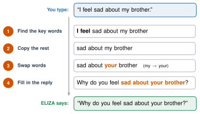
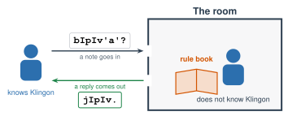

# 1.3 - The First Chatbot {.unnumbered}

In 1966, people at a university in Massachusetts talked to a computer program named **ELIZA**. ELIZA acted like a counselor. Some people told it their secrets. Some people believed it understood them.

ELIZA understood nothing. It followed a list of  that one person wrote.

Today, you play ELIZA yourself and see how it works. Then you act out a famous puzzle: a person who answers notes in a language they do not know.

:::{.agenda}
**Today's Plan** (40 minutes)

- [🔥]{.icon} **Warm Up** Be ELIZA [7 min]{.time}
- [👥]{.icon} **Learn Together** How ELIZA works [8 min]{.time}
- [🧪]{.icon} **Try It** The Klingon Room [18 min]{.time}
- [💬]{.icon} **Talk About It** Does it understand? [7 min]{.time}
:::

:::{.objectives}
- [ ] I can explain how ELIZA used key words and rules to answer.
- [ ] I can explain the ELIZA effect.
- [ ] I can act out the Chinese Room (as the Klingon Room) and explain the question it asks.
:::

::::{.vocab}
:::{.word-cards}
- [🔑]{.icon} : a word that a program looks for to decide what to do
- [📏]{.icon} : an exact instruction, like "If this happens, do that."
- [🪞]{.icon} : when people feel that a computer understands them, but it does not
- [💡]{.icon} : to know what something means, not only what it looks like
:::
::::

:::{.guided-notes-link}
[Printable lesson sheet](/handouts/Unit_1/1.3_The_First_Chatbot.pdf){target="_blank"} - the sheet you write on today.
:::

:::{.guided-notes-link}
[Klingon Room rule book and note cards](/handouts/Unit_1/1.3_Klingon_Room_Rule_Book.pdf){target="_blank"} - print one set for each group.
:::



Work with a partner (or a group of 3, taking turns). One of you is **ELIZA**. ELIZA can only answer with the rule card. ELIZA cannot think of anything new!

| If your partner says ... | ELIZA says ... |
|---|---|
| I feel ___ | Why do you feel ___? |
| I am ___ | How long have you been ___? |
| I want ___ | Why do you want ___? |
| a word about family | Tell me more about your family. |
| anything else | Please go on. |

1. Your partner tells ELIZA about their day. Talk for 3 turns.
2. Switch jobs.

:::{.think title="Was it hard to be ELIZA? Did your partner's answers make sense?"}
Being ELIZA is easy. You do not need to understand anything. You only look for the key words and follow the card.

Sometimes ELIZA's answer sounds caring. Sometimes it sounds strange. ELIZA cannot tell the difference.
:::



### 1.3.1 - How ELIZA Works

ELIZA was made in 1966 by **Joseph Weizenbaum**, a professor at MIT. ELIZA does not learn. Weizenbaum wrote every rule by hand. Here is how ELIZA answers one sentence:

{width="620px" fig-align="center" fig-alt="You type: I feel sad about my brother. Step 1: find the key words, I feel. Step 2: copy the rest, sad about my brother. Step 3: swap words, my becomes your. Step 4: fill in the reply. ELIZA says: Why do you feel sad about your brother?"}

:::{.remember}
- ELIZA looks for . It does not know what the words mean.
- If no rule matches, ELIZA says something that fits anything, like "Please go on."
- ELIZA is a **normal program**: a person wrote the rules (like the calculator in Lesson 1.1).
:::

***

### 1.3.2 - People Believed It

Weizenbaum's secretary knew that ELIZA was only a program. She watched him build it. But one day, she was chatting with ELIZA. She asked Weizenbaum to leave the room so she could talk to it alone.

Many people felt that ELIZA understood them. Today, we call this the ****.



### 1.3.3 - The Chinese Room

:::{.experiment title="The Chinese Room (John Searle, 1980)"}
A philosopher named **John Searle** asked people to imagine this:

- A person sits in a closed room. They do **not** know the language of the notes.
- Notes come in through a slot.
- The person has a **rule book**. It says: *"If you see these shapes, send back those shapes."*
- The person finds the shapes and copies the reply. They pass it out.
- Outside, people who know the language read the replies. The replies make sense! They think someone in the room knows the language.

**Does anyone in the room understand the language?**
:::

**Act it out: the Klingon Room.** Searle imagined notes in Chinese, a language he could not read. We will use **Klingon**. It is a language made up for the *Star Trek* TV shows and movies. (Some fans really speak it!)

{width="560px" fig-align="center" fig-alt="A person who knows Klingon passes a note into a closed room. Inside, a person who does not know Klingon looks in a rule book and passes a reply in Klingon back out."}

Work in a group of **2 to 4**: one person in the room, the rest outside. Each group needs one rule book and one set of note cards. (Only 4 in class? Be one group, and take turns going in the room.)

:::{.steps}
1. One person is **in the room**. Sit behind a folder or a book so the others cannot see you. Take the rule book.
2. Everyone else is **outside**. Share the note cards. Fold back the English part.
3. Pass one note into the room. The person in the room finds the note that looks **exactly** the same in the rule book. They copy the reply on the back. Pass it out.
4. Outside: check the reply with the English on your card. Does it make sense?
5. Do all 6 notes. Then switch: a new person goes in the room.
:::

:::{.think title="Look at the note that asks, &quot;Do you speak Klingon?&quot; What did the room say?"}
The room answered: *"Yes. I am learning Klingon."*

But the person in the room does not know any Klingon. The answer sounds right, and it is **not true**.

Now look at the note about the bathroom. The room said: *"I don't understand."* That one is true! But the room only said it because a rule told it to.
:::



Searle said: the person in the room does not understand the language. They only follow rules. **A computer is the same.** It follows rules, so it does not understand anything.

Other people disagree. They say: maybe the person does not understand, but the **whole room** (the person plus the book) does.

What do you think?

:::{.frames}
- The person in the room **does** / **does not** understand Klingon, because ...
- The whole room **does** / **does not** understand Klingon, because ...
- ELIZA is like the Klingon Room because ...
- Today's chatbots are **like** / **not like** the Klingon Room, because ...
:::



:::{.project title="Day 2: Chat with ELIZA, Then Change Its Rules"}
1. Chat with ELIZA below for 2 minutes.
2. Check the box **Show which rule ELIZA used**. Chat some more. Which rules does ELIZA use most?
3. **Break ELIZA.** Write something that makes ELIZA give a strange answer.
4. Open **ELIZA's rules**. Add a new rule. Test it! (Example: when someone says `i like *`, ELIZA says `Why do you like *?`)
5. Add a rule in your **home language**. Does ELIZA answer you now? Why did ELIZA not understand your language before?
:::



:::{.gotcha title="ELIZA does not understand you"}
Do not tell ELIZA anything private. It is a game. (Nothing you type here leaves your computer.)

If you need to talk about something real, talk to a person: a teacher, the school counselor, or your family.
:::

:::{.project title="Build a Better ELIZA"}
With your group, write 10 new rules for a different job: a **school helper**, a **soccer fan**, or a **food expert**. Add them to ELIZA.

Then let another group chat with your ELIZA. How many turns until it says something strange?
:::

:::{.project title="ELIZA vs. Today's Chatbot"}
Type the same sentence to ELIZA and to your class AI tool. Try: *I feel nervous about my test.*

Compare the two answers. Which one sounds like it understands? Does either one really understand?
:::

:::{.explore-link}
🔭 **Explore More:** [the man who made ELIZA, and why he worried](/chapters/Explore/explore-unit-1.qmd#explore-1-3). For students who want to learn more on their own.
:::
