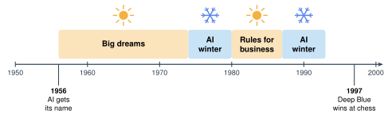

# 1.4 - Rules Win at Games {.unnumbered}

In 1958, a newspaper wrote about a new computer. It said the computer would soon "walk, talk, see, write, reproduce itself and be conscious of its existence."

Did that happen? Not in 1958. Not for a long time.

For about 40 years, scientists tried to build AI out of rules. Rules did not work for seeing or talking. But rules did work for one thing: **games**. Today, you play a game against a bot made only of rules. Then you break it.

:::{.agenda}
**Today's Plan** (40 minutes)

- [🔥]{.icon} **Warm Up** Did it come true? [7 min]{.time}
- [👥]{.icon} **Learn Together** Winters and chess [10 min]{.time}
- [🛠️]{.icon} **Try It** Beat the rule bot [15 min]{.time}
- [💬]{.icon} **Talk About It** Is it smart? [8 min]{.time}
:::

:::{.objectives}
- [ ] I can explain what an AI winter was and why it happened.
- [ ] I can explain how Deep Blue beat the world chess champion.
- [ ] I can test which rules a game bot needs.
- [ ] I can explain why rules work for games but not for seeing pictures.
:::

::::{.vocab}
:::{.word-cards}
- [❄️]{.icon} : a time when people stopped giving money to AI research
- [📣]{.icon} : big promises and excitement, more than the facts show
- [♟️]{.icon} : the IBM computer that beat the world chess champion in 1997
- [📏]{.icon} : an exact instruction, like "If this happens, do that."
:::
::::

:::{.guided-notes-link}
[Printable lesson sheet](/handouts/Unit_1/1.4_Rules_Win_at_Games.pdf){target="_blank"} - the sheet you write on today.
:::



Long ago, people made big promises about AI. Read each one. Did it come true by the time they said? Mark your sheet.

| | Year | Who said it | The promise |
|---|---|---|---|
| **A** | 1958 | A newspaper | A new computer will soon walk, talk, see, write, make copies of itself, and know that it exists. |
| **B** | 1958 | Two scientists | Within 10 years, a computer will be the world chess champion. |
| **C** | 1970 | Marvin Minsky | In 3 to 8 years, we will have a machine as smart as an average person. |

:::{.think title="Which promises came true?"}
**None of them came true by the time they said.**

Parts of Promise **A** came true much later. Today, AI can talk, see, and write. Can it know that it exists? Nobody knows.

Promise **B** came true later. A computer beat the world chess champion in **1997**. That is 39 years later, not 10.

Promise **C** did not come true by the 1970s. Today, some people say AI is getting close. Other people strongly disagree. You will think about this in Unit 6.
:::



### 1.4.1 - AI Winters

In 1956, scientists met at Dartmouth College. They gave the new field a name: **artificial intelligence**. They thought smart machines were only a few years away. Governments and companies gave them a lot of money.

Progress was much slower than the promises. So the money stopped. This happened two times.

People call these times ****. (In winter, plants stop growing. In an AI winter, AI research stopped growing.)

{width="700px" fig-align="center" fig-alt="A timeline from 1950 to 2000. 1956: AI gets its name. Big dreams until the early 1970s. Then an AI winter in the late 1970s. Rules for business in the 1980s. Then another AI winter around 1990. 1997: Deep Blue wins at chess."}

:::{.think title="This time is different"}
The promises in the Warm Up were ****. In 1958 and 1970, they were much bigger than what the machines could do. When the promises failed, the money stopped.

But the promises were not all wrong. Some were only too early.

Today is different. AI already does many things people once only dreamed about. It talks, writes, translates, and finds things in pictures. Millions of people use it every day. Many big promises today start from things AI can already do.

That does not mean every promise will come true. When you hear one, ask: **What can AI already do? Who checked it?**
:::

***

### 1.4.2 - Rules Can Win at Games

A game is a small world. It has clear rules. Every move is on the board. Rules can work well in a small world.

:::{.real-world title="Deep Blue beats the champion (1997)"}
In May 1997, IBM's computer **** played the world chess champion, **Garry Kasparov**. Deep Blue won, $3\frac{1}{2}$ to $2\frac{1}{2}$.

- People wrote Deep Blue's rules for judging a chess position.
- Then it checked about **200 million** positions every second.
- Deep Blue did not learn like the drawing AI in Lesson 1.1. It used rules and speed.
:::

:::{.remember}
Deep Blue could beat the best chess player in the world. But its rules could not tell a cat from a dog. Rules that work in a small world do not work in the big, messy real world.
:::



### 1.4.3 - Beat the Rule Bot

This bot plays tic-tac-toe. It has 8 rules. It checks them **in order** and uses the first one it can.

:::{.steps}
1. Play 3 games with **all the rules on**. Can you beat the bot?
2. **Turn off one rule.** Play again. Can you beat it now?
3. Try different rules. Find the rules the bot needs most. Write them on your sheet.
4. Look at the orange box after each move. Which rule did the bot use?
:::



:::{.think title="With all the rules on, could anyone beat the bot?"}
No. With all 8 rules, the bot never loses. The best you can do is a tie.

Some rules matter more than others. Turn off **Block** and the bot does not stop you from winning. Turn off **Side** and nothing changes.
:::

:::{.think title="Tic-tac-toe needs 8 rules. How many rules would a cat finder need?"}
No one knows. People tried for years and could not write them. A cat can be any color, any size, in any position, in any light. There are too many cases.

That is why AI changed. In the next lesson, you will see what happened when scientists stopped writing rules and started collecting **examples**.
:::



Deep Blue beat the best chess player in the world. Is Deep Blue **smart**?

:::{.frames}
- I think Deep Blue **is** / **is not** smart, because ...
- The most important rule for the bot was ... because ...
- Rules work for games, but not for ... , because ...
- AI today is different from AI in 1970 because ...
- One promise about AI today that I think (will / will not) come true is ... , because ...
:::



:::{.project title="Rule Book Battle"}
Play tic-tac-toe on paper with a partner. One of you is the **bot**. The bot must follow the 8 rules on your sheet, in order. The bot cannot think! Can the human win? Switch jobs.
:::

:::{.project title="My AI Promise for 2036"}
Write one promise about AI for 10 years from now. Use the form: *"By 2036, AI will ..."* Mr. Ross keeps the promises. Will you be right, or will it be hype?
:::

:::{.explore-link}
🔭 **Explore More:** [how AI got its name, rules for business, and a rock, paper, scissors challenge](/chapters/Explore/explore-unit-1.qmd#explore-1-4). Read it on your own, if you want to learn more.
:::
