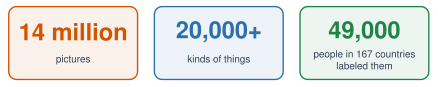
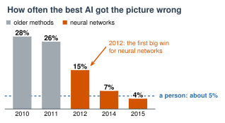

# 1.5 - Data Changes Everything {.unnumbered}

How did you learn what a dog is? Nobody gave you a rule. You saw many dogs: big dogs, small dogs, dogs in pictures, dogs on the street.

In 2006, a young scientist named **Fei-Fei Li** had an idea. Maybe computers need the same thing: not rules, but **millions of examples**.

Today, you do the job that thousands of people did for her project: you label pictures. And you find out that people don't always agree.

:::{.agenda}
**Today's Plan** (40 minutes)

- [🔥]{.icon} **Warm Up** How did you learn? [5 min]{.time}
- [👥]{.icon} **Learn Together** ImageNet and the big win [12 min]{.time}
- [🛠️]{.icon} **Try It** Be the labelers [15 min]{.time}
- [💬]{.icon} **Talk About It** Who decides? [8 min]{.time}
:::

:::{.objectives}
- [ ] I can explain why ImageNet was important.
- [ ] I can explain the new recipe for AI: data, neural networks, and fast chips.
- [ ] I can label data and find where people disagree.
- [ ] I can explain why the people who label data matter.
:::

::::{.vocab}
:::{.word-cards}
- [🏷️]{.icon} : the right answer that a person attaches to an example, like "cat"
- [🖼️]{.icon} : a big collection of examples, like pictures with labels
- [🕸️]{.icon} : a kind of AI made of many small parts, based on an idea from brain cells
- [🎮]{.icon} : a computer chip made for video games that can do many small math problems at once
:::
::::

:::{.guided-notes-link}
[Printable lesson sheet](/handouts/Unit_1/1.5_Data_Changes_Everything.pdf){target="_blank"} - the sheet you write on today.
:::



Think about something you learned to recognize as a child: a dog, a car, your mother's voice, the letter A.

1. Did someone give you a **rule**? Or did you see many **examples**?
2. About how many examples do you think you saw?

Tell a partner.

:::{.think title="How many examples does a child see?"}
A lot! Fei-Fei Li says: think of a child's eyes as a camera that takes about 5 pictures every second. By age 3, the child has seen **hundreds of millions** of pictures. Children learn from examples, not rules.

Fei-Fei Li thought: computers have rules, but they don't have enough examples.
:::



### 1.5.1 - ImageNet

In 2006, Fei-Fei Li, a scientist at Princeton University, started a project called **ImageNet**. She wanted a giant : pictures of everything in the world, each with a .

{width="660px" fig-align="center" fig-alt="ImageNet in three numbers: 14 million pictures, more than 20,000 kinds of things, labeled by 49,000 people in 167 countries."}

The pictures came from the internet. But the internet doesn't say what is in each picture. **People** had to look and decide. Each person saw a word, like *chair*, and a group of pictures. They clicked every picture that showed a chair.

ImageNet was shared with the world in 2009. It was the biggest set of labeled pictures anyone had made.

***

### 1.5.2 - The Big Win in 2012

Every year, scientists entered a contest. Their programs looked at ImageNet pictures and named what was in them.

{width="560px" fig-align="center" fig-alt="Bar chart of how often the best AI got the picture wrong in the ImageNet contest. 2010: 28%. 2011: 26%. 2012, a neural network: 15%. 2014: 7%. 2015: 4%. A person gets it wrong about 5% of the time."}

In 2012, a team from Toronto used a . (You'll learn how neural networks work in Unit 2.) Their mistakes dropped from about 26% to **15%**. Nobody had seen a jump that big.

They trained their network on two , chips made for **video games**. A GPU can do thousands of small math problems at the same time.

:::{.remember title="The new recipe for AI"}
1. **Lots of data** (like ImageNet)
2. **Neural networks** that learn from the data
3. **Fast chips** (GPUs) to do the math

AI didn't get better because people wrote better rules. It got better because of examples.
:::

:::{.real-world title="AlphaGo (2016)"}
Go is a board game from China. It's much harder for computers than chess. In 2016, a neural network called **AlphaGo** played Lee Sedol, one of the best Go players in the world. AlphaGo won, 4 games to 1.

Deep Blue used rules that people wrote (Lesson 1.4). AlphaGo learned from examples. First it learned from games that people played. Then it played millions of games against itself.
:::



### 1.5.3 - Be the Labelers

Do the job of the ImageNet workers.

:::{.steps}
1. Choose the **sandwich** round.
2. Work **alone** first. Click every picture that shows a sandwich. Don't talk!
3. Press **I'm done**. Write your picture numbers on your sheet.
4. Compare with a partner (or a group of 3). Which pictures did you **disagree** on?
:::



**Class vote.** Your teacher picks the hardest picture. Everyone votes. How many said yes? How many said no?

:::{.think title="Is a hot dog a sandwich? Is a chair with wheels a chair?"}
There's no right answer! People decide. And different people decide differently.

ImageNet had this problem too. So the workers got instructions, and several people labeled each picture. If most people agreed, the label stayed.
:::

:::{.gotcha title="An AI learns what the labelers decided"}
If the labelers said a hot dog is a sandwich, the AI will say it too. The AI doesn't know what a sandwich *really* is. It only knows what people labeled.

What if all the labelers came from one country? The AI would learn their idea of a sandwich. In Unit 4, you'll see more ways that AI learns unfair patterns.
:::

:::{.real-world title="You have done this job before"}
Have you ever clicked every picture with a traffic light, to prove you aren't a robot? That test is a .

Google's reCAPTCHA uses those clicks to label data for AI. Look at what it asked for, and you can see what AI was learning:

- **2007:** blurry words from old books and newspapers. Computers were learning to read.
- **From 2012:** house numbers, street signs, traffic lights, crosswalks, and buses, from photos of streets. Computers were learning to see a street.

Every time you solved one, you were a labeler too. Nobody paid you.
:::



49,000 people labeled ImageNet. Most people don't know their names. The scientists became famous.

:::{.frames}
- The people who labeled the data **should** / **should not** get credit, because ...
- People disagreed about picture ... because ...
- If the labelers all came from one country, the AI might ...
- People who solve CAPTCHAs (should / shouldn't) be told that they label data for AI, because ...
- The most important part of the new recipe is ... because ...
:::



:::{.watch title="How we teach computers to understand pictures (Fei-Fei Li, TED, 2015)"}


Fei-Fei Li gave this talk in 2015, three years after the Toronto team's neural network won. It's history now: computers can do much more today. The talk is 18 minutes. In class, we watch the first part.

**While you watch:** Fei-Fei Li compares computers to children. In 2015, what could children do that computers couldn't?

**Captions in your language:** Press **CC**, then ⚙️ **Settings**, then **Subtitles/CC**, then **Auto-translate**.
:::



:::{.project title="Day 2: More Rounds and a Labeling Rule"}
1. Do the **chair** and **car** rounds. Label alone first, then compare with a partner.
2. Which round had the most disagreement? Why?
3. Write a rule for **sandwich** that ends the argument. Test it on all 12 sandwich pictures. Does your rule work for every picture? Does everyone in your group agree with it?
:::

:::{.project title="The GPU Race"}
Why do GPUs help? Try it with your class.

1. **One student** solves all 24 problems in Set A alone, on paper. Time it.
2. **Everyone else** shares the 24 problems in Set B. Each person does a few, all at the same time. Time it.
3. Which was faster? A normal computer chip is like the one fast student. A GPU is like the whole class.

(Only 4 in class? One student against a team of 3 still works.)

**Set A: for one student**

|   |   |   |   |   |   |
|---|---|---|---|---|---|
| 23 + 4 | 45 + 7 | 28 + 6 | 30 + 3 | 30 + 9 | 13 + 5 |
| 49 + 4 | 16 + 4 | 20 + 4 | 31 + 7 | 23 + 3 | 47 + 9 |
| 17 + 5 | 44 + 4 | 24 + 4 | 35 + 4 | 16 + 6 | 42 + 9 |
| 42 + 6 | 15 + 6 | 18 + 2 | 29 + 2 | 39 + 9 | 21 + 7 |

**Set B: for everyone else, shared**

|   |   |   |   |   |   |
|---|---|---|---|---|---|
| 23 + 4 | 31 + 8 | 34 + 7 | 27 + 4 | 27 + 7 | 41 + 6 |
| 16 + 4 | 15 + 2 | 20 + 7 | 34 + 6 | 14 + 9 | 30 + 8 |
| 43 + 5 | 32 + 5 | 29 + 6 | 31 + 9 | 34 + 2 | 45 + 5 |
| 36 + 5 | 47 + 8 | 13 + 3 | 35 + 9 | 15 + 9 | 39 + 3 |
:::

:::{.explore-link}
🔭 **Explore More:** [Fei-Fei Li's story, AlphaGo's famous move, and the film](/chapters/Explore/explore-unit-1.qmd#explore-1-5). Read it on your own, if you want to learn more.
:::
