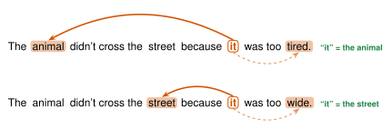
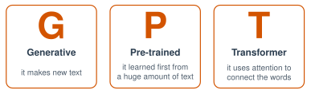

# 1.6 - Transformers and ChatGPT {.unnumbered}

On November 30, 2022, a company called OpenAI shared a chatbot named **ChatGPT**. In about two months, around **100 million** people used it. At that time, no app had ever grown that fast.

ChatGPT came from an idea that Google scientists shared in 2017. The idea is called **attention**. You use it every time you read.

Today, you see how attention works. Then you build a sentence the way a chatbot does: one word at a time.

:::{.agenda}
**Today's Plan** (40 minutes)

- [🔥]{.icon} **Warm Up** What does "it" mean? [5 min]{.time}
- [👥]{.icon} **Learn Together** Attention and GPT [12 min]{.time}
- [🛠️]{.icon} **Try It** Next word, by vote [16 min]{.time}
- [💬]{.icon} **Talk About It** Whose words? [7 min]{.time}
:::

:::{.objectives}
- [ ] I can explain what attention means for a transformer.
- [ ] I can explain what the letters in GPT mean.
- [ ] I can build a sentence one word at a time, like a chatbot.
:::

::::{.vocab}
:::{.word-cards}
- [🔦]{.icon} : when an AI looks at all the other words to decide which ones matter
- [🔀]{.icon} : a kind of neural network that uses attention. The T in GPT
- [📚]{.icon} : a transformer trained on a huge amount of text to predict the next word
- [🔮]{.icon} : a best guess about something you do not know yet
:::
::::

:::{.guided-notes-link}
[Printable lesson sheet](/handouts/Unit_1/1.6_Transformers_and_ChatGPT.pdf){target="_blank"} - the sheet you write on today.
:::



Read these two sentences. What does **"it"** mean in each one? Write your answers on your sheet.

> 1. The animal didn't cross the street because **it** was too **tired**.
> 2. The animal didn't cross the street because **it** was too **wide**.

:::{.think title="How did you know?"}
In sentence 1, "it" means **the animal**. Animals get tired. Streets do not.

In sentence 2, "it" means **the street**. Streets can be wide. Animals are not "too wide" to cross.

Only one word changed. To decide, you looked back at other words in the sentence. You **paid attention** to the right words.
:::



### 1.6.1 - Attention (2017)

For a long time, AI read one word at a time. It had trouble remembering the start of a long sentence. In 2017, scientists at Google shared a new kind of neural network. They called it the .

A transformer looks at **every word at the same time**. For each word, it decides which other words matter most. This is called . The scientists' paper had a famous title: *Attention Is All You Need.*

{width="720px" fig-align="center" fig-alt="Two sentences. In 'The animal didn't cross the street because it was too tired,' an arrow goes from 'it' to 'animal.' In the same sentence ending with 'wide,' the arrow goes from 'it' to 'street.' In both, the last word is highlighted."}

***

### 1.6.2 - GPT and ChatGPT

{width="600px" fig-align="center" fig-alt="G is Generative: it makes new text. P is Pre-trained: it learned first from a huge amount of text. T is Transformer: it uses attention to connect the words."}

A GPT is a . It learned by playing one game, billions of times: **predict the next word** (like the phone keyboard in Lesson 1.1). When it answers you, it predicts one word, then the next, then the next.

:::{.note title="Right now (fall 2026)"}
There are many chatbots built this way: ChatGPT, Gemini, Claude, Copilot, Llama, and more. Most AI tools made for schools are built on top of models like these.
:::

In 2024, two Nobel Prizes, among the biggest prizes in science, went to scientists who worked on AI.



### 1.6.3 - Be the Chatbot: Next Word, by Vote

A chatbot writes one word at a time. It picks a word that is likely to come next. Now the class does the same thing.

:::{.steps}
1. Mr. Ross writes the start of a sentence on the board: **After school, my friends and I ...**
2. Everyone writes **one** next word on a small paper. Do not talk!
3. Mr. Ross counts the words. The word with the most votes goes on the board.
4. Do it again for the next word. Keep going until the sentence ends (about 8 words).
5. Now give the same start to your class AI tool: *"Finish this sentence: After school, my friends and I"*. Compare its sentence with the class sentence.
:::

:::{.teacher title="Small class?"}
With only 4 or 5 people, many words get 1 vote. Break a tie by rolling a die, or ask everyone to write **two** words each.
:::

:::{.think title="Was the class sentence surprising or ordinary?"}
Usually it is **ordinary**. The most common word wins every time, so the sentence uses common words.

Chatbots have the same problem. So they do not always pick the top word. Sometimes they pick the second or third word, on purpose, to make the writing more interesting.
:::



ChatGPT learned from text that people wrote: books, websites, news, and more. Most of those writers were never asked.

:::{.frames}
- Writers **should** / **should not** be asked before AI learns from their words, because ...
- A chatbot writes one word at a time by ...
- In 10 years, I think AI will ... , because ...
:::



:::{.project title="Day 2: See the Attention, and Finish the Timeline"}
1. In the demo below, click the word that **"it"** means. Then change the last word. Watch which words light up.
2. Put every card from Unit 1 on the wall, in order. Use the list below. Is anything missing?
3. With a partner, pick one card and explain it to the class in 2 sentences.
:::



| Year | What happened |
|---|---|
| 1950 | Alan Turing asks: Can a machine think? |
| 1956 | AI gets its name at Dartmouth College. |
| 1966 | ELIZA, one of the first chatbots. |
| 1980 | The Chinese Room. |
| 1997 | Deep Blue beats the world chess champion. |
| 2009 | ImageNet: 14 million labeled pictures. |
| 2012 | A neural network wins the ImageNet contest. |
| 2016 | AlphaGo beats Lee Sedol at Go. |
| 2017 | Transformers and attention. |
| 2022 | ChatGPT. |
| 2024 | Nobel Prizes for AI. |
| 2025 | A chatbot passes the Turing test. |

:::{.project title="Trick the Attention"}
Write your own tricky "it" sentence, where one word changes what "it" means. Ask your class AI tool: *"In this sentence, what does 'it' mean?"* Does it get it right? Try your sentence in your home language too.
:::

:::{.project title="People of AI"}
With a partner, make a poster about one person from Unit 1: Alan Turing, Joseph Weizenbaum, John Searle, Fei-Fei Li, Geoffrey Hinton, or Demis Hassabis. Where were they from? What did they do? Hang it next to their card on the timeline.
:::

:::{.explore-link}
🔭 **Explore More:** [the 2024 Nobel Prizes for AI, and who won them](/chapters/Explore/explore-unit-1.qmd#explore-1-6). Read it on your own, if you want to learn more.
:::
