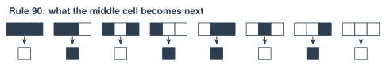

# 2.1 - Simple Rules, Complex Behavior {.unnumbered}

In Unit 1, rules failed. Nobody could write rules for "cat."

But rules have a surprise. A **very simple** rule can make something **very complicated**. Nobody plans it. It just happens.

Your brain works a little like this. Each brain cell follows simple rules. About 86 billion of them together make **you**. Today, you follow simple rules, then test hundreds of them.

:::{.agenda}
**Today's Plan** (40 minutes)

- [🔥]{.icon} **Warm Up** Make a wave [5 min]{.time}
- [👥]{.icon} **Learn Together** One rule, one small change [12 min]{.time}
- [🛠️]{.icon} **Try It** Explore the rules, then simple rules everywhere [17 min]{.time}
- [💬]{.icon} **Talk About It** Can simple make smart? [6 min]{.time}
:::

:::{.objectives}
- [ ] I can follow a rule card to make the next row of cells.
- [ ] I can test rules and sort what they make: no change, a pattern that repeats, chaos, or complex.
- [ ] I can give real examples of simple rules making complicated patterns.
- [ ] I can explain what emergence means.
:::

::::{.vocab}
:::{.word-cards}
- [🔲]{.icon} : a row or grid of cells that change color by following a rule
- [🌊]{.icon} : when many simple parts together make something complicated that no one planned
- [🎲]{.icon} : with no pattern, so you can't guess what comes next
- [📏]{.icon} : an exact instruction, like "If this happens, do that."
:::
::::

:::{.guided-notes-link}
[Printable lesson sheet](/handouts/Unit_2/2.1_Simple_Rules_Complex_Behavior.pdf){target="_blank"} - the sheet you write on today.
:::



Watch a crowd make a wave. Every person follows **one rule**:

> When the person on your left raises their hands, raise your hands. Put them down quickly.



1. Press **Start the wave**.
2. Turn on **Watch one person** and start it again. Does that person move down the row? Then what moves?
3. Turn on **One person ignores the rule**. What happens to the wave?

If there's time, try it yourselves. Sit in a row and follow the same rule. Even 4 people can pass a small wave.

:::{.teacher title="Class size"}
The animation is the wave everyone sees, so the warm-up works with any class size. With 10 or more students, also make a real wave down a row. With 4 or 5, pass a small one around a table.
:::

:::{.think title="Who was in charge of the wave?"}
Nobody! Each person only watched one neighbor. The person you watched only went up and down. The wave moved across the row, but no person did.

When many simple parts make something bigger that nobody planned, we call it ****.
:::



### 2.1.1 - One Row, One Rule

**Stephen Wolfram** started **Wolfram Research**, the company that makes the math program Mathematica. He spent years on one question: *how can very simple rules make very complicated things?* He studied rows of squares like this one.

Picture a row of squares. Each square is black or white. Every square looks at **itself** and its **two neighbors**. Then the rule card says what color it will be in the next row.

{width="700px" fig-align="center" fig-alt="The Rule 90 card. Eight patterns of three squares. Under each, the color of the middle square in the next row. Black, black, black gives white. Black, black, white gives black. Black, white, black gives white. Black, white, white gives black. White, black, black gives black. White, black, white gives white. White, white, black gives black. White, white, white gives white."}

There are only 8 possible patterns of 3 squares. So a rule card has 8 answers. This card is called **Rule 90**. A world like this is called a .

:::{.you-try title="Make a few rows"}
On your sheet, start with **one black square** in the middle of the top row. Make the next 4 rows with the Rule 90 card. Look at each square and its two neighbors in the row above. (Outside the grid, everything is white.) What shape is starting to appear?
:::

***

### 2.1.2 - One Small Change: Rule 30

Now change just **2** of the 8 answers on the card. The new card is **Rule 30**:

{width="700px" fig-align="center" fig-alt="The Rule 30 card. Eight patterns of three squares, each with its answer. Two answers are circled: black, black, white gives white, and white, black, white gives black. The 2 circled answers are the only ones that are different from Rule 90."}

Wolfram studied Rule 30 in 1983. Here it's after 80 rows, starting from **one black square**:

{width="640px" fig-align="center" fig-alt="Rule 30 after 80 rows: a large triangle. The left side has stripes. The middle and right look random, with small white triangles of many sizes."}

The rule is tiny. But the middle of the picture looks ****. Even Wolfram can't say what row 1,000 will look like. The only way to know is to make all 999 rows before it.

Nature makes patterns like this. A sea snail's shell grows at its edge, one thin row at a time. Each cell on the edge makes color or doesn't, depending on its neighbors. That's a row of cells following a rule! Look at the shell of this cone snail:

{target="_blank"}, Wikimedia Commons)](/images/Unit_2/explore_conus_textile.jpg){width="420px" fig-align="center" fig-alt="A cone snail on sand. Its shell is covered with small brown and white triangles of many sizes."}

:::{.remember title="The big idea"}
Simple rules can make behavior that is **just as complicated** as anything else. Wolfram calls this the **Principle of Computational Equivalence**. He thinks a row of cells, the weather, and a brain can all be equally complicated. Not every scientist agrees.

This matters for AI. A neural network is made of tiny parts that follow simple rules. So is your brain.
:::

Here's a tool that makes the rows for you. It starts on Rule 90. Press **Draw it**. Your rows are the top of this picture. Keep going down. What does Rule 90 make?





### 2.1.3 - Explore the Rules

There are **256** different rule cards. Most of them were never studied by anyone before computers. Use the tool in 2.1.2 with a partner.

:::{.steps}
1. Try **110**, **4**, **150**, and **30**. For each rule, circle what it looks like on your sheet: **never changes**, **a pattern that repeats**, **chaos**, or **complex**.
2. **Make your own rule.** Click the bottom squares on the rule card to change them. What's your rule's number? What kind is it?
3. **Traffic!** Choose **184** and **Start: random**, then press **Draw it**. Each black square is a car. A car moves one square to the right if the square in front of it is empty. Each row is the same road, one moment later. Find a traffic jam: a thick dark stripe. As you go down the picture, which way does the jam move?
:::

:::{.think title="Every car moves forward. Which way did the jams move?"}
**Backward!** No car ever moves backward. But a jam does. Cars at the front of the jam drive away, and new cars join at the back. Real traffic jams on highways do the same thing. Nobody planned it. It emerges from one simple rule.

You can't tell what a rule will do by reading its card. **Rule 110** is the strangest: it makes shapes that move and crash into each other. Scientists proved that Rule 110 can do any calculation a computer can do, if the row is long enough. You have to run a rule and look.
:::

### 2.1.4 - Simple Rules Everywhere

Your teacher shows these on the screen.

**A flock of birds.** Thousands of birds can turn together like one animal. There is no leader. Each bird follows 3 simple rules about the birds near it:



:::{.steps}
1. Watch the flocks form. Turn on **Watch one bird**. It only sees the birds inside its circle.
2. Turn off rule 2, **Fly the same way**. What happens?
3. Turn it back on. Turn off rule 3, **Stay close**. What happens?
:::

**The Game of Life.** This is a grid, not a row. Each square follows simple rules about its 8 neighbors. Your teacher adds a **glider** and presses **Run**. Watch the glider. Look closely at one square. Does it move?



:::{.think title="The glider moves across the screen. But does any cell move?"}
No! Each cell stays in its place. It only turns black or white. The "glider" is a **pattern** that moves, like the wave in the Warm Up and the traffic jam.
:::

:::{.real-world title="More simple rules, more complicated results"}
- **Ants:** each ant follows the smell trails of other ants. Together, a colony finds the shortest path to food.
- **Termites:** each termite moves bits of mud by simple rules. Together, they build mounds taller than a person, with tunnels that keep the air fresh. No termite has a plan.
- **Fireflies:** in some forests, thousands of fireflies flash **at the same time**. Each one only watches the fireflies near it.
- **Your brain:** each brain cell follows simple rules. About 86 billion of them together make you. (That's Lesson 2.2.)
:::



A brain cell follows simple rules. A part of a neural network follows simple rules. Can simple parts make something smart?

:::{.frames}
- I think simple rules **can** / **cannot** make something smart, because ...
- The wave, the traffic jam, and the flock are alike because ...
- Another place I've seen simple rules make something complicated is ...
- A brain **is** / **is not** just simple rules, because ...
:::



:::{.project title="Day 2: Be Rule 30"}
The class becomes a row of cells. Each time the caller says "Go!", the **same** row turns into the next row.

1. Each **cell** gets a paper that's black on one side and white on the other. Stand in a row. (Small class? Put 15 papers in a row on the desks. Each person is in charge of 3 or 4 of them.)
2. Start with **only the middle cell black**. Everyone else shows white.
3. **Each cell:** look at your left neighbor, yourself, and your right neighbor. Find the same 3 colors on the Rule 30 card (in 2.1.2). That's your color in the next row. Don't flip your paper yet! (The ends of the row have a white neighbor outside.)
4. The **caller** says "Ready ... Go!" Everyone flips to their new color **at the same time**. Now the class shows the next row.
5. The **recorder** presses **Show the next row** in the tool below. Does the class match? Everyone colors the row on the Go Further grid on their sheet.
6. Do at least 6 rows.
:::



:::{.gotcha title="Why wait for the caller?"}
On paper, each new row goes under the old one, so the old row is still there. Here, the class is the only row. When you flip your paper, your old color is gone. If you flip early, a neighbor who's still deciding sees your **new** color and gets the wrong answer.
:::

:::{.project title="Build in the Game of Life"}
Use the Game of Life tool in 2.1.4 with a partner. Click squares to make them black. Try to build 3 patterns: one that **never changes**, one that **blinks**, and one that **moves** like the glider.
:::

:::{.project title="Rule 30 with Cups"}
Make Rule 30 on a table with paper cups: cup up is white, cup down is black. Make 6 rows. Ask your teacher to take a photo of your table.
:::

:::{.watch title="Inventing the Game of Life (Numberphile)"}


John Conway, the mathematician who made the Game of Life in 1970, tells how he invented it.

**Captions in your language:** Press **CC**, then ⚙️ **Settings**, then **Subtitles/CC**, then **Auto-translate**.
:::

:::{.explore-link}
🔭 **Explore More:** [different rule cards, and Rule 30 in the real world](/chapters/Explore/explore-unit-2.qmd#explore-2-1). Read it on your own, if you want to learn more.
:::
