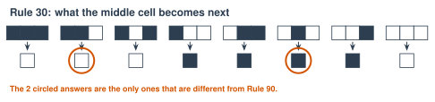
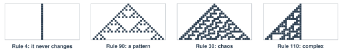
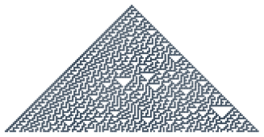

# 2.1 - Simple Rules, Complex Behavior {.unnumbered}

In Unit 1, rules failed. Nobody could write rules for "cat."

But rules have a surprise. A **very simple** rule can make something **very complicated**. Nobody plans it. It just happens.

Your brain works a little like this. Each brain cell follows simple rules. About 86 billion of them together make **you**. Today, you become the cells.

:::{.agenda}
**Today's Plan** (40 minutes)

- [🔥]{.icon} **Warm Up** Make a wave [5 min]{.time}
- [👥]{.icon} **Learn Together** One row, one rule [9 min]{.time}
- [🛠️]{.icon} **Try It** Be Rule 30, then explore [19 min]{.time}
- [💬]{.icon} **Talk About It** Can simple make smart? [7 min]{.time}
:::

:::{.objectives}
- [ ] I can follow a rule card to make the next row of cells.
- [ ] I can explain how simple rules can make complicated patterns.
- [ ] I can explain what emergence means.
- [ ] I can connect simple rules to brain cells.
:::

::::{.vocab}
:::{.word-cards}
- [🔲]{.icon} : a row or grid of cells that change color by following a rule
- [🌊]{.icon} : when many simple parts together make something complicated that no one planned
- [🎲]{.icon} : with no pattern, so you cannot guess what comes next
- [📏]{.icon} : an exact instruction, like "If this happens, do that."
:::
::::

:::{.guided-notes-link}
[Printable lesson sheet](/handouts/Unit_2/2.1_Simple_Rules_Complex_Behavior.pdf){target="_blank"} - the sheet you write on today.
:::



Everyone stands in a line (or sits in a row). Everyone follows **one rule**:

> When the person on your left raises their hands, raise your hands. Put them down after one second.

Mr. Ross starts it at one end. Watch what happens. Then try it again, faster.

:::{.think title="Who was in charge of the wave?"}
Nobody! Each person only watched one neighbor. But together, you made a wave that moved down the line.

When many simple parts make something bigger that nobody planned, we call it ****.
:::



### 2.1.1 - A Question from Mr. Ross's Old Job

Before he was a teacher, Mr. Ross worked at **Wolfram Research**, the company that makes the math program *Mathematica*. The company's founder, **Stephen Wolfram**, spent years on one question:

> How can very simple rules make very complicated things?

***

### 2.1.2 - One Row, One Rule

Picture a row of squares. Each square is black or white. Every square looks at **itself** and its **two neighbors**. Then the rule card says what color it will be in the next row.

{width="700px" fig-align="center" fig-alt="The Rule 30 card. Eight patterns of three squares. Under each, the color of the middle square in the next row. Black, black, black gives white. Black, black, white gives white. Black, white, black gives white. Black, white, white gives black. White, black, black gives black. White, black, white gives black. White, white, black gives black. White, white, white gives white."}

There are only 8 possible patterns of 3 squares. So a rule card has 8 answers. This card is called **Rule 30**. A world like this is called a .

Different cards make very different pictures. All four of these start with **one black square**:

{width="760px" fig-align="center" fig-alt="Four pictures. Rule 4: a single straight line that never changes. Rule 90: a neat triangle pattern. Rule 30: a triangle full of messy chaos. Rule 110: a complex pattern that grows on one side."}

***

### 2.1.3 - Rule 30

Stephen Wolfram studied Rule 30 in 1983. Here it is after 80 rows:

{width="640px" fig-align="center" fig-alt="Rule 30 after 80 rows: a large triangle. The left side has stripes. The middle and right look random, with small white triangles of many sizes."}

The rule is tiny. But the middle of the picture looks ****. Even Wolfram cannot say what row 1,000 will look like. The only way to know is to make all 999 rows before it.

:::{.real-world title="Rule 30 in the real world"}
- **Random numbers.** *Mathematica* used Rule 30 to make random numbers.
- **A sea snail.** A cone snail called *Conus textile* has a pattern on its shell that looks like Rule 30.
- **A train station.** Cambridge North station in England has Rule 30 patterns on its walls.
:::

:::{.remember title="The big idea"}
Simple rules can make behavior that is **just as complicated** as anything else. Wolfram calls this the **Principle of Computational Equivalence**. He thinks a row of cells, the weather, and a brain can all be equally complicated. Not every scientist agrees.

This matters for AI. A neural network is made of tiny parts that follow simple rules. So is your brain.
:::



### 2.1.4 - Be Rule 30

The class becomes a row of cells.

:::{.steps}
1. Each **cell** gets a paper that is black on one side and white on the other. Stand in a row. (Small class? Put 15 papers in a row on the desks. Each person is in charge of 3 or 4 of them.)
2. Start with **only the middle cell black**. Everyone else shows white.
3. **Each cell:** look at your left neighbor, yourself, and your right neighbor. Find the same 3 colors on the Rule 30 card. (The ends of the row have a white neighbor outside.)
4. The **caller** says "Ready ... Go!" Everyone shows their new color **at the same time**.
5. The **recorder** colors the new row on the board. Everyone colors it on their sheet too.
6. Do at least 6 rows. Then finish 10 rows on your sheet with a partner.
:::

:::{.gotcha title="Everyone changes at the same time"}
Decide your new color, but wait for "Go!" If you change early, your neighbors will see the wrong color.
:::

### 2.1.5 - Explore the Rules on Screen

:::{.steps}
1. Press **Draw it** for Rule 30. Does it match your sheet?
2. Try the other rules: 90, 110, 4, 184, 150. Which one makes chaos? Which one makes a neat pattern?
3. **Make your own rule.** Click the answer squares on the rule card. What is your rule's number?
4. Switch to **The Game of Life**. Add a **glider** and press **Run**. What does the glider do?
:::



:::{.think title="The glider moves across the screen. But does any cell move?"}
No! Each cell stays in its place. It only turns black or white. The "glider" is a **pattern** that moves, like the wave in the Warm Up.
:::



A brain cell follows simple rules. A part of a neural network follows simple rules. Can simple parts make something smart?

:::{.frames}
- I think simple rules **can** / **cannot** make something smart, because ...
- The wave and Rule 30 are alike because ...
- A brain **is** / **is not** just simple rules, because ...
:::



:::{.project title="Life Challenge"}
In the Game of Life, try to build:

1. A pattern that **never changes**.
2. A pattern that **blinks** back and forth forever.
3. A pattern that **moves**, like the glider.

Draw your best pattern on grid paper. Can a partner guess what it will do?
:::

:::{.project title="Rule 30 with Cups"}
Make Rule 30 on a table with paper cups: cup up is white, cup down is black. Make 6 rows. Take a photo of your table.
:::

:::{.watch title="Inventing the Game of Life (Numberphile)"}


John Conway, the mathematician who made the Game of Life in 1970, tells how he invented it.

**Captions in your language:** Press **CC**, then ⚙️ **Settings**, then **Subtitles/CC**, then **Auto-translate**.
:::

**More to explore**

- [Conus textile (Wikipedia)](https://en.wikipedia.org/wiki/Conus_textile){target="_blank"}: See photos of the snail shell. Does it look like Rule 30?
