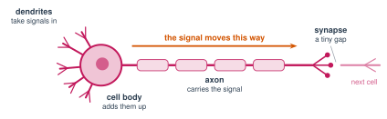

# 2.2 - Your Brain Is Made of Cells {.unnumbered}

A ruler falls. You catch it. That took less than half a second.

In that time, your eyes saw the ruler move. A signal went to your brain. Your brain sent a signal to your hand. Your hand closed.

All of it was done by **cells**. Today, you measure how fast your brain cells work.

:::{.agenda}
**Today's Plan** (40 minutes)

- [🔥]{.icon} **Warm Up** Catch the ruler [7 min]{.time}
- [👥]{.icon} **Learn Together** Neurons and signals [10 min]{.time}
- [🛠️]{.icon} **Try It** The squeeze chain and the click test [15 min]{.time}
- [💬]{.icon} **Talk About It** Slow cells, fast brain? [8 min]{.time}
:::

:::{.objectives}
- [ ] I can name the parts of a neuron and what each part does.
- [ ] I can explain how a signal moves from one neuron to the next.
- [ ] I can measure my reaction time.
- [ ] I can explain why a brain is fast even though each cell is slow.
:::

::::{.vocab}
:::{.word-cards}
- [🧠]{.icon} : a brain cell that sends signals
- [🌿]{.icon} : the branches of a neuron that take signals in
- [➖]{.icon} : the long part of a neuron that carries the signal away
- [🤝]{.icon} : the tiny gap where one neuron passes a signal to the next
:::
::::

:::{.guided-notes-link}
[Printable lesson sheet](/handouts/Unit_2/2.2_Your_Brain_Is_Made_of_Cells.pdf){target="_blank"} - the sheet you write on today.
:::



Work with a partner. You need a ruler (30 cm).

:::{.steps}
1. Your partner holds the ruler at the top. The **0** is at the bottom.
2. Put your thumb and finger open around the **0**. Do not touch the ruler.
3. Your partner drops the ruler without warning. Catch it!
4. Read the number where you caught it (in cm). Write it on your sheet.
5. Do it 3 times. Then switch.
:::

Use the table to change centimeters into **milliseconds** (ms). A millisecond is $\frac{1}{1000}$ of a second.

| Caught at | 5 cm | 10 cm | 15 cm | 20 cm | 25 cm | 30 cm |
|---|:---:|:---:|:---:|:---:|:---:|:---:|
| **Reaction time** | 101 ms | 143 ms | 175 ms | 202 ms | 226 ms | 247 ms |

:::{.think title="Why does a short catch mean a fast reaction?"}
The ruler falls faster and faster. If you catch it at 5 cm, it fell for only about $\frac{1}{10}$ of a second. If you catch it at 30 cm, it fell for about $\frac{1}{4}$ of a second.
:::



### 2.2.1 - Neurons

Your brain has about **86 billion** cells called . A neuron is a cell that sends signals.

{width="720px" fig-align="center" fig-alt="A neuron. On the left, branches called dendrites take signals in. The round cell body adds them up. A long axon carries the signal to the right. At the end, a tiny gap called a synapse passes the signal to the next cell."}

| Part | What it does |
|---|---|
|  | take signals **in** from other neurons |
| Cell body | adds up the signals |
|  | carries the signal **away**, sometimes over a long distance |
|  | the tiny gap where the signal passes to the next neuron |

***

### 2.2.2 - How a Signal Moves

1. Signals come in through the dendrites.
2. The cell body adds them up. If the total is big enough, the neuron **fires**. If not, nothing happens. There is no "half fire."
3. When it fires, an electric signal runs down the axon.
4. At the synapse, the neuron lets out tiny chemicals. They carry the signal across the gap to the next neuron.

:::{.remember title="Brain numbers"}
- About **86 billion** neurons.
- Hundreds of **trillions** of synapses (connections).
- Signals move from about **0.5** to **120 meters per second**. The fastest signals are as fast as a race car. The slowest are slower than walking.
- Your whole brain runs on about **20 watts** of power. That is less than an old light bulb.
:::



### 2.2.3 - The Squeeze Chain

How fast does a signal move through the whole class?

:::{.steps}
1. Stand in a circle. Hold hands, or put your hand on the next person's shoulder.
2. Mr. Ross starts a timer and squeezes (or taps) the first person.
3. When you feel a squeeze, squeeze the next person.
4. The last person says "Stop!" Write the time on your sheet.
5. Do it 3 times. Do you get faster?
:::

:::{.gotcha title="Small class?"}
With only 4 or 5 people, the squeeze goes around too fast to time. Go around the circle **5 times** without stopping. Then divide the time by 5.
:::

**Time for one person** $= \dfrac{\text{total time}}{\text{number of people}}$

### 2.2.4 - The Click Test

Click the box as soon as it turns **green**. Do it 5 times.



:::{.think title="Is your click time the same as your ruler time?"}
They are close. Most people react in about 200 to 300 milliseconds.

In that time, a signal went from your eyes to your brain, through many neurons, and back down to your hand.
:::



One neuron is slow. A computer chip does billions of steps every second. But your brain can still do things that are very hard for computers: walk on rocks, understand a joke, know a friend's face from far away.

How can slow cells make a fast brain? (Think about the GPU race in Lesson 1.5.)

:::{.frames}
- A brain can be fast because ...
- My reaction time was ... milliseconds. My fastest try was ...
- A brain is like the class in the GPU race because ...
:::



:::{.project title="A Science Experiment"}
Does talking slow down your reaction time? Do the ruler test 5 times while it is quiet. Then do it 5 times while your partner asks you math questions. Compare the averages. Make a bar graph.
:::

:::{.project title="Build a Neuron"}
Build a neuron from string, paper, or pipe cleaners. Label the dendrites, cell body, axon, and synapse. Connect your neuron to a partner's neuron at a synapse.
:::
