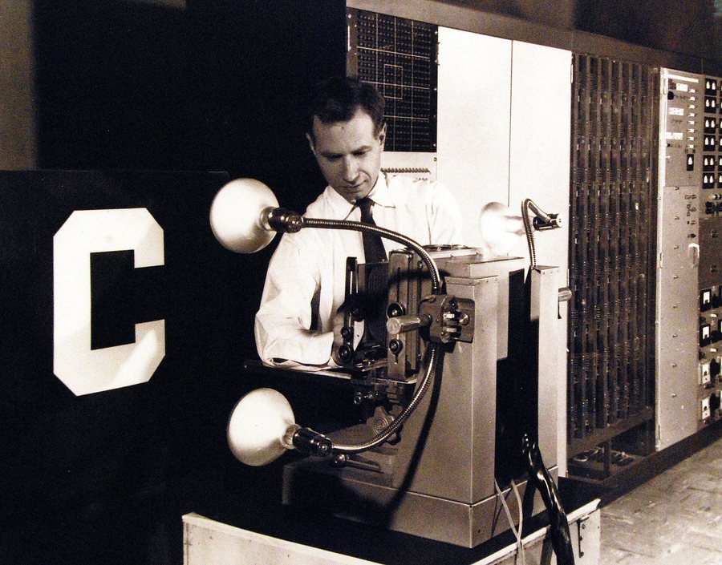
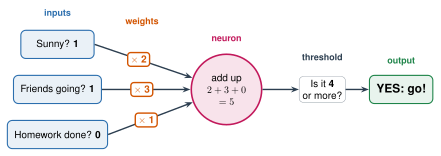

# 2.4 - The Artificial Neuron {.unnumbered}

A real neuron takes in signals, adds them up, and fires if the total is big enough.

In 1943, two scientists, Warren McCulloch and Walter Pitts, wrote this idea as **math**. In 1958, Frank Rosenblatt built a machine from it. It was called the **perceptron**. (The 1958 newspaper story in Lesson 1.4 was about this machine.)

{width="560px" fig-align="center" fig-alt="An old photo. A man in a white shirt and tie adjusts a camera on a stand. Two lamps light a large white letter C on a black board in front of the camera. Tall panels full of wires and dials stand behind him."}

That simple idea is the building block of every neural network today. Today, the class becomes one.

:::{.agenda}
**Today's Plan** (40 minutes)

- [🔥]{.icon} **Warm Up** Should I go? [7 min]{.time}
- [👥]{.icon} **Learn Together** Multiply, add, compare [10 min]{.time}
- [🛠️]{.icon} **Try It** Be a neuron [16 min]{.time}
- [💬]{.icon} **Talk About It** Who picks the weights? [7 min]{.time}
:::

:::{.objectives}
- [ ] I can explain inputs, weights, and a threshold.
- [ ] I can calculate what an artificial neuron decides.
- [ ] I can compare an artificial neuron with a real neuron.
:::

::::{.vocab}
:::{.word-cards}
- [📥]{.icon} : a number that goes into a neuron
- [⚖️]{.icon} : a number that says how much an input matters
- [🚦]{.icon} : the number the total must pass for the neuron to fire
- [🔵]{.icon} : the first artificial neuron that could learn (1958)
:::
::::

:::{.guided-notes-link}
[Printable lesson sheet](/handouts/Unit_2/2.4_The_Artificial_Neuron.pdf){target="_blank"} - the sheet you write on today.
:::



Your friends invite you to play soccer after school. Should you go? Three things matter:

| Question | Answer: 1 = yes, 0 = no | How much does it matter to you? (0 to 3) |
|---|:---:|:---:|
| Is it sunny? | | |
| Are my friends going? | | |
| Is my homework done? | | |

1. Fill in the table on your sheet. **You** decide how much each thing matters.
2. Multiply each answer by how much it matters. Add them up.
3. If the total is **4 or more**, you go!

Compare with a partner. You had the same answers (1 or 0). Did you make the same decision?

:::{.think title="Why did partners make different decisions?"}
Because you chose different numbers for **how much it matters**. Those numbers are called **weights**. The weights decide everything.
:::



### 2.4.1 - Multiply, Add, Compare

An artificial neuron does three things:

{width="720px" fig-align="center" fig-alt="Three inputs: Sunny 1, Friends going 1, Homework done 0. Each is multiplied by a weight: 2, 3, and 1. The neuron adds them up: 2 plus 3 plus 0 is 5. Is it 4 or more? Yes. Output: go."}

1. **Multiply** each  by its .
2. **Add** them up.
3. **Compare** the total with the . If the total is big enough, the neuron fires: **YES**. If not: **NO**.

$$\text{total} = (\text{input}_1 \times \text{weight}_1) + (\text{input}_2 \times \text{weight}_2) + (\text{input}_3 \times \text{weight}_3)$$

A weight can be **negative**. A negative weight says: *this input makes me LESS likely to fire.*

| Real neuron | Artificial neuron |
|---|---|
| Dendrites take signals in | Inputs |
| Strong or weak synapses | Weights |
| The cell body adds up the signals | Add up input × weight |
| Fires only if the total is big enough | Fires only if the total passes the threshold |

:::{.remember}
An artificial neuron is only **multiply, add, compare**. That is all. A neural network is many of these, connected together.
:::



### 2.4.2 - Be a Neuron

:::{.steps}
1. One person is the **neuron**. The neuron gets a **threshold** card: 3.
2. Three people are **inputs**: **A**, **B**, and **C**. Their weight cards are **A: +2**, **B: +2**, and **C: −1**.
3. Your teacher calls out who is "on" (the rounds are on your sheet). The inputs that are on hold up their cards.
4. The neuron adds the cards that are up. If the total is **3 or more**, the neuron stands up (fires)!
5. Do 5 rounds. Then switch jobs.
:::

:::{.teacher title="Class size"}
**4 students:** one neuron and three inputs. **More students:** make two or three neurons. Then connect them: the neurons' answers become the inputs for one more neuron. That is a **network**!
:::



Today, **you** chose every weight. But ChatGPT has billions of weights. Nobody can choose them by hand.

:::{.frames}
- An artificial neuron is like a real neuron because ...
- An artificial neuron is different from a real neuron because ...
- I think an AI with billions of weights gets them by ...
:::



:::{.project title="Day 2: Build a Neuron That Sees"}
This neuron looks at a 3 by 3 picture. Each square is an input: **1** if it is black, **0** if it is white. Each square has its own **weight**. The neuron says **X** if the total is more than the threshold. Otherwise it says **O**. Work with a partner.

1. Draw an X. All the weights are 0. What does the neuron say? Why?
2. Change the weights with **+** and **−**. Try to get **6 out of 6** right on the test pictures.
3. Write your weights on your sheet.
4. Stuck? Ask: which squares are black in an X but white in an O?
:::



:::{.think title="Look at your weights. Do they make a picture?"}
They often do! Squares that are **only black in an X** (like the center) get **positive** weights. Squares that are **only black in an O** (like the sides) get **negative** weights. The weights are a picture of what the neuron is looking for.
:::

:::{.project title="My Decision Neuron"}
Make a neuron for a decision in your life: what to eat, what to watch, whether to go out. Pick 4 inputs and give each a weight. Test it on 5 days from last week. Does it decide what you really did?
:::

:::{.project title="A Neuron for a Letter"}
Make the picture bigger in your head: 5 by 5 squares. On grid paper, choose weights that tell a **T** from an **L**. Test your weights on a partner's T and L.
:::

:::{.explore-link}
🔭 **Explore More:** [the first neuron machine, and the problem one neuron cannot solve](/chapters/Explore/explore-unit-2.qmd#explore-2-4). Read it on your own, if you want to learn more.
:::
