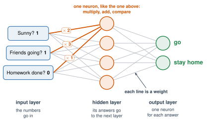

# 2.4 - The Artificial Neuron {.unnumbered}

A real neuron takes in signals, adds them up, and fires if the total is big enough.

In 1943, two scientists, Warren McCulloch and Walter Pitts, wrote this idea as **math**. In 1958, Frank Rosenblatt built a machine from it. It was called the **perceptron**. (The 1958 newspaper story in Lesson 1.4 was about this machine.)

{width="560px" fig-align="center" fig-alt="An old photo. A man in a white shirt and tie adjusts a camera on a stand. Two lamps light a large white letter C on a black board in front of the camera. Tall panels full of wires and dials stand behind him."}

That simple idea is the building block of every neural network today. Today, you'll build one by hand.

:::{.agenda}
**Today's Plan** (40 minutes)

- [🔥]{.icon} **Warm Up** Fighter or Wizard? [7 min]{.time}
- [👥]{.icon} **Learn Together** One neuron, then a network [13 min]{.time}
- [🛠️]{.icon} **Try It** Find the weights [14 min]{.time}
- [💬]{.icon} **Talk About It** Who picks the weights? [6 min]{.time}
:::

:::{.objectives}
- [ ] I can explain inputs, weights, and a threshold.
- [ ] I can calculate what an artificial neuron decides.
- [ ] I can change the weights to fix a neuron's mistakes.
- [ ] I can name the layers of a neural network.
:::

::::{.vocab}
:::{.word-cards}
- [📥]{.icon} : a number that goes into a neuron
- [⚖️]{.icon} : a number that says how much an input matters
- [🚦]{.icon} : the number the total must be more than for the neuron to fire
- [🔵]{.icon} : the first artificial neuron that could learn (1958)
- [🧱]{.icon} : a row of neurons in a neural network. Each layer sends its answers to the next one
:::
::::

:::{.guided-notes-link}
[Printable lesson sheet](/handouts/Unit_2/2.4_The_Artificial_Neuron.pdf){target="_blank"} - the sheet you write on today.
:::

:::{.guided-notes-link}
[Creature cards](/handouts/Unit_2/2.4_Creature_Cards.pdf){target="_blank"}: print one set for the class.
:::

:::{.teacher title="Before class"}
Print and cut one set of creature cards. Fold each card so the type is hidden.

The creatures are made up, from a recipe in `scripts/make-creatures.py`: Fighters have high Strength and low Magic, Wizards the opposite, with some overlap. The same 300 creatures are used in 2.4, 2.5, and 2.6, so the class can compare what each network learns with the real recipe (Explore More, Unit 2).
:::



These cards are for made-up creatures. Each card shows two numbers, as stars: **Strength** (how hard it hits) and **Magic**.

| Card | Strength | Magic |
|---|:---:|:---:|
| **Krellis** | ★★★★☆ (4) | ★★☆☆☆ (2) |
| **Lullom** | ★★☆☆☆ (2) | ★★★★☆ (4) |

One is a **Fighter**. One is a **Wizard**. Which is which? Tell a partner why.

:::{.think title="Answer"}
Krellis is the **Fighter**: more Strength than Magic. Lullom is the **Wizard**: more Magic than Strength.

You used a rule in your head: *compare the two numbers.* Today, you'll build a neuron that uses a rule like that.
:::



### 2.4.1 - Multiply, Add, Compare

An artificial neuron does three things:

{width="720px" fig-align="center" fig-alt="Two inputs from a card: Strength 4 stars and Magic 2 stars. Strength is multiplied by 1. Magic is multiplied by minus 1. The neuron adds them up: 4 minus 2 is 2. Is it more than 0? Yes. Output: Fighter."}

1. **Multiply** each  by its .
2. **Add** them up.
3. **Compare** the total with the . If the total is **more than** the threshold, the neuron fires: **Fighter**. If not: **Wizard**.

$$\text{total} = (\text{Strength} \times \text{Strength weight}) + (\text{Magic} \times \text{Magic weight})$$

A weight can be **negative**. Here the Magic weight is $-1$. It says: *more Magic makes me LESS likely to say Fighter.*

| Real neuron | Artificial neuron |
|---|---|
| Dendrites take signals in | Inputs |
| Strong or weak synapses | Weights |
| The cell body adds up the signals | Add up input × weight |
| Fires only if the total is big enough | Fires only if the total is more than the threshold |

:::{.remember}
An artificial neuron is only **multiply, add, compare**. That's all. A neural network is many of these, connected together.
:::

### 2.4.2 - From One Neuron to a Network

One neuron makes one small decision. A  connects many neurons. They're arranged in rows called .

{width="720px" fig-align="center" fig-alt="A small neural network. On the left, two inputs: Strength 4 and Magic 2. In the middle, a column of three neurons. On the right, two neurons: Fighter and Wizard. Lines connect every input to every middle neuron, and every middle neuron to both right neurons. The top middle neuron's two lines are highlighted with weights times 1 and times minus 1. It's labeled: one neuron, like the one above: multiply, add, compare. A note says each line is a weight. Labels under the columns: input layer, the numbers go in. Hidden layer, its answers go to the next layer. Output layer, one neuron for each answer."}

1. The **input layer** holds the numbers that go in. Here, they're the two numbers from a card.
2. Every neuron in the **hidden layer** gets every input. Each one multiplies, adds, and compares, like the neuron above. Each one has its **own** weights. Its answer isn't "Fighter" or "Wizard". Its answer goes to the next layer as an input.
3. The **output layer** gives the answer. There's one neuron for each possible answer. The one with the biggest total wins.

Every line is a **weight**. Count them: $2 \times 3 + 3 \times 2 = 12$ weights. The chatbots you use have **billions** of weights and many hidden layers.

:::{.think title="Why is it called hidden?"}
You see the numbers that go in and the answer that comes out. You don't see what the middle neurons decide. Nobody tells them what to look for, either. They find it while the network learns. In Lesson 2.5, the class becomes a network and watches this happen.
:::



### 2.4.3 - Find the Weights

Your teacher writes a neuron on the board. Its numbers are **wrong**. Your job is to fix them.

:::{.steps}
1. The neuron starts with **Strength weight 1**, **Magic weight 1**, and **threshold 5**.
2. Each group gets one or two creature cards. Keep the type folded under.
3. Calculate the total for your card. Is it more than the threshold? Say "Fighter" or "Wizard" out loud. Then unfold the card. Right or wrong?
4. Count the right answers on the board.
5. As a class, change **one** number. Look at the wrong cards first. Should a weight go up or down? Then test every card again.
6. Keep going until all 6 cards are right. Write your weights on your sheet.
:::

:::{.teacher title="Class size and hints"}
**4 students:** each student takes one or two cards. **More students:** groups of 2 or 3, one card each. Extra students keep score and write the numbers on the board. **Big class:** two teams fix their own neuron. Who gets 6 of 6 first?

**If the class is stuck:** "Lullom has more Magic. Which weight should push its total down?" One answer that works: Strength weight 1, Magic weight $-1$, threshold 0. Many others work too. The starting numbers get 2 of 6 right.
:::

Check your class's weights here. Change the numbers and watch the line move.



:::{.think title="Look at the graph. What does the neuron's rule look like?"}
It's **one straight line**. The neuron says Fighter on one side and Wizard on the other. Every set of weights makes a line. Changing a weight turns or moves the line.
:::



Your class picked **3 numbers**, and it took a while. The network in 2.4.2 has 12. A chatbot has **billions**. Nobody can choose them by hand.

:::{.frames}
- We fixed the weights by ...
- An artificial neuron is like a real neuron because ...
- An artificial neuron is different from a real neuron because ...
- I think an AI with billions of weights gets them by ...
:::



:::{.project title="Day 2: Test Your Neuron on 140 Creatures"}
The data has 140 Fighters and Wizards. Your class's neuron only saw 6 of them. Work with a partner.

1. Put your class's weights into the tool in 2.4.3.
2. Press **Test on all 140 Fighters and Wizards**. Write the score on your sheet.
3. Try to beat it. Change the numbers. What's your best score?
4. Look at the graph. Can **any** line get all 140 right? Why not?
:::

:::{.think title="Why can't one line get 100%?"}
A few Fighters have as much Magic as a Wizard. A few Wizards are strong. They land on the wrong side of every line. The best line gets about **88%** right.
:::

:::{.project title="My Decision Neuron"}
Make a neuron for a decision in your life: what to eat, what to watch, whether to go out. Pick 4 inputs and give each a weight. Test it on 5 days from last week. Does it decide what you really did?
:::

:::{.explore-link}
🔭 **Explore More:** [the first neuron machine, and a neuron that sees](/chapters/Explore/explore-unit-2.qmd#explore-2-4). Read it on your own, if you want to learn more.
:::
