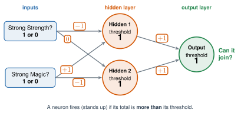

# 2.5 - Train a Human Neural Network {.unnumbered}

In Lesson 2.4, one neuron sorted Fighters from Wizards. Its whole rule was one straight line.

Now your class runs a club. **Fighters and Wizards can join. Giants and Minis can't.** Giants are strong at both Strength and Magic. Minis are weak at both.

One neuron can't learn this rule. Today, the class becomes a real network, with a hidden layer. It starts with bad weights, and it learns by fixing its own mistakes.

:::{.agenda}
**Today's Plan** (40 minutes)

- [🔥]{.icon} **Warm Up** Can one neuron do it? [7 min]{.time}
- [👥]{.icon} **Learn Together** The network and the fix rule [10 min]{.time}
- [🛠️]{.icon} **Try It** Train the class network [17 min]{.time}
- [💬]{.icon} **Talk About It** What did the hidden neurons learn? [6 min]{.time}
:::

:::{.objectives}
- [ ] I can explain why one neuron can't answer some questions.
- [ ] I can calculate what each neuron in a small network says.
- [ ] I can use the fix rule to change the weights after a mistake.
- [ ] I can explain what the hidden neurons learned.
:::

::::{.vocab}
:::{.word-cards}
- [🏋️]{.icon} : showing an AI many examples so it can fix its weights
- [🧪]{.icon} : new examples the AI never trained on, used to check what it learned
- [🧱]{.icon} : a row of neurons in a neural network. Each layer sends its answers to the next one
- [🔙]{.icon} : how real networks learn: after a mistake, the blame goes back through the layers, and every weight changes a little
:::
::::

:::{.guided-notes-link}
[Printable lesson sheet](/handouts/Unit_2/2.5_Train_a_Human_Neural_Network.pdf){target="_blank"} - the sheet you write on today.
:::

:::{.guided-notes-link}
[Creature cards](/handouts/Unit_2/2.5_Creature_Cards.pdf){target="_blank"}: print one set for each network.
:::

:::{.teacher title="Before class"}
Print and cut one set of creature cards for each network. Fold each card so the answer is hidden.

Put this page on the screen. The tool in 2.5.3 is the class board: it draws the network with every number, and its highlighted numbers show each fix. Press **Next step** only after the class has worked out each step by hand. The key on the sheet follows the cards in order: the network makes 5 mistakes in pass 1, and 0 in pass 2.
:::



"Strong" means **4 or 5 stars**. Each creature in the club question has one of four patterns:

| Creature | Strong Strength? | Strong Magic? | Can it join? |
|---|:---:|:---:|:---:|
| Fighter | yes (1) | no (0) | **YES** |
| Wizard | no (0) | yes (1) | **YES** |
| Giant | yes (1) | yes (1) | **NO** |
| Mini | no (0) | no (0) | **NO** |

With a partner, try to make **one** neuron that gets all 4 rows right. Choose a weight for Strong Strength, a weight for Strong Magic, and a threshold. The neuron says YES if the total is more than the threshold.

:::{.think title="Did you find weights that work?"}
Nobody can! To let Fighters in, Strength needs a big weight. To let Wizards in, Magic needs a big weight. But a Giant has **both**. Its total is even bigger, so it gets in too.

In 1969, Marvin Minsky and Seymour Papert wrote a famous book. It proved that one neuron can't solve problems like this. Many people stopped working on neural networks for years. This was part of an AI winter (Lesson 1.4).

The answer is a **network**, with a hidden layer.
:::



### 2.5.1 - The Class Network

{width="720px" fig-align="center" fig-alt="The class network. Two inputs: Strong Strength, 1 or 0, and Strong Magic, 1 or 0. Two hidden neurons, Hidden 1 and Hidden 2, each with threshold 1. One output neuron, Can it join, with threshold 1. Weights: Strong Strength to Hidden 1 is minus 1. Strong Strength to Hidden 2 is 0. Strong Magic to Hidden 1 is plus 1. Strong Magic to Hidden 2 is minus 1. Hidden 1 to Output is plus 1. Hidden 2 to Output is plus 1. A neuron fires (stands up) if its total is more than its threshold."}

Each neuron is a **team** of students. Each team writes its numbers on the sheet. The tool in 2.5.3 shows every number on the screen. The starting numbers are wrong on purpose.

To run one card:

1. **Read the card.** Strong Strength? Strong Magic? Each answer is **1** (yes) or **0** (no).
2. **Hidden teams:** add the weights of the inputs that are **1**. (An input that's 0 adds nothing.) If your total is **more than** your threshold, stand up. You fired!
3. **Output team:** add the weights of the hidden teams that are **standing**. More than your threshold? Say "Can join!" If not, say "Can't join."
4. **Check:** unfold the card. Was the network right?

***

### 2.5.2 - The Fix Rule, and Who's to Blame

When the network is wrong, **one** neuron changes. Every neuron uses the same fix rule:

| What happened | What that neuron does |
|---|---|
| It **should have fired**, but it didn't | **ADD:** +1 to the weight of each input that was 1. Threshold −1. |
| It **fired**, but it **shouldn't have** | **SUBTRACT:** −1 from the weight of each input that was 1. Threshold +1. |

An input that was 0 didn't cause the mistake, so its weight stays the same.

But **which** neuron should change? Play **Who's to Blame?**

:::{.steps}
1. Look at the two hidden neurons. Which one was **least sure**? That's the one whose total was **closest to its threshold**.
2. Imagine that neuron changed its answer. Would the network be right now?
3. **Yes:** that hidden neuron uses the fix rule. **No:** the output neuron uses the fix rule.
:::

:::{.real-world title="Example: card T1, Konik"}
Konik has Strength 4 stars and Magic 2 stars. Strong Strength = **1**. Strong Magic = **0**.

1. **Hidden 1:** total $= -1$. More than 1? No. It stays seated (0).
2. **Hidden 2:** total $= 0$. More than 1? No. It stays seated (0).
3. **Output:** nobody is standing, so its total $= 0$. More than 1? No: "Can't join."
4. **Check:** Konik is a Fighter. It **can** join. Wrong!
5. **Who's to blame?** Hidden 1 is 2 away from its threshold ($-1$ to $1$). Hidden 2 is 1 away ($0$ to $1$). Hidden 2 is least sure.
6. If Hidden 2 stood up, the output total would be 1. More than 1? No. Still wrong. So the **output** neuron fixes itself.
7. It should have fired: **ADD.** Both of its inputs were 0, so its weights stay the same. Its threshold goes from 1 to **0**.
:::

This is a simple version of a real method from 1988, called MADALINE Rule II. Bernard Widrow and Rodney Winter made it.



### 2.5.3 - Train the Class Network

Each person has a job.

| | Job | What you do |
|---|---|---|
| 🃏 | **Card dealer** | Read the card's name and stars. Say the inputs: "Strong Strength 1, Strong Magic 0." Keep the answer hidden. |
| 🟠 | **Hidden 1 team** | Add your weights. Stand up if you fire. Fix your numbers when you're to blame. |
| 🟠 | **Hidden 2 team** | The same, with your own numbers. |
| 🟢 | **Output team** | Add the weights of the hidden teams that are standing. Say "Can join!" or "Can't join." |
| ✅ | **Checker** | Unfold the card. Say "right" or "wrong." If it's wrong, lead Who's to Blame. |
| 📊 | **Scorekeeper** | Count the mistakes in each pass. Check your count with the tool. |

:::{.teacher title="Class size"}
**4 students:** one student for each neuron, and one dealer who is also the checker and scorekeeper. **5 to 9:** two or three students on each neuron team. **10 or more:** make **two networks** with two sets of cards. Both start with the same numbers. Which network learns first? Do they end with the same numbers? (The tool on the screen follows one network. The other network checks against it.)

**Timing:** a card takes about a minute, a fix about two. The key path makes 5 fixes in pass 1 (T1, T2, T3, T5, T6) and none in pass 2.
:::

:::{.steps}
1. Your teacher opens the tool below on the screen and presses **Start A**. It shows the starting numbers.
2. Use the training cards **in order**: T1, T2, ... T8. For each card: hidden teams, output team, check. Then your teacher presses **Next step**. Did the class get the same totals?
3. If the network was wrong, play Who's to Blame and fix the numbers. Then your teacher presses **Next step** again. Did the class fix the same numbers? Everyone writes each step on the sheet.
4. After T8, the scorekeeper writes the number of mistakes. That was **pass 1**.
5. Do **pass 2** with the same cards. Keep going until a whole pass has **0 mistakes**.
6. Now use the **test cards**, X1 to X6. They're the : the network never trained on them. **Don't fix anything on a test!** Just record what the network says.
:::

This tool is the class board. Press **Next step** after the class does each step by hand. At the end, flip the inputs and watch which neurons fire.



:::{.think title="Look at the final numbers. What does each hidden neuron look for?"}
**Hidden 1** ends with weights $-2$ (Strength) and $+2$ (Magic), and threshold 0. It fires only for strong Magic **without** strong Strength. It's a **Wizard detector**.

**Hidden 2** ends with weights $+1$ and $-1$, and threshold 0. It fires only for a **Fighter**.

The output fires if **either** one is standing. Nobody told the hidden neurons to look for Wizards and Fighters. They found it by fixing mistakes.
:::

:::{.think title="What happened on the test cards?"}
The network got X1 to X4 right. Then look at the last two:

- **Tibi** (X5) is a Fighter, but its Strength is only 3 stars. To the network, it looks like a Mini: "Can't join." Wrong.
- **Gobur** (X6) is a Giant, but its Strength is only 3 stars. To the network, it looks like a Wizard: "Can join." Wrong.

The network only sees two yes-or-no answers. A creature near the line between "strong" and "not strong" fools it.
:::



Your class needed about 20 minutes for **9 numbers**. The network in Lesson 2.6 has hundreds. A chatbot has billions.

Real networks share the blame with . After a mistake, the computer works out how much each weight caused it, from the last layer back to the first. Then it changes every weight a little. It does this billions of times.

:::{.frames}
- The hidden neurons learned to ...
- Nobody told them to look for Fighters, but ...
- One neuron couldn't do it because ...
- The network got Tibi wrong because ...
:::



:::{.project title="Day 2: Same Cards, Different Start"}
Use the tool in 2.5.3 with a partner. It has three starts.

1. Press **Start A**. Step through all the cards. Does the tool match your class's work?
2. Press **Start B**. Train until a pass has 0 mistakes. What does each hidden neuron fire for now?
3. Press **Start C**. Train for 6 passes. What happens?
4. Write what you found on your sheet.
:::

:::{.think title="What did the three starts do?"}
**Start B** learns a different way. Hidden 1 fires for any creature that's strong at **something**. Hidden 2 fires only for **Giants**. The output says yes when Hidden 1 fires and Hidden 2 doesn't. Same answers, but a different network inside!

**Start C** never learns. Its two hidden neurons start as twins, and the network goes around in circles. Real networks get stuck too. That's one reason computer scientists start from random weights and use many neurons.
:::

:::{.project title="The Team Race"}
Two networks train at the same time with the same cards. Network 1 uses Start A, the class's starting numbers. Network 2 uses Start B: Hidden 1 weights 1 and 1, threshold 0. Hidden 2 weights 1 and 1, threshold 1. Output weights 1 and 0, threshold 0. Who needs fewer fixes? Do they end with the same numbers?
:::

:::{.explore-link}
🔭 **Explore More:** [why the fix rule works, and how backpropagation shares the blame](/chapters/Explore/explore-unit-2.qmd#explore-2-5). Read it on your own, if you want to learn more.
:::
