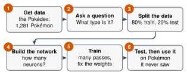

# 2.6 - Build a Real AI {.unnumbered}

In Lesson 2.5, the class trained a network of 3 neurons on 8 cards. It took about 20 minutes, and every step was done by hand.

A computer can do the same work on **300** creatures, with **many** neurons, in a few seconds. Today, you build it yourself. You'll watch its weights change while it learns.

Your job is to **predict** what will happen, then train the network, and then test it.

:::{.agenda}
**Today's Plan** (40 minutes)

- [🔥]{.icon} **Warm Up** How long by hand? [5 min]{.time}
- [👥]{.icon} **Learn Together** Six steps, and how to read the network [8 min]{.time}
- [🛠️]{.icon} **Try It** Predict, train, and test [20 min]{.time}
- [💬]{.icon} **Talk About It** What could go wrong? [7 min]{.time}
:::

:::{.objectives}
- [ ] I can name the six steps to build an AI.
- [ ] I can read a picture of a network: its weights and its hidden neurons.
- [ ] I can explain why we keep test data apart from training data.
- [ ] I can explain why an AI can only learn what is in its data.
:::

::::{.vocab}
:::{.word-cards}
- [🏋️]{.icon} : showing an AI many examples so it can fix its weights
- [🧪]{.icon} : new examples the AI never trained on, used to check what it learned
- [📝]{.icon} : when an AI memorizes its training examples instead of learning the real pattern
- [🖼️]{.icon} : a big collection of examples
:::
::::

:::{.guided-notes-link}
[Printable lesson sheet](/handouts/Unit_2/2.6_Build_a_Real_AI.pdf){target="_blank"} - the sheet you write on today.
:::

:::{.teacher title="Before class"}
Open the page on the projector. Do Run 1 together at **slow** speed, so everyone sees the lines change and learns to read the picture. Then pairs do the other runs on Chromebooks. Each run takes a few seconds at normal speed, and about 30 seconds at slow speed.

Scores change a little with each new random split. The patterns in the think boxes stay the same.
:::



The class network needed **2 passes** through **8 cards**. Each card took about **1 minute**.

The computer trains on **240 creatures**, and does **300 passes**. How long would that take by hand? Work it out with a partner.

:::{.think title="Answer"}
$240 \times 300 = 72{,}000$ cards. At 1 minute each, that's $72{,}000$ minutes: about **1,200 hours**, or **50 days** without sleeping!

A computer does it in a few seconds.
:::



### 2.6.1 - Six Steps to Build an AI

{width="560px" fig-align="center" fig-alt="Six steps. 1, get data: 300 made-up creatures. 2, ask a question: Fighter or Wizard? 3, split the data: 80% train, 20% test. 4, build the network: how many hidden neurons? 5, train: many passes, fix the weights. 6, test, then use it on creatures it never saw."}

1. **Get data.** The  has **300 creatures**, the same made-up creatures from the cards. Each one has 6 numbers: Strength, Magic, Speed, Toughness, Height, and Weight. Each one also has a type and a home.
2. **Ask a question.** For example: *Is it a Fighter or a Wizard?*
3. **Split the data.** Most creatures go into the **training data**. The rest go into the . The network never trains on the test data.
4. **Build the network.** Choose how many neurons go in its hidden layer.
5. **Train.** Each **pass**, the network looks at every training creature. Then it changes every weight a little, to make fewer mistakes. This is , the computer's way to play Who's to Blame (Lesson 2.5).
6. **Test, then use it.** Check it on the test creatures. Then ask it about any creature.

:::{.remember title="Why keep the test data apart?"}
Imagine you get the answers to a test the day before. You get 100%. Did you learn the math? Maybe not! You might have just **memorized** the answers.

An AI can do the same thing. The only fair check is data it has **never seen**.
:::

### 2.6.2 - How to Read the Network

The tool draws the network while it trains.

- **Left:** the inputs, the numbers that go in. **Middle:** the hidden neurons. **Right:** the answers.
- **Every line is a weight.** A **blue** line is a positive weight. An **orange** line is a negative weight. A **thicker** line is a bigger weight. Watch the lines change while it trains.
- **On a 2-number question, each hidden neuron is a small square.** It's a tiny map: Strength goes right, Magic goes up. It's **blue** where that neuron fires, and **orange** where it doesn't. Each one draws one line, like the neuron in Lesson 2.4.
- **Ask the network** about one creature. The picture lights up for that creature, and the answers show how sure the network is.



### 2.6.3 - Predict, Train, and Test

Work with a partner. Before each run, **predict** the test score on your sheet. Then train.

:::{.steps}
1. **Run 1:** *Fighter or Wizard?* (2 numbers), 4 hidden neurons. Train at **slow** speed. Watch the lines change.
2. **Run 2:** *Can it join the club?* (2 numbers). First use **0** hidden neurons. Then use **2**, like the class network. Look at the two small squares.
3. **Run 3:** *Fighter or Wizard?* (**all 6 numbers**), 16 hidden neurons. More information. Will it do better?
4. **Run 4:** *Where does it live?* (all 6 numbers), 16 hidden neurons.
5. After each run, write the training score and the test score on your sheet.
:::



:::{.think title="Run 1 vs. the class neuron"}
The class neuron from Lesson 2.4 got about **91%** of all 140 Fighters and Wizards right. This network gets about the same on the test creatures. Look at the big map: the border is almost a straight line. Fighter or Wizard really is a one-line question, so more neurons don't help much.
:::

:::{.think title="Run 2: why did 0 hidden neurons fail?"}
With **0** hidden neurons, the network can draw only **one** line. It gets about **55%**, about the same as always guessing "can't join."

With **2** hidden neurons, it gets about **97%**. Look at the two small squares. In our tests, one fires only in the corner where the Giants live. The other fires everywhere except the corner where the Minis live. The answer is "can join" when the second fires and the first doesn't. That's **Start B** from Lesson 2.5! Nobody told the network to look for Giants and Minis.
:::

:::{.think title="Run 3 used MORE numbers. Why was it worse?"}
The training score went up to **100%**, but the test score went down, to about **80%**.

In the recipe for these creatures, Fighters and Wizards have the **same** Speed, Toughness, Height, and Weight. Those numbers are noise. The network found "patterns" in the training data that weren't real. This is called : learning the training examples by heart instead of the real pattern. Look for the gap between the blue line (training) and the orange line (test).
:::

:::{.think title="Run 4: why couldn't it learn where a creature lives?"}
The training score climbed, but the test score stayed at about **35%**, the same as guessing. In the recipe, each creature's home was picked **at random**. Nothing in the 6 numbers says where it lives. The network only memorized the training creatures.

**An AI can only learn what is in its data.** If the answer isn't in the data, no network can find it.
:::



This AI took only a few seconds to build. Now imagine someone builds an AI like this to decide who gets a job or who gets a loan.

:::{.frames}
- The test data must be kept apart because ...
- In Run 3, more numbers made it worse because ...
- An AI can only learn what is in its data, so ...
- If someone used an AI like this to make decisions about **people**, a problem could be ...
:::



:::{.project title="Day 2: Ask the Network, and Be the Data Scientist"}
Use the tool in 2.6.3 with a partner.

1. Train *Fighter or Wizard?* with 2 numbers.
2. **Ask the network.** Type the name of a creature from the cards, like Krellis or Pona. Was it right? Was it a training creature or a test creature? Watch the picture light up. Try 3 creatures.
3. Try *Which type?* with 0 hidden neurons, then with 4. Write the test scores.
4. Choose *Fighter or Wizard? (all 6 numbers)*. Train with 0, 2, 4, 8, and 16 hidden neurons. Which gets the best **test** score? Is the biggest network always the best?
5. Press **New random split** and train again. Do the scores change?
:::

:::{.project title="An AI for Our School?"}
Think of something at school that an AI could predict. What data would you need? Who owns that data? Who should say yes before anyone uses it? Write your plan in 5 sentences.
:::

:::{.explore-link}
🔭 **Explore More:** [the secret recipe for the creatures, and how data scientists split data](/chapters/Explore/explore-unit-2.qmd#explore-2-6). Read it on your own, if you want to learn more.
:::
