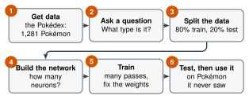

# 2.6 - Watch Mr. Ross Build an AI {.unnumbered}

In Lesson 2.5, the class trained one neuron on 10 cards. It took about 20 minutes, and every step was done by hand.

A computer can do the same work on **hundreds** of Pokémon, with **many** neurons, in a few seconds.

Mr. Ross built AI for his job for many years. Today, he builds one in front of you. Your job is to **predict** what will happen, and then to test the AI.

:::{.agenda}
**Today's Plan** (40 minutes)

- [🔥]{.icon} **Warm Up** How long by hand? [5 min]{.time}
- [👥]{.icon} **Learn Together** Six steps to build an AI [8 min]{.time}
- [🛠️]{.icon} **Try It** Predict, train, and test [20 min]{.time}
- [💬]{.icon} **Talk About It** What could go wrong? [7 min]{.time}
:::

:::{.objectives}
- [ ] I can name the six steps to build an AI.
- [ ] I can explain why we keep test data apart from training data.
- [ ] I can read a graph of an AI learning.
- [ ] I can explain why an AI can only learn what is in its data.
:::

::::{.vocab}
:::{.word-cards}
- [🏋️]{.icon} : showing an AI many examples so it can fix its weights
- [🧪]{.icon} : new examples the AI never trained on, used to check what it learned
- [📝]{.icon} : when an AI memorizes its training examples instead of learning the real pattern
- [🖼️]{.icon} : a big collection of examples
:::
::::

:::{.guided-notes-link}
[Printable lesson sheet](/handouts/Unit_2/2.6_Watch_Mr_Ross_Build_an_AI.pdf){target="_blank"} - the sheet you write on today.
:::



The class neuron needed **2 passes** through **10 cards**. Each card took about **1 minute**.

Now imagine **140 cards** and **300 passes**. How long would that take by hand? Work it out with a partner.

:::{.think title="Answer"}
$140 \times 300 = 42{,}000$ cards. At 1 minute each, that is $42{,}000$ minutes: about **700 hours**, or about **29 days** without sleeping!

A computer does it in a few seconds.
:::



### 2.6.1 - Six Steps to Build an AI

{width="560px" fig-align="center" fig-alt="Six steps. 1, get data: the Pokédex, 1,281 Pokémon. 2, ask a question: what type is it? 3, split the data: 80% train, 20% test. 4, build the network: how many neurons? 5, train: many passes, fix the weights. 6, test, then use it on Pokémon it never saw."}

1. **Get data.** Mr. Ross's  has **1,281 Pokémon**. For each one, it has 8 numbers: height, weight, HP, Attack, Defense, Special Attack, Special Defense, and Speed. It also has the type.
2. **Ask a question.** For example: *Is it Fighting or Psychic?*
3. **Split the data.** Most Pokémon go into the **training data**. The rest go into the . The network never trains on the test data.
4. **Build the network.** Choose how many neurons it has.
5. **Train.** Show the network every training Pokémon, again and again. Each time through is one **pass**. After each pass, the network fixes its weights a little, like the class neuron did.
6. **Test, then use it.** Check it on the test Pokémon. Then ask it about any Pokémon.

:::{.remember title="Why keep the test data apart?"}
Imagine you get the answers to a test the day before. You get 100%. Did you learn the math? Maybe not! You might have just **memorized** the answers.

An AI can do the same thing. The only fair check is data it has **never seen**.
:::



### 2.6.2 - Predict, Train, and Test

Mr. Ross runs the AI on the projector. Before each run, **predict** the test score on your sheet. Then watch.

:::{.steps}
1. **Run 1:** *Fighting or Psychic?* with 2 numbers (Attack and Special Attack). This is the class neuron's question, with 140 Pokémon. Watch the colored map: it shows what the network says for every Attack and Special Attack.
2. **Run 2:** *Fighting or Psychic?* with **all 8 numbers**. More information. Will it do better?
3. **Run 3:** *Fighting, Psychic, Rock, or Bug?*
4. **Run 4:** *Which of all 18 types?*
5. After each run, write the training score and the test score on your sheet.
:::



:::{.think title="Run 1 vs. the class neuron"}
The class neuron got about **87%** of all 140 right. This network usually gets about **90%** of the test Pokémon right. It has more neurons, and it trained on 112 Pokémon instead of 10.

Look at the colored map. The class neuron's rule was one straight line. This network can make a curved border.
:::

:::{.think title="Run 2 used MORE numbers. Why was it often not better?"}
Height, weight, speed, and the other numbers do not say much about Fighting or Psychic. They add noise. The network found "patterns" in the training data that were not real, so the **training** score went up but the **test** score did not.

This is called : learning the training examples by heart instead of the real pattern. Look for the gap between the blue line (training) and the orange line (test).
:::

:::{.think title="Run 4: why was it so bad at all 18 types?"}
The network beat guessing, but not by much. The numbers alone do not decide a Pokémon's type. A Water type and a Normal type can have almost the same stats.

**An AI can only learn what is in its data.** If the answer is not in the data, no network can find it.
:::

**Your turn.** Type the name of a Pokémon you know. Ask the network. Was it right? Was it a training Pokémon or a test Pokémon?



Mr. Ross built this AI in a few minutes, with data he downloaded. Now imagine someone builds an AI like this to decide who gets a job or who gets a loan.

:::{.frames}
- The test data must be kept apart because ...
- An AI can only learn what is in its data, so ...
- If someone used an AI like this to make decisions about **people**, a problem could be ...
:::



:::{.project title="Be the Data Scientist"}
Try a run yourself. Change the number of hidden neurons: 0, 4, 16, 64. Train each one on the same question. Which gets the best **test** score? Is the biggest network always the best?
:::

:::{.project title="An AI for Our School?"}
Think of something at school that an AI could predict. What data would you need? Who owns that data? Who should say yes before anyone uses it? Write your plan in 5 sentences.
:::
