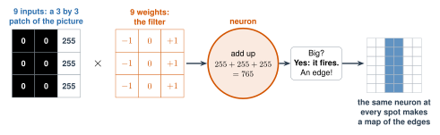

# 2.8 - How AI Sees {.unnumbered}

In Lesson 2.7, your AI told Rock from Paper from Scissors. But to a computer, a photo is a **grid of numbers**. Nothing else.

So how does a network find a hand in a grid of numbers? It uses neurons, like the ones you built. And it uses **layers**: each layer finds something a little more complicated than the layer before.

:::{.agenda}
**Today's Plan** (40 minutes)

- [🔥]{.icon} **Warm Up** Color by number [7 min]{.time}
- [👥]{.icon} **Learn Together** Pixels, filters, and layers [13 min]{.time}
- [🛠️]{.icon} **Try It** Watch the layers [14 min]{.time}
- [💬]{.icon} **Talk About It** What could a car miss? [6 min]{.time}
:::

:::{.objectives}
- [ ] I can explain how a computer stores a picture as numbers.
- [ ] I can explain how a filter is a neuron that looks at a small piece of a picture.
- [ ] I can explain how layers find edges, then shapes, then whole things.
- [ ] I can name ways computer vision is used, and what could go wrong.
:::

::::{.vocab}
:::{.word-cards}
- [🟦]{.icon} : one tiny square of a picture. It's stored as a number.
- [🔍]{.icon} : a small grid of weights that slides over a picture to find something, like edges
- [📐]{.icon} : a place where a picture changes fast from dark to light
- [👁️]{.icon} : AI that finds things in pictures and video
:::
::::

:::{.guided-notes-link}
[Printable lesson sheet](/handouts/Unit_2/2.8_How_AI_Sees.pdf){target="_blank"} - the sheet you write on today.
:::



Your sheet has a grid of numbers. Color every square with a **1**. Leave every **0** white. What is the picture?

:::{.think title="What did you just do?"}
You turned numbers into a picture. A computer screen does the same thing millions of times a second.

A camera does the opposite. It turns a picture into numbers.
:::



### 2.8.1 - Pixels Are Numbers

Zoom in on any photo and you see tiny squares. Each square is a .

- In a black-and-white picture, each pixel is one number: **0** is black, **255** is white, and the numbers between are grays.
- In a color picture, each pixel is **three** numbers: how much red, green, and blue.
- A phone photo can have about **12 million** pixels. That's about 36 million numbers!

***

### 2.8.2 - A Filter Is a Neuron

Where does a picture change fast from dark to light? That's an . Edges show where things begin and end.

To find edges, a vision network uses a . A filter is a **neuron** with 9 inputs: a 3 by 3 patch of the picture. Its 9 weights are the filter's numbers.

{width="760px" fig-align="center" fig-alt="A 3 by 3 patch of a picture: the left two columns are dark, 0, and the right column is light, 255. It's multiplied by 9 weights: minus 1, 0, plus 1 in each row. The neuron adds up 255 plus 255 plus 255 equals 765. Big? Yes, it fires: an edge. The same neuron at every spot makes a map of the edges: a small grid with a bright stripe down the middle."}

1. **Multiply** the 9 picture numbers by the 9 weights, and **add**. That's the same **multiply, add, compare** as the neuron in Lesson 2.4.
2. If the total is far from 0, the neuron fires: there's an edge here. (A big **minus** number is an edge too, going the other way: light to dark.) Where the picture is the same on both sides, the $-1$s and $+1$s cancel. The total is 0: no edge.
3. Then the **same** neuron moves one square over and looks again. It does this at every spot. Its answers make a new picture: a **map** of the edges.

***

### 2.8.3 - Layers: Edges, Then Shapes, Then Things

Layer 1 finds edges. Layer 2 doesn't look at the picture. It looks at **layer 1's maps**. Where an up-and-down edge meets a side-to-side edge, a layer 2 neuron finds a **corner**.

Every layer builds on the one before: edges, then corners and curves, then patterns, then parts, then whole things. Here's what real neurons look for, layer by layer:

{target="_blank"}. Cropped and labeled.)](/images/Unit_2/2.8_feature_visualization.jpg){width="760px" fig-align="center" fig-alt="Five columns of colorful computer-made pictures, three in each column. Edges: fine stripes. Textures: honeycomb, bumps, and ripples. Patterns: woven loops, fuzzy balls, and hexagons. Parts: flowers, dog noses with eyes, and pieces of cloth. Objects: buildings, dog faces, and bowls of food. An arrow under them goes from early layers to later layers."}

:::{.think title="Who chose these filters?"}
**Nobody.** Nobody told this network to look for stripes, flowers, or dog noses. Training found every one of its filters, the same way the network in Lesson 2.6 found its weights.

The first layer of almost every vision network ends up finding edges, like the filters you'll try today.
:::

:::{.real-world title="Computer vision is everywhere"}
- **Self-driving cars** find lanes, signs, other cars, and people.
- **Phones** find your face to unlock.
- **Doctors** use it to look for problems in X-rays.
- **Farms** use it to find sick plants.
:::



### 2.8.4 - Watch the Layers

This is a tiny vision network with two layers. Layer 1 has two edge neurons. Layer 2 has a corner neuron. Work with a partner.

:::{.steps}
1. Choose the **square**. Where does each edge neuron fire? Where does the corner neuron fire?
2. Click a bright square in an edge map. Read the math. Then click a pale one.
3. Click a green square in the corner map. Why did it fire?
4. Try the **L**, the **T**, and the **plus**. Count the corners yourself first. Does the network agree?
5. Try the **circle**. A circle has no corners. What does the network say? Why?
6. Draw your own shape. Can you fool the corner neuron?
:::



:::{.think title="Why did the circle have corners?"}
Zoom in. A circle made of square pixels has tiny **steps**. Each step is a tiny corner, and the corner neuron can't tell a tiny corner from a big one. It only sees a 3 by 3 patch.

Real networks have many more layers. Each layer looks at a bigger piece of the picture than the one before. So later layers can tell a smooth curve from a sharp corner, and a circle from a square.
:::



A self-driving car sees only numbers. What if it sees something it never saw in training: a person in a costume, snow on a stop sign, or a kangaroo?

:::{.frames}
- A computer sees ... , but I see ...
- A self-driving car could make a mistake when ... , because ...
- Computer vision is helpful when ... , and dangerous when ...
:::



:::{.project title="Day 2: Find the Edge by Hand"}
Do the edge problem on your sheet, with a partner. A tiny picture has dark squares (0) on the left and bright squares (9) on the right.

1. Put the up-and-down filter over the first 3 columns. Multiply each pair of numbers. Add all 9.
2. Move the filter one column to the right. Do it again. Do all 4 places.
3. Where are the big answers? Why there?
4. Use the tool below to try more filters. Choose the **house** and turn on **show the numbers**. Click a square on the right to check the math.
:::



:::{.project title="Make a Blur"}
In the tool above, choose the **blur** filter. Click a square and read the math. Why does blur add all 9 numbers and divide by 9? (Hint: what is the mean of 9 numbers?)
:::

:::{.project title="Send a Secret Picture"}
Draw a 10 by 10 picture on grid paper. Write it as numbers (0 and 1) on another paper. Give only the numbers to a partner. Can they draw your picture? This is how pictures travel over the internet.
:::

:::{.explore-link}
🔭 **Explore More:** [layers: from edges to a cat, and more pictures of what neurons see](/chapters/Explore/explore-unit-2.qmd#explore-2-8). Read it on your own, if you want to learn more.
:::
