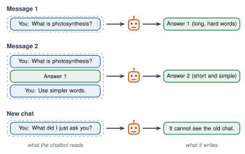

# 3.2 - Keep Talking {.unnumbered}

When you ask a teacher a question and you don't understand the answer, you don't walk away. You say, "Can you say that another way?" or "Can you show me an example?"

You can do the same with a chatbot. The first answer is only a first try. The second and third answers are often much better.

Today you learn the follow-up questions that turn a bad answer into a useful one.

:::{.agenda}
**Today's Plan** (40 minutes)

- [🔥]{.icon} **Warm Up** What is wrong with this answer? [6 min]{.time}
- [👥]{.icon} **Learn Together** The chat is the prompt [10 min]{.time}
- [🛠️]{.icon} **Try It** The follow-up challenge [17 min]{.time}
- [💬]{.icon} **Talk About It** When should you start over? [7 min]{.time}
:::

:::{.objectives}
- [ ] I can use follow-up questions to make an answer more useful.
- [ ] I can explain why a chatbot remembers what I said earlier in a chat.
- [ ] I can explain why a new chat starts over.
:::

::::{.vocab}
:::{.word-cards}
- [↩️]{.icon} : a question you ask after an answer, to make it better
- [🪟]{.icon} : all the words a chatbot can read at one time
- [⌨️]{.icon} : what you type to tell an AI what you want
:::
::::

:::{.guided-notes-link}
[Printable lesson sheet](/handouts/Unit_3/3.2_Keep_Talking.pdf){target="_blank"} - the sheet you write on today.
:::



A student asked a chatbot, "What is photosynthesis?" Here is an answer like the one they got:

> Photosynthesis is the biochemical process by which photoautotrophic organisms convert electromagnetic radiation into chemical energy, synthesizing glucose from carbon dioxide and water while releasing molecular oxygen as a byproduct.

On your sheet, circle 3 hard words. What would you say to the chatbot next?

:::{.think title="One follow-up question"}
The student typed: **"Explain it in simple words. I am in high school and I am learning English. Use 3 short sentences."**

The new answer: *Plants make their own food. They use sunlight, water, and air. They give off oxygen, the gas we breathe.*

Same facts. Now the student can use them.
:::



### 3.2.1 - The Chat Is the Prompt

When you send a new message, the chatbot doesn't read only your new message. It reads the **whole chat** again, from the top. Then it predicts its answer.

{width="680px" fig-align="center" fig-alt="Three rows. Message 1: the chatbot reads one question and writes a long, hard answer. Message 2: the chatbot reads the question, its own first answer, and the follow-up 'Use simpler words', then writes a short, simple answer. New chat: the chatbot reads only 'What did I just ask you?' and cannot see the old chat."}

So your follow-up question works because the old messages are still part of the . The words a chatbot can read at one time are called its .

:::{.remember}
A **new chat** starts over. The chatbot can't see your old chat. If you need the context, type it again.
:::

***

### 3.2.2 - Follow-Up Moves

| Move | Say this | Use it when the answer is ... |
|---|---|---|
| **Simpler** | "Explain it in simple words." | too hard to read |
| **Shorter** | "Say it in 3 sentences." | too long |
| **Example** | "Give me an example." | too general |
| **Why?** | "Why? Show me the steps." | hard to believe |
| **Fix it** | "That is not what I meant. I meant ..." | about the wrong thing |
| **New shape** | "Make it a table." or "Make it a list." | hard to use |
| **Language** | "Say it in English and in Arabic." | hard to understand in English |



### 3.2.3 - The Follow-Up Challenge

Work with a partner, or in a group of 3.

:::{.steps}
1. Choose a hard topic from another class: photosynthesis, the water cycle, slope, the U.S. Constitution, or your own idea.
2. Ask your class AI tool: **"What is ...?"** Read the answer.
3. On your sheet, give the answer a score from 1 to 5. (1 = I can't use this. 5 = I can use this today.)
4. Use **one** follow-up move. Score the new answer.
5. Do it 2 more times, with different moves. Which move helped the most?
:::

:::{.teacher title="Class size"}
**Small class (4 or 5):** work as one group. Each person chooses the next follow-up move. **Big class:** two teams get the same topic and 3 follow-ups each. Read both final answers aloud. Which team got the more useful answer?
:::



You kept asking until the answer was useful. When is it better to keep talking, and when is it better to start a new chat? Should it be your job to keep asking, or should the AI get it right the first time?

:::{.frames}
- The follow-up move that helped me most was ... , because ...
- A chatbot remembers the chat because ...
- I would start a new chat when ...
- It (is / isn't) fair that I have to keep asking, because ...
:::



:::{.project title="Day 2: The New Chat Test"}
Test the picture in 3.2.1 for yourself.

1. In the **same** chat as your follow-up challenge, ask: "What topic did I ask about?" What does it say?
2. Open a **new** chat. Ask the same question. What does it say now?
3. Write what happened on your sheet. Use the picture in 3.2.1 to explain why.
:::

:::{.project title="Practice a Job Interview"}
Type: **"You are a job interviewer at a grocery store. Ask me one question at a time. Wait for my answer. After each answer, give me one tip."** Keep talking for 5 questions. What was the best tip? (Don't type your name or anything else about who you are.)
:::

:::{.project title="Quiz Me"}
Type: **"Quiz me on the water cycle. Ask one question at a time. Tell me if I am right before the next question."** How is this different from just reading the answer?
:::

:::{.explore-link}
🔭 **Explore More:** [why "Are you sure?" can change a right answer, and chatbot memory](/chapters/Explore/explore-unit-3.qmd#explore-3-2). Read it on your own, if you want to learn more.
:::
