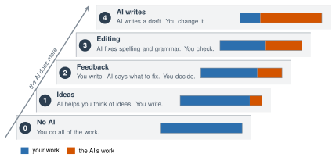

# 3.3 - Writing with AI, Not by AI {.unnumbered}

Two students get the same job: write a paragraph about a place that matters to them.

Ahmed types, "Write a paragraph about a place that matters to me." In 5 seconds, he has a nice paragraph about a quiet park where he likes to think. He has never been to that park.

Sara writes about her grandmother's kitchen: the smell of bread, the radio, the blue door. Then she asks the AI, "What is one thing I could make clearer?" She fixes two sentences. Who wrote something true? Who got better at writing?

:::{.agenda}
**Today's Plan** (40 minutes)

- [🔥]{.icon} **Warm Up** Who did the work? [5 min]{.time}
- [👥]{.icon} **Learn Together** The AI use ladder [9 min]{.time}
- [🛠️]{.icon} **Try It** Write, ask, decide [20 min]{.time}
- [💬]{.icon} **Talk About It** When is it cheating? [6 min]{.time}
:::

:::{.objectives}
- [ ] I can name the steps of the AI use ladder.
- [ ] I can ask AI for feedback without asking it to write for me.
- [ ] I can decide which advice to keep, and explain why.
:::

::::{.vocab}
:::{.word-cards}
- [✏️]{.icon} : a first try at a piece of writing. You will change it.
- [🗣️]{.icon} : comments that tell you what is good and what to make better
- [🚫]{.icon} : turning in someone else's words or ideas as your own
:::
::::

:::{.guided-notes-link}
[Printable lesson sheet](/handouts/Unit_3/3.3_Writing_with_AI.pdf){target="_blank"} - the sheet you write on today.
:::



Read the story at the top again. Answer on your sheet:

1. Whose paragraph is **true**?
2. Who **practiced** writing?
3. Did both of them use AI?

:::{.think title="Writing is practice for thinking"}
When you write, you decide what you mean. You choose the words. You put ideas in order. That is how you get better at thinking.

If the AI writes it, the AI got the practice. You did not.
:::



### 3.3.1 - The AI Use Ladder

There are many ways to use AI for writing. Each step up the ladder, the AI does more of the work.

{width="640px" fig-align="center" fig-alt="A ladder with five steps. Step 0, No AI: you do all of the work. Step 1, Ideas: AI helps you think of ideas, and you write. Step 2, Feedback: you write, AI says what to fix, and you decide. Step 3, Editing: AI fixes spelling and grammar, and you check. Step 4, AI writes: AI writes a draft, and you change it. A bar on each step shows your work in blue getting smaller and the AI's work in orange getting bigger."}

Each assignment should say which step is OK. **If it does not say, ask your teacher before you use AI.**

:::{.remember}
Using AI on a step that is not allowed, and turning the work in as your own, is . It is the same as copying from a friend.
:::

***

### 3.3.2 - Ask for Feedback, Then Decide

If you ask, "Make my paragraph better," the AI will often write a new paragraph. Then it is not yours anymore. Ask for  instead:

:::{.prompt-example}
[Do not rewrite my paragraph.]{.p-task} [I am in high school and I am learning English.]{.p-context} [Tell me 2 things that are good and 2 things I could make better.]{.p-task} [Use simple words.]{.p-format} Here is my paragraph: ...
:::

AI advice is not always right. You are the boss of your writing. For each piece of advice, you decide:

| Decision | When |
|---|---|
| ✅ **Keep** it | It makes your meaning clearer. |
| ✏️ **Change** it | The idea is good, but you want to say it your way. |
| ❌ **Skip** it | It is wrong, or it changes what you meant. |



### 3.3.3 - Write, Ask, Decide

Work with a partner. (If there is an odd number, make one group of 3.)

:::{.steps}
1. Write a : **5 sentences** about a place that matters to you. You can plan in your home language first.
2. Read your paragraph to your partner. Your partner says one thing they liked.
3. Copy the feedback prompt from 3.3.2 into your class AI tool. Add your paragraph at the end.
4. On your sheet, write each piece of advice. Mark it **Keep**, **Change**, or **Skip**. Write why.
:::

:::{.gotcha title="Keep it private"}
Write about a place, not an address. Do not use any names: write "my grandmother" or "my friend" instead.
:::



When is using AI for writing **OK**, and when is it **cheating**? If AI can write well, why should people still learn to write?

:::{.frames}
- Using AI is OK when ... , and it is cheating when ...
- I kept the advice to ... because ...
- I skipped the advice to ... because ...
- People should still learn to write because ...
:::



:::{.project title="Day 2: Revise and Write Your AI Note"}
1. Use your Keep and Change decisions. Write your new paragraph on your sheet.
2. At the end, write an **AI note**. It is short and honest. It says what you did and what the AI did. For example:

> **AI note:** I wrote this paragraph myself. I used my class AI tool for feedback. I kept 1 idea: I added the smell of the bread. I skipped 1 idea, because it changed what I meant.

3. Read your new paragraph to your partner. What changed?
:::

:::{.project title="Our Class AI Rules"}
As a class, decide which step of the ladder is OK for different jobs: a journal, a science report, a job application, a text to a friend. Make a poster.
:::

:::{.project title="Human or AI?"}
Ask the AI to write 5 sentences about a place that matters to it. Give your paragraph and the AI's paragraph to a partner, with no names. Can they tell which is which? How?
:::

:::{.explore-link}
🔭 **Explore More:** [your writing voice, and feedback in your language](/chapters/Explore/explore-unit-3.qmd#explore-3-3). Read it on your own, if you want to learn more.
:::
