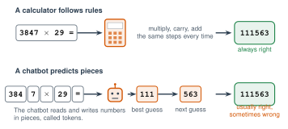

# 3.6 - AI and Math {.unnumbered}

A calculator from 1975 can do $3847 \times 29$ and get it right every time. Some of the most powerful AI in the world can solve very hard math contest problems. And yet a chatbot can still get a long multiplication problem **wrong**, and sound completely sure.

How can that be? Today you find out, and you test it yourself.

:::{.agenda}
**Today's Plan** (40 minutes)

- [🔥]{.icon} **Warm Up** Catch the mistake [7 min]{.time}
- [👥]{.icon} **Learn Together** Rules and predictions [9 min]{.time}
- [🛠️]{.icon} **Try It** Test the chatbot [18 min]{.time}
- [💬]{.icon} **Talk About It** Help or shortcut? [6 min]{.time}
:::

:::{.objectives}
- [ ] I can explain why a calculator is always right on arithmetic, but a chatbot isn't.
- [ ] I can check an AI answer with a calculator, an estimate, or by plugging it in.
- [ ] I can find a wrong step in a solution.
:::

::::{.vocab}
:::{.word-cards}
- [📏]{.icon} : a quick answer that's close, but not exact. Use it to check.
- [🧩]{.icon} : a word or a piece of a word that a chatbot reads and writes
- [📜]{.icon} : an exact step that a computer follows every time
:::
::::

:::{.guided-notes-link}
[Printable lesson sheet](/handouts/Unit_3/3.6_AI_and_Math.pdf){target="_blank"} - the sheet you write on today.
:::



A student asked a chatbot to solve $3x + 5 = 20$. Here are its steps. One step is wrong. Which one?

| Step | Work |
|---|---|
| 1 | $3x + 5 = 20$ |
| 2 | $3x = 25$ |
| 3 | $x = \dfrac{25}{3}$ |

:::{.answers title="Answer"}
Step 2 is wrong. To undo $+5$, you **subtract** 5 from both sides: $3x = 15$. Then $x = 5$.

**Check by plugging in:** $3(5) + 5 = 15 + 5 = 20$. ✅
:::



### 3.6.1 - Rules and Predictions

Remember Lesson 1.1: some computers follow **rules**, and some learn from **examples**.

{width="680px" fig-align="center" fig-alt="Top: a calculator gets 3847 times 29 and follows the same steps every time: multiply, carry, add. It gets 111563, always right. Bottom: a chatbot reads the problem in pieces called tokens: 384, 7, times, 29, equals. It predicts the answer one piece at a time: a best guess of 111, then a next guess of 563. It gets 111563, usually right, sometimes wrong."}

- A **calculator** follows the  for multiplying. It does the same steps every time.
- A **chatbot** predicts the answer, one  at a time, like words. On small problems, its guesses are almost always right. On long problems, one bad guess makes the whole answer wrong.

This picture shows the idea. Real chatbots split numbers into pieces in different ways.

:::{.note title="Right now (fall 2026)"}
In July 2025, AI from Google DeepMind and OpenAI scored at **gold-medal** level at the International Mathematical Olympiad. It's a contest for the best high school math students in the world.

Many AI tools now use a calculator or computer code behind the scenes for arithmetic. Some don't. Even the best ones still make mistakes. Always check.
:::

***

### 3.6.2 - Three Ways to Check

| Way | How | Example: is $3847 \times 29 = 111563$? |
|---|---|---|
| **Estimate** | Round, then do it in your head. Is the answer close? | $4000 \times 30 = 120000$. Close! ✅ |
| **Calculator** | Do it again with a tool that follows rules. | $111563$ ✅ |
| **Plug it in** | Put the answer back in the problem. Does it work? | $111563 \div 29 = 3847$ ✅ |



### 3.6.3 - Test the Chatbot

Work with a partner.

:::{.steps}
1. Ask your class AI tool each problem below. Ask for **only the answer**, with no steps.
2. Check each answer with a calculator.
3. Mark it ✅ or ❌ on your sheet.
4. Add your results to the class chart. Which problems did the AI get wrong most often?
:::

| Problem | Size |
|---|---|
| $23 \times 47$ | small |
| $3847 \times 29$ | medium |
| $48213 \times 7956$ | big |
| $8374615 \times 293847$ | very big |

:::{.gotcha title="It might get them all right"}
That's a good result too! Write it down. Your class AI tool may use a calculator behind the scenes. Try asking: "Did you use a calculator for that?" Then check its answer to **that** question.
:::

:::{.teacher title="Class size"}
**Small class:** everyone tests the chatbot, then the class makes one chart together. **Big class:** each pair tests only 2 of the 4 problems, but asks each one 3 times in new chats. Does the AI give the same answer every time?
:::



Should students be allowed to use AI on math homework? When does it help you learn, and when does it stop you from learning?

:::{.frames}
- The AI got the ... problem (right / wrong), because ...
- A calculator is better for arithmetic because ...
- AI helps me learn math when ...
- AI stops me from learning when ...
:::



:::{.project title="Day 2: The Hint Challenge"}
If AI does your homework, you didn't learn it. Then the test comes, and the AI isn't there. So ask for a  instead:

> I am learning to solve equations. Don't give me the answer. Give me one hint for the first step of $2x - 7 = 11$. Then wait for me to try.

1. Use this prompt. Don't let the AI give you the answer.
2. Write each hint and each of your steps on your sheet.
3. Check your answer by plugging it in.

You can also ask AI to check your work: "Here are my steps. Tell me which step is wrong, but do not fix it."
:::

:::{.project title="Same Problem, Three Times"}
Ask the very big problem in 3 new chats. Did you get the same answer each time? Why could a chatbot give different answers to the same question? (Hint: Lesson 2.9.)
:::

:::{.project title="Word Problem Trap"}
Ask: "A farmer has 15 cows. All but 8 run away. How many are left?" Is the AI right? (The answer is 8.) Write your own trick word problem and test it.
:::

:::{.explore-link}
🔭 **Explore More:** [why numbers are hard for chatbots, and math in your language](/chapters/Explore/explore-unit-3.qmd#explore-3-6). Read it on your own, if you want to learn more.
:::
