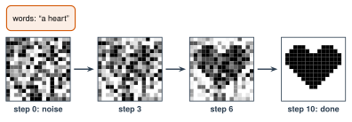

# 3.7 - Making Pictures with AI {.unnumbered}

Type "an orange cat reading a book in a library, watercolor." Wait a few seconds. A picture appears. Nobody drew it. It did not exist before.

How? The AI starts with **static**, like an old TV with no signal. Then it removes a little static at a time, again and again, until a picture is left.

:::{.agenda}
**Today's Plan** (40 minutes)

- [🔥]{.icon} **Warm Up** Find the picture in the static [6 min]{.time}
- [👥]{.icon} **Learn Together** From noise to picture [10 min]{.time}
- [🛠️]{.icon} **Try It** Watch noise become a picture [18 min]{.time}
- [💬]{.icon} **Talk About It** Is it art? [6 min]{.time}
:::

:::{.objectives}
- [ ] I can explain how an image generator turns noise into a picture.
- [ ] I can explain why the same prompt makes a different picture each time.
- [ ] I can say who should get credit for an AI picture, and why.
:::

::::{.vocab}
:::{.word-cards}
- [🖼️]{.icon} : an AI that makes a new picture from words
- [📺]{.icon} : random dots with no picture in them, like TV static
- [🌫️]{.icon} : making a picture by removing noise a little at a time
:::
::::

:::{.guided-notes-link}
[Printable lesson sheet](/handouts/Unit_3/3.7_Making_Pictures_with_AI.pdf){target="_blank"} - the sheet you write on today.
:::



Look at the first three squares on your sheet. Cover the last one. At which step can you guess the picture? Write your guess.

:::{.think title="When could you see it?"}
At step 0, there is no picture at all. It is only . At step 3, maybe you see a dark shape. At step 6, most people can see it. The details come last.

An image generator works the same way, but it does not know the picture ahead of time. It has to guess it.
:::



### 3.7.1 - From Noise to Picture

{width="620px" fig-align="center" fig-alt="Four 16 by 16 grids. Words: a heart. Step 0 is random gray squares. Step 3 is still mostly noise. At step 6 a dark heart shape shows through the noise. Step 10 is a clean black heart."}

An  learns in two parts.

**Training.** People collect millions of pictures, each with words that describe it. The computer adds noise to each picture, a little at a time, until only noise is left. A neural network practices guessing: *which part of this is noise?* It practices millions of times.

**Making a picture.** Now you type words. The AI starts with pure noise. The network guesses which part is noise, and removes a little of it. It does this again and again, often 20 to 50 times. Your words guide every guess. This is called .

:::{.remember}
The AI does not copy a picture or glue pieces together. It starts from noise and removes it, step by step, guided by what it learned from millions of pictures.
:::

***

### 3.7.2 - Why Every Picture Is Different

Every time you press the button, the AI starts from **new** random noise. So the same prompt makes a different picture each time. (Like the chatbot that picks by chance, in Lesson 2.9.)



### 3.7.3 - Watch Noise Become a Picture

Work with a partner. (In a big class, groups of 3 share one computer.)

:::{.steps}
1. Choose words. Press **Remove some noise** one step at a time. At which step can you guess the picture?
2. Press **New noise** with the **same** words. Play it. What changed? What stayed the same?
3. Keep the noise. Choose **new words**. Play it. What changed?
:::



This shows the idea, but it cheats. This demo already has the finished picture (an emoji), and it mixes the noise away. A real image generator does not have the picture. Its neural network has to **guess** what to remove, using what it learned from millions of pictures.

:::{.gotcha title="Never make pictures of real people"}
Do not make AI pictures of classmates, teachers, or anyone real. A fake picture of a real person can hurt them, even as a joke. (More in Lesson 4.3.)
:::



Is a picture made by AI **art**? Who should get the credit: the person who wrote the prompt, the company that made the AI, or the artists whose pictures trained it?

:::{.frames}
- The noise turned into a picture when ...
- The same prompt made different pictures because ...
- An AI picture (is / is not) art, because ...
- The credit should go to ... , because ...
:::



:::{.watch title="Does AI Have Creativity and Imagination? (Code.org)"}


**While you watch:** What does the AI learn from, before it can make a picture?

**Captions in your language:** Press **CC**, then ⚙️ **Settings**, then **Subtitles/CC**, then **Auto-translate**.
:::



:::{.project title="Day 2: Write Picture Prompts"}
Most school AI tools do not make pictures. So you write the prompts, and Mr. Ross makes the pictures on the projector. Work with a partner, or in a group of 3.

A good picture prompt says what you want to **see**:

| Part | Question | Example |
|---|---|---|
| **Subject** | What is in the picture? | a small orange cat |
| **Action** | What is it doing? | reading a book |
| **Place** | Where is it? When? | in a library at night |
| **Style** | What should it look like? | watercolor painting |
| **Details** | Colors? Light? | warm yellow light |

1. Write a picture prompt on your sheet. Use all 5 parts.
2. Give it to Mr. Ross. He makes the picture **two times** with the same prompt. How are the two pictures different?
3. Change only the . He makes it again. What changed?
4. Find one mistake in a picture. Write it down.

**Small class:** every pair gets 3 pictures. **Big class:** play "Describe It." One student from each team sees a secret picture. The team writes a prompt from the description. Mr. Ross makes each team's picture. Whose is closest?
:::

:::{.project title="One Subject, Five Styles"}
Choose one subject, like "a bus at our school." Write 5 prompts for it in 5 styles: photo, cartoon, pixel art, oil painting, and a style from your home country. Give them to Mr. Ross. Make a poster of the 5 pictures.
:::

:::{.project title="Who Does It Show?"}
Write prompts for "a doctor," "a nurse," "a scientist," and "a basketball player." Mr. Ross makes each one 4 times. Count who the AI shows: men or women, young or old, skin colors. What do you notice? Bring your results to Lesson 4.2.
:::

:::{.explore-link}
🔭 **Explore More:** [what image generators get wrong, and the counting test](/chapters/Explore/explore-unit-3.qmd#explore-3-7). For students who want to learn more on their own.
:::
