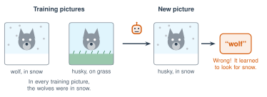

# 4.2 - Where Bias Comes From {.unnumbered}

In 2014, Amazon started building an AI to pick the best job applications. It learned from the applications of people Amazon had hired over 10 years. Most of them were men.

The AI learned to give **lower scores** to applications with the word "women's," like "captain of the women's soccer team." Nobody told it to do that. It learned it from the examples. Amazon stopped using it.

Today you find out where unfair AI comes from. Then you act out the story of a horse that fooled a whole city.

:::{.agenda}
**Today's Plan** (40 minutes)

- [🔥]{.icon} **Warm Up** He or she? [5 min]{.time}
- [👥]{.icon} **Learn Together** Bias and shortcuts [11 min]{.time}
- [🛠️]{.icon} **Try It** Act out Clever Hans [18 min]{.time}
- [💬]{.icon} **Talk About It** Who should fix it? [6 min]{.time}
:::

:::{.objectives}
- [ ] I can explain what bias in AI means.
- [ ] I can name three ways bias gets into AI: data, missing people, and shortcuts.
- [ ] I can explain the Clever Hans story and how it is like AI.
:::

::::{.vocab}
:::{.word-cards}
- [⚖️]{.icon} : when a system is unfair to some people, or works better for some people than others
- [🏷️]{.icon} : an idea that all people in a group are the same, like "all nurses are women"
- [🐴]{.icon} : a clue that gives the right answer in training, but is not the real reason
- [🗂️]{.icon} : a big collection of examples that an AI learns from
:::
::::

:::{.guided-notes-link}
[Printable lesson sheet](/handouts/Unit_4/4.2_Where_Bias_Comes_From.pdf){target="_blank"} - the sheet you write on today.
:::

:::{.teacher title="Before class"}
For Clever Hans, Round 2: seal a math problem in an envelope. Nobody in the room should know the answer.
:::



In Turkish, there is one word for "he" and "she": **o**. So "O bir doktor" can mean "He is a doctor" **or** "She is a doctor."

Mr. Ross types these into Google Translate, from Turkish to English:

> O bir doktor. O bir hemşire. *(doctor, nurse)*

Before he presses Enter, predict: will the AI choose "he" or "she" for each one? Why?

:::{.think title="Why would it choose?"}
Turkish did not say. The AI has to guess. It guesses from its training examples. If most English sentences it read said "**he** is a doctor" and "**she** is a nurse," that is what it predicts. The AI did not decide that women cannot be doctors. It copied a pattern from its data.
:::

:::{.note title="Right now (fall 2026)"}
After people complained, Google Translate started showing **both** "he" and "she" for some short sentences in some languages. Longer sentences, and other tools, may still choose one.
:::



### 4.2.1 - What Is Bias?

In AI,  means a system is unfair to some people, or works better for some people than for others. It is usually not on purpose. It gets in three ways:

1. **The data copies the past.** If the past was unfair, the AI learns the unfair pattern. Amazon's AI learned from 10 years of mostly male hires. The translator learned a , "he is a doctor," from millions of old sentences.
2. **Some people are missing.** Face programs from big companies made far more mistakes on darker-skinned women. Their training  had far fewer faces like theirs.
3. **Shortcuts.** The AI finds a clue that works in training, but it is not the real reason. This one is the strangest. Read on.

***

### 4.2.2 - Shortcuts

:::{.experiment title="Clever Hans, the horse that did math (1904)"}
In Berlin, a horse named Hans seemed to do arithmetic. His owner asked, "What is 3 + 2?" Hans tapped his hoof 5 times. Crowds came to see him. Experts could not find a trick.

In 1907, a scientist named Oskar Pfungst tried two tests:

- When the person asking **did not know** the answer, Hans got it wrong.
- When Hans **could not see** the person, Hans got it wrong.

Hans could not do math. He watched people's faces and bodies. When he reached the right number, people relaxed a tiny bit, without knowing it. Hans stopped tapping. He learned a .
:::

AI can do the same thing. In 2016, researchers made an AI to tell **wolves** from **huskies** (a dog that looks like a wolf). They chose the training pictures on purpose: every wolf was in snow. They wanted to see if people would notice the problem.

{width="640px" fig-align="center" fig-alt="Training pictures: a wolf in snow, and a husky on grass. In every training picture, the wolves were in snow. A new picture shows a husky in snow. The AI says wolf. It is wrong, because it learned to look for snow."}

The AI learned to look at the **snow**, not the animal. Many people who tested it did not notice until the researchers showed them. Researchers now call this the "Clever Hans" problem in AI: right answers for the wrong reason.



### 4.2.3 - Act It Out: Clever Hans

:::{.steps}
1. Choose one student to be **Hans**, one to be the **questioner**, and everyone else to be the **crowd**.
2. **Round 1:** the questioner shows a math card to the crowd, but not to Hans. Hans taps on the desk. The crowd leans back a little when Hans reaches the answer. Does Hans look smart?
3. **Round 2:** Mr. Ross gives the questioner a closed envelope. **Nobody** in the room knows the answer. Hans taps. What happens?
4. **Round 3:** Hans turns around and faces the wall. The crowd knows the answer again. What happens?
:::

:::{.teacher title="Class size"}
**4 students:** Hans, a questioner, and a crowd of 2. **Big class:** make two Hans teams. Each team tries to fool the other team's crowd in Round 1.
:::



Who should fix bias in AI: the company that makes it, the government, or the people who use it? Is it OK to use an AI that works better for some people than for others?

:::{.frames}
- Bias got into ... because ...
- Clever Hans is like the wolf AI because ...
- The Turkish translation chose ... because ...
- The people who should fix this are ... , because ...
:::



:::{.watch title="Training Data and Bias (Code.org)"}


**While you watch:** Where does the bias in the video come from?

**Captions in your language:** Press **CC**, then ⚙️ **Settings**, then **Subtitles/CC**, then **Auto-translate**.
:::



:::{.project title="Day 2: He or She in Your Language"}
Work with a partner. Use Google Translate or your class AI tool. Write what happens on your sheet.

1. Translate these sentences from English into a language you know: **The doctor is busy. The nurse is busy. The engineer is tired. The teacher is kind.**
2. Many languages show if a person is a man or a woman (Spanish, French, Arabic, Russian). Which one did the AI choose for each job?
3. Some languages have one word for "he" and "she" (Turkish, Persian, Swahili, Nepali, Tagalog, Indonesian). If you know one, translate from that language into English. Did the AI choose "he" or "she"?
4. Add your results to the class chart.
:::

:::{.project title="Who Does It Show?"}
Use your prompts from Lesson 3.7. Mr. Ross makes pictures of "a doctor," "a nurse," "a scientist," and "a basketball player," 4 times each. Count who the AI shows. Make a chart. Is it fair?
:::

:::{.project title="Missing from the Data"}
Think of an app you use: a face filter, a voice assistant, a translator. Who might be missing from its training data? How could you test it? Plan a fair test.
:::

:::{.explore-link}
🔭 **Explore More:** [the face study that changed big companies, and more AI shortcuts](/chapters/Explore/explore-unit-4.qmd#explore-4-2). Read it on your own, if you want to learn more.
:::
