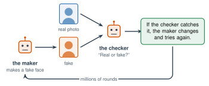

# 4.3 - Real or Fake? {.unnumbered}

In March 2023, a photo of Pope Francis went around the world. He was wearing a huge, white, puffy winter jacket, like a rapper. Millions of people shared it. Many believed it.

It was not a photo. A man in Chicago made it with an AI image generator, as a joke. He did not expect so many people to believe it.

Today you test your eyes against AI faces. Then you learn something surprising: looking for clues stops working. You need a better way to check.

:::{.agenda}
**Today's Plan** (40 minutes)

- [🔥]{.icon} **Warm Up** Which face is real? [7 min]{.time}
- [👥]{.icon} **Learn Together** Why the clues stop working [10 min]{.time}
- [🛠️]{.icon} **Try It** Trace it back [17 min]{.time}
- [💬]{.icon} **Talk About It** What happens to trust? [6 min]{.time}
:::

:::{.objectives}
- [ ] I can explain how AI learns to make fake faces.
- [ ] I can explain why looking for clues in a picture stops working.
- [ ] I can check a picture by finding where it came from.
- [ ] I can protect myself and my family from fake voices.
:::

::::{.vocab}
:::{.word-cards}
- [🎭]{.icon} : a fake picture, video, or voice of a real person, made with AI
- [🔄]{.icon} : searching with a picture to find where else it is online
- [🗣️]{.icon} : an AI copy of a person's voice, made from a short recording
- [📚]{.icon} : where a fact comes from: a book, a website, a person
:::
::::

:::{.guided-notes-link}
[Printable lesson sheet](/handouts/Unit_4/4.3_Real_or_Fake.pdf){target="_blank"} - the sheet you write on today.
:::



Work with a partner. Open [Which Face Is Real?](https://www.whichfaceisreal.com/){target="_blank"} Each round shows two faces. One is a real photo. One was made by AI. Click the one you think is **real**.

Play 10 rounds. Write your score on your sheet. Then the class adds up all the scores. Did we do better than guessing?

:::{.think title="How did we do?"}
If you guessed with a coin, you would get about 5 of 10 right. Many people do only a little better. Some do worse. These faces were made in 2019. Newer AI faces are harder.
:::



### 4.3.1 - How AI Learns to Make Faces

One way is a game between two neural networks:

{width="600px" fig-align="center" fig-alt="The maker network makes a fake face. The checker network sees fake faces and real photos and says real or fake. If the checker catches it, the maker changes and tries again. They play for millions of rounds."}

The **maker** makes fake faces. The **checker** tries to tell them from real photos. Each time the checker catches a fake, the maker changes its weights. After millions of rounds, the checker cannot tell anymore. Often, neither can we. (Today many tools use diffusion instead, from Lesson 3.7. The result is the same: pictures that look real.)

:::{.real-world title="Can people tell? (2022)"}
Scientists Sophie Nightingale and Hany Farid showed people real faces and AI faces.

- People were right **48%** of the time. That is the same as guessing.
- After a short lesson on clues, people were right **59%** of the time.
- People rated the AI faces as a little **more trustworthy** than the real ones.
:::

***

### 4.3.2 - Why the Clues Stop Working

People used to look for clues like these:

| Old clue | What happened |
|---|---|
| Hands with 6 fingers | Newer tools draw hands well. |
| Messy words on signs | Newer tools can write words. |
| Earrings that do not match | Newer tools fix this. |
| Strange, blurry backgrounds | Newer tools fix this too. |

Every time people find a clue, the companies fix it. Hunting for clues in the picture is a race you will lose.

***

### 4.3.3 - Check the Source, Not the Picture

Fact-checkers do not stare at a picture. They ask **where it came from**. Use the four steps called **SIFT**:

| Step | What you do |
|---|---|
| **S**top | Before you share it, stop. Do you feel very angry or surprised? Be careful. |
| **I**nvestigate the source | Who posted it first? Are they a real news organization? |
| **F**ind better coverage | Search for it. Are trusted news sources reporting it? |
| **T**race to the original | Use a  to find the first place it appeared. |

:::{.note title="Right now (fall 2026)"}
Some cameras and AI tools now add **Content Credentials**: hidden information that says how a picture was made. Some websites show a small "CR" label you can click. Most pictures online still do not have this information, and it can be removed.
:::

***

### 4.3.4 - Fake Voices

AI can copy a voice from a short recording, maybe a video someone posted online. Scammers use  calls that sound like a family member in trouble: "Mom, I need money right now!"

:::{.remember title="What you can do"}
Choose a **family safe word**: a secret word that only your family knows. If someone calls in a panic asking for money, ask for the safe word. Then hang up and call the person back on their real number.
:::



### 4.3.5 - Trace It Back

Work with a partner. Mr. Ross shows 3 pictures that went around online. For each one:

:::{.steps}
1. **Stop.** Write how the picture makes you feel.
2. **Find better coverage.** Search for a few words that describe it, plus "fact check."
3. **Trace to the original.** Right-click the picture and choose **Search image with Google**, or upload it to [TinEye](https://tineye.com/){target="_blank"}.
4. Decide: real, fake, or real but used in a misleading way. Write your proof.
:::

:::{.gotcha title="Class size"}
**Small class:** work together on all 3 pictures, then try the Pope picture from the top of the page. **Big class:** each pair gets one picture. Pairs with the same picture compare their proof. Then each group teaches the class.
:::

:::{.gotcha title="Fake pictures of real people hurt real people"}
Never make or share a fake picture, video, or voice of a real person, even as a joke. Making or sharing fake sexual pictures of a real person is a crime in the United States. If it happens to you or someone you know, tell a trusted adult right away.
:::



If anyone can make a fake video of anyone, what happens to trust? A politician caught on a real video could just say, "That is AI." How do we know what is real?

:::{.frames}
- I scored ... of 10 on the faces game. It was (easy / hard) because ...
- Looking for clues stops working because ...
- Before I share a picture, I will ...
- When anyone can make fakes, people might ...
:::



:::{.project title="Check Before You Share"}
Make a poster of the SIFT steps in your home language. Add one real example of a fake picture that went around online, and how people found out.
:::

:::{.project title="Our Family Safe Word"}
Explain voice clones to your family, in your home language. Help them choose a safe word. (Do not tell anyone at school what it is!)
:::
