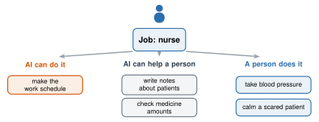

# 5.3 - AI and Jobs {.unnumbered}

In the 1970s, banks started using ATMs: machines that give you cash. Many people thought bank tellers would lose their jobs. The machines could count money faster than any person.

That is not what happened next. Banks opened more branches, and for many years the number of tellers did not go down. But the **job changed**. Tellers counted less cash and helped people more.

Will AI do the same thing to jobs today, or something different? Experts disagree. Today you look at **your** dream job, one task at a time.

:::{.agenda}
**Today's Plan** (40 minutes)

- [🔥]{.icon} **Warm Up** My dream job [5 min]{.time}
- [👥]{.icon} **Learn Together** A job is a bundle of tasks [10 min]{.time}
- [🛠️]{.icon} **Try It** Sort the tasks [18 min]{.time}
- [💬]{.icon} **Talk About It** Is he right? [7 min]{.time}
:::

:::{.objectives}
- [ ] I can break a job into the tasks people do.
- [ ] I can sort tasks into: AI can do it, AI can help, and a person does it.
- [ ] I can explain what kinds of work are hardest for AI.
:::

::::{.vocab}
:::{.word-cards}
- [📋]{.icon} : one piece of work, like "write a report" or "fix a pipe"
- [🤖]{.icon} : when a machine does work that people used to do
- [🛠️]{.icon} : something you can do well because you learned and practiced it
- [🧭]{.icon} : the work you do over many years of your life
:::
::::

:::{.guided-notes-link}
[Printable lesson sheet](/handouts/Unit_5/5.3_AI_and_Jobs.pdf){target="_blank"} - the sheet you write on today.
:::



What job do you want someday? Write it on your sheet. Then write 3 things a person in that job does in a normal day.



### 5.3.1 - A Job Is a Bundle of Tasks

AI almost never does a whole job. It does some of the s inside a job. Look at a nurse:

{width="640px" fig-align="center" fig-alt="A job, nurse, splits into tasks in three groups. AI can do it: make the work schedule. AI can help a person: write notes about patients, and check medicine amounts. A person does it: take blood pressure, and calm a scared patient."}

When a machine does tasks that people used to do, that is . A person may have more time for other tasks, like the bank tellers. Or a company may hire fewer people. Both happen.

***

### 5.3.2 - What Is Hard for AI?

| Easier for AI | Harder for AI |
|---|---|
| writing, summarizing, translating | work with your hands in messy places, like fixing a pipe under a sink |
| sorting and finding patterns in data | caring for people: a scared child, a sick grandparent |
| answering common questions | new problems nobody has seen before |
| routine computer work | being **responsible**: someone must answer for the decision |

:::{.note title="Right now (fall 2026)"}
Experts disagree about how fast AI is changing jobs.

- A 2025 Stanford study looked at the jobs AI can do most. Since 2022, workers aged 22 to 25 in those jobs had about 13% fewer jobs than expected. Older workers in the same jobs were not hurt.
- A 2025 Yale study found no big change in the whole job market yet.

Both can be true: the change may start with young workers in a few kinds of jobs.
:::

***

### 5.3.3 - Robots Are Learning Too

The table above is about right now. Robots are learning fast.

Chatbots learned words from millions of examples. Now some robots learn **movements** from many examples, with the same kind of AI. Robots usually start in places that are the same every day, like a warehouse or a truck yard. A messy place, like the pipes under an old house, is much harder. Experts disagree about how long it will take.

:::{.note title="Right now (fall 2026)"}
- Self-driving semi trucks carry freight on highways in Texas and nearby states. Some still have a person riding along, just in case.
- In some truck yards, trucks with no driver back trailers up to the loading dock.
- Robots that walk on two legs are being tested in some warehouses and factories.
- No robot can go into a house it has never seen and fix a leaking pipe. Not yet.
:::



### 5.3.4 - Sort the Tasks

Work with a partner. Choose one dream job: yours or your partner's.

:::{.steps}
1. Ask your class AI tool: **"List 10 tasks a [job] does in a normal week. Use simple words."** Do not type your name or anything about you.
2. Check the list. Is anything missing or wrong? Ask yourself: what would a real person in this job say?
3. On your sheet, sort each task: **AI can do it**, **AI can help**, or **A person does it**. Write why for 3 of them.
4. Look at your sort. Which skills will matter most in this job in 10 years?
:::

:::{.gotcha title="No class AI tool today?"}
Use the job cards on your sheet: nurse, electrician, store manager, or interpreter. Each card already lists 8 tasks.
:::

:::{.teacher title="Class size"}
**Small class:** everyone sorts one job together first (the nurse), then pairs choose their own. **Big class:** pairs with the same kind of job (health, building, business, computers) join into a group and compare their sorts.
:::



Mr. Ross wrote this book. In 2024, his father-in-law said:

> "It may be able to drive, but I'd love to see it try to back up a semi."

(A semi is a big truck that pulls a trailer. He meant that a computer could never back one up.) Today, in some truck yards, trucks with no driver do it.

In 2026, he said:

> "Kids need to not worry about college and become plumbers and electricians."

(He meant: skip college, and learn a trade that uses your hands. He thinks those jobs are safe from AI.)

Is he right this time? Will robots do the work of plumbers and electricians someday? When? What should **you** learn now, for your ?

:::{.frames}
- I think he (is / is not) right, because ...
- A job that robots will do soon is ... , because ...
- A job that will need people for a long time is ... , because ...
- If AI or robots do part of a job, the company should ... because ...
- A skill I want to learn now is ...
:::



:::{.project title="Day 2: Ask a Worker"}
Interview an adult about their job: someone in your family, a coach, or someone who works at our school.

1. Ask: "What tasks do you do in a normal week?" Write 6 of them.
2. Ask: "Do you use AI or computers for any of them? Which ones?"
3. Sort their tasks the same way you did in class.
4. Ask: "What part of your job would you never give to a machine?"
5. Ask: "Do you think a robot or AI could do your job someday? When?"

Do not write the person's name. Write their job only.
:::

:::{.project title="Jobs That Need People Who Speak Two Languages"}
Many jobs need people who speak two languages: interpreters, nurses, teachers, police, store workers. Can AI translation do those jobs? Use what you learned in Lesson 3.5 to decide.
:::

:::{.explore-link}
🔭 **Explore More:** [the full ATM story, past machines that changed work, and the jobs studies](/chapters/Explore/explore-unit-5.qmd#explore-5-3). Read it on your own, if you want to learn more.
:::
