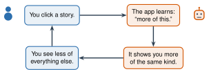

# 5.4 - AI and the News {.unnumbered}

Two friends open the same video app at the same time. One sees soccer highlights and a cooking video. The other sees an angry argument and a fight at a store.

Same app. Same minute. Different worlds. An AI chose each video for each person.

In 2018, YouTube said that **more than 70%** of the time people spent watching came from videos its AI recommended. Today you see how a feed learns, and what it learns about you.

:::{.agenda}
**Today's Plan** (40 minutes)

- [🔥]{.icon} **Warm Up** What did you see first today? [5 min]{.time}
- [👥]{.icon} **Learn Together** How a feed chooses [10 min]{.time}
- [🛠️]{.icon} **Try It** Train a feed, then compare [18 min]{.time}
- [💬]{.icon} **Talk About It** Who decides what is news? [7 min]{.time}
:::

:::{.objectives}
- [ ] I can explain how an app chooses what to show me.
- [ ] I can explain why my feed can be very different from my friend's.
- [ ] I can explain why angry stories spread fast.
:::

::::{.vocab}
:::{.word-cards}
- [📰]{.icon} : the list of posts, videos, or stories an app shows you
- [🎯]{.icon} : something an app chooses for you, because it predicts you will like it
- [⚙️]{.icon} : a set of steps a computer follows to make a choice
- [🫧]{.icon} : when an app shows you only what you already like, so you miss everything else
:::
::::

:::{.guided-notes-link}
[Printable lesson sheet](/handouts/Unit_5/5.4_AI_and_the_News.pdf){target="_blank"} - the sheet you write on today.
:::

:::{.teacher title="Before class"}
For Day 2, choose one news story or picture that spread online this month.
:::



Think about the first video or post you saw today. Write it on your sheet (no names). Why do you think the app showed it to you?



### 5.4.1 - How a Feed Chooses

An app has millions of videos and posts. It can show you only a few. So an AI makes a : *which ones will this person click, and watch the longest?*

{width="520px" fig-align="center" fig-alt="A loop. You click a story. The app learns: more of this. It shows you more of the same kind. You see less of everything else. Then you click again."}

Every click, like, share, and second you watch teaches the app. This is the same idea as training in Unit 2: the AI fixes its weights after every example. Here, **you** are the example.

***

### 5.4.2 - Why It Matters

- **Different worlds.** Your feed and your friend's feed can be very different. You may not know what the other person sees. This is called a .
- **Angry stories win.** People click and share angry and scary stories more. So the app learns to show more of them.
- **Fake news looks real.** AI can write whole news websites, with no reporters at all.

:::{.note title="Right now (fall 2026)"}
NewsGuard is a company that checks news sites. It has found more than **3,700** websites that publish news written mostly by AI, with little or no human checking. They are in 16 languages (June 2026).
:::



### 5.4.3 - Train a Feed

Work with a partner. Each partner uses their own computer. This demo uses made-up stories.

:::{.steps}
1. Click **10 stories** you really want to read. Do not look at your partner's screen.
2. Watch the bars: what does the app think you like?
3. After 10 clicks, compare feeds with your partner. How many stories are the same?
4. Press **Start over**. This time, click only the angry stories. What happens to your feed?
:::



This shows the idea. Real apps use neural networks and watch much more: how long you look, what you share, and what people like you click.

:::{.teacher title="Class size"}
**Small class:** one student trains the feed on the projector while the class tells them what to click. Then a second student tries. **Big class:** every pair compares, then the class counts: how many pairs had feeds that were almost the same?
:::



Should an app show you what you **like**, or what is **important**? Who should decide what is news?

:::{.frames}
- The app thought I liked ... because I clicked ...
- My feed and my partner's feed were (the same / different) because ...
- Angry stories spread fast because ...
- An app should show me ... , because ...
:::



:::{.project title="Day 2: Trace a Story Back"}
Mr. Ross shows a news story or picture that spread online this month. Work with a partner.

1. Use the SIFT steps from Lesson 4.3.
2. Ask your class AI tool: **"Is this story true? Give me 3 sources."** Then check every source yourself. Does it say what the AI says?
3. Decide: true, false, or missing important facts. Write your proof.

**No class AI tool today?** Use only lateral reading (Lesson 3.4).
:::

:::{.project title="Break Your Bubble"}
For one week, follow or search for one topic you never see in your feed: science, news from your home country, a new sport. What changes? Write about it.
:::

:::{.explore-link}
🔭 **Explore More:** [how recommendations learn, AI news websites, and fake voices in elections](/chapters/Explore/explore-unit-5.qmd#explore-5-4). Read it on your own, if you want to learn more.
:::
