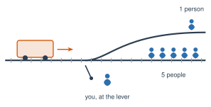

# 6.4 - Who Makes the Rules? {.unnumbered}

In some U.S. cities, you can call a taxi, and it comes with **nobody** in the driver's seat. An AI drives.

Most of the time, the AI's job is simple: follow the road rules and do not hit anything. But what should it do when a crash cannot be stopped? Who decides? The company? The government? The people who ride in it, or the people walking on the street?

Today you act out one of the most famous thought experiments in the world, and then you make the rules.

:::{.agenda}
**Today's Plan** (40 minutes)

- [🔥]{.icon} **Warm Up** Who makes the rules at school? [4 min]{.time}
- [👥]{.icon} **Learn Together** The trolley problem [8 min]{.time}
- [🧪]{.icon} **Try It** Act it out, then the AI car [20 min]{.time}
- [💬]{.icon} **Talk About It** Who should decide? [8 min]{.time}
:::

:::{.objectives}
- [ ] I can explain the trolley problem and why people disagree about it.
- [ ] I can explain why people in different countries may want different rules for AI.
- [ ] I can say who I think should make the rules for AI, with a reason.
:::

::::{.vocab}
:::{.word-cards}
- [⚖️]{.icon} : ideas about what is right and wrong
- [🚃]{.icon} : a famous question: would you change a train's path to save five people, if it hurts one?
- [📜]{.icon} : a rule made by a government
- [🙋]{.icon} : being the one who must answer for what happened
:::
::::

:::{.guided-notes-link}
[Printable lesson sheet](/handouts/Unit_6/6.4_Who_Makes_the_Rules.pdf){target="_blank"} - the sheet you write on today.
:::

:::{.teacher title="Before class"}
Bring tape to make two tracks on the floor, and paper people for a small class.
:::



Name 3 rules at our school. Who made each one: the teacher, the principal, the district, or the state? Did students get a say?



### 6.4.1 - The Trolley Problem

:::{.experiment title="The trolley problem (1967)"}
A trolley (a train on a city street) is rolling down the track. It cannot stop. Ahead, 5 people are on the track. You stand next to a lever. If you pull it, the trolley moves to a side track, where there is **1** person.

{width="520px" fig-align="center" fig-alt="A trolley rolls toward 5 people on the main track. A side track has 1 person. A person stands next to the lever that switches the tracks."}

Do you pull the lever?

The philosopher Philippa Foot asked a question like this in 1967. People have argued about it ever since. There is no answer everyone agrees on.
:::

Most people say they would pull the lever: 1 is fewer than 5. But change the story a little, and many people change their answer. What if you had to **push** a person onto the track to stop the trolley? The numbers are the same. Most people say no.



### 6.4.2 - Act It Out

:::{.steps}
1. Make two tracks on the floor with tape or desks. One student stands at the **lever**.
2. Students (or paper people, if the class is small) stand on the tracks: 5 on the main track, 1 on the side track.
3. Your teacher reads each round from your sheet. The lever student decides out loud. Then **everyone** votes by walking to one side of the room: **pull** or **do not pull**.
4. After each round, one person from each side says why.
:::

The rounds on your sheet change one thing at a time. You push a person. An AI car must choose between its passenger and people on the street. Then young and old. Then people crossing on a red light.

:::{.teacher title="Class size"}
**4 students:** one at the lever, and paper people on the tracks. Everyone votes. **Big class:** take turns at the lever. Students on the tracks vote too.
:::

:::{.real-world title="The Moral Machine (2018)"}
Scientists at MIT made a website with questions like these about self-driving cars. People in **233 countries and territories** made about **40 million** choices. Most people chose to save more lives. But people in different parts of the world made different choices about young and old, and about people breaking the law. If people disagree, whose choices should the car follow?
:::

:::{.think title="Do real AI cars do this?"}
Engineers say these exact choices almost never happen on real roads. Their job is to stop the car before there is a choice. But the hard question is real: someone writes the rules, and someone is  when something goes wrong.
:::



Who should make the rules for AI cars, and for AI in general: the companies that build it, the government, or the people it affects? Should the rules be the same in every country?

:::{.frames}
- In the first round, I chose ... because ...
- I changed my vote when ... because ...
- The rules for AI should be made by ... because ...
- When an AI car crashes, the one responsible is ...
:::



:::{.project title="Day 2: Our Class Rules for AI"}
Work in groups of 3 or 4 (in a class of 4, one group).

1. Write 5 rules for how AI should be used: at our school, in cars, or in the whole country.
2. Each rule needs a reason.
3. Groups share. The class votes on the best 5 rules.
4. Compare our rules with the real laws in the box below. What did lawmakers think of that we missed? What did we think of that they missed?

:::{.note title="Right now (fall 2026)"}
- The **European Union** passed the first big AI law in 2024. It bans some uses, like scoring people on their behavior. It has strict rules for "high-risk" AI, like AI that helps choose who gets a job. The rules start in steps through 2027.
- The **United States** has no single national AI law. Many states have their own, like California and Colorado. In December 2025, the President ordered the government to challenge state AI laws it sees as too strict. As of spring 2026, the state laws were still in force. Leaders disagree about who should make the rules.
- Our **school district** has its own rules for AI use. Ask your teacher what they say.
:::
:::

:::{.explore-link}
🔭 **Explore More:** [more trolley problems, the Moral Machine results, and how AI laws are made](/chapters/Explore/explore-unit-6.qmd#explore-6-4). Read it on your own, if you want to learn more.
:::
