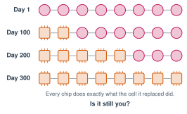

# 6.6 - The Big Question, Again {.unnumbered}

On the first day of this class, you answered a question: *Is AI like a human brain?* Your teacher kept your answer.

Since then, you were a neuron. You trained a neural network with creature cards. You sat in the Klingon Room. You caught chatbots making things up, and you saw how AI changes jobs, news, and friendship.

Today you get your first answer back. Then you answer again, with everything you know now.

:::{.agenda}
**Today's Plan** (40 minutes)

- [🔥]{.icon} **Warm Up** Read your first answer [5 min]{.time}
- [👥]{.icon} **Learn Together** What we know now [8 min]{.time}
- [🧪]{.icon} **Try It** Replace the brain, one cell at a time [15 min]{.time}
- [💬]{.icon} **Talk About It** The Big Question [12 min]{.time}
:::

:::{.objectives}
- [ ] I can name ways AI is like a brain, and ways it's different.
- [ ] I can explain the brain replacement thought experiment.
- [ ] I can answer the Big Question with reasons from this class.
:::

::::{.vocab}
:::{.word-cards}
- [🧠]{.icon} : a brain cell that sends signals to other cells
- [🔵]{.icon} : a computer program made of many artificial neurons in layers
- [🤔]{.icon} : to know what something means, not just what to say
- [💡]{.icon} : being aware: having thoughts and feelings that you experience
:::
::::

:::{.guided-notes-link}
[Printable lesson sheet](/handouts/Unit_6/6.6_The_Big_Question_Again.pdf){target="_blank"} - the sheet you write on today.
:::

:::{.teacher title="Before class"}
Bring back the Big Question answers from Lesson 1.1. Make orange cards and rule cards for the chips.
:::



Your teacher gives you your answer from the first day. Read it. On your sheet, copy what you circled: **Yes**, **A little**, or **No**, and your reason. Do you still agree with yourself?



### 6.6.1 - What We Know Now

| How AI is **like** a brain | How AI is **different** |
|---|---|
| It's made of many small parts (neurons) that pass signals (Lessons 2.2 and 2.4). | A brain has about 86 billion neurons, in a living body. |
| Connections get stronger with practice, like weights (Lessons 2.3 and 2.5). | A brain runs on about **20 watts**, about as much power as a dim light bulb. Big AI runs on thousands of computers in data centers (Lesson 6.3). |
| It learns from examples, not rules (Lesson 1.1). | A child learns "dog" from a few dogs. AI needs thousands of pictures. |
| It finds patterns and makes predictions (Lesson 1.6). | A brain has feelings, a body, and a life. Does AI ? (Lesson 1.3) |

***

### 6.6.2 - The Hardest Part

Scientists can measure neurons and weights. They can't yet measure : what it's like to **be** you, from the inside. Nobody knows for sure how a brain makes it, or whether a machine could ever have it. This is one of the biggest open questions in science.



### 6.6.3 - Replace the Brain, One Cell at a Time

:::{.experiment title="The brain replacement (1980s and 1990s)"}
Philosophers like Zenon Pylyshyn and David Chalmers asked: imagine scientists replace one of your neurons with a tiny chip. The chip does **exactly** what the neuron did. You feel the same. Then they replace another one. And another.

{width="440px" fig-align="center" fig-alt="Four rows of 8 cells. Day 1: all pink brain cells. Day 100: 2 orange chips. Day 200: 5 chips. Day 300: all chips. Every chip does exactly what the cell it replaced did. Is it still you?"}

After all 86 billion neurons are chips, are you still you? Do you still feel anything? If not, when did it stop?
:::

Now act it out with the squeeze chain from Lesson 2.2.

:::{.steps}
1. Stand in a line and hold hands. You're neurons in a brain. Your teacher starts a squeeze. Time how long it takes to reach the end.
2. Your teacher gives one student an orange card. That student is now a **chip**. The chip follows a rule card: *When you feel a squeeze, squeeze the next hand.* Pass the squeeze again. Did anything change?
3. Replace one more student at a time, until everyone is a chip. Pass the squeeze each time.
4. Is the line still a "brain"? When did it stop, or did it?
:::

Look at your squeeze times. Did they change? If they didn't, nobody could tell from the outside which hands were chips. Scientists can measure the squeeze. Nobody knows how to measure what it feels like inside.

:::{.teacher title="Class size"}
**4 students:** make a line of 4 with the teacher. Replace one student each round. **Big class:** make two lines. One line stays all neurons. Compare the squeeze times.
:::





:::{.big-question}
[Is AI like a human brain?]{.bq}

1. On your sheet, circle one again: **Yes**, **A little**, or **No**.
2. Write **two** reasons. Use something you did in this class for each one.
3. Did your answer change from the first day? Why or why not?
4. Share with a partner. Then a few students share with the class.
:::

:::{.frames}
- On the first day, I said ... Now I say ... because ...
- AI is like a brain because, in Lesson ..., we saw ...
- AI is different from a brain because ...
- The question I still have is ...
:::



:::{.project title="Day 2: The Class Debate"}
Split into two teams: **"AI is like a brain"** and **"AI is not like a brain."** You might be on the side you don't agree with. That's OK. It makes you think harder.

1. Each team has 10 minutes to find its 3 best reasons from this class.
2. Each team speaks for 2 minutes. Then each team answers the other for 1 minute.
3. At the end, everyone votes for the side they **really** believe.

In a class of 4, make two teams of 2. Your teacher can join the smaller team.
:::

:::{.project title="A Letter to Next Year's Class"}
Write a letter to a student who will take this class next year. What surprised you? What should they watch out for? What is your answer to the Big Question? Don't write your name or anyone else's.
:::

:::{.explore-link}
🔭 **Explore More:** [consciousness, the ship of Theseus, and brains versus AI by the numbers](/chapters/Explore/explore-unit-6.qmd#explore-6-6). Read it on your own, if you want to learn more.
:::
