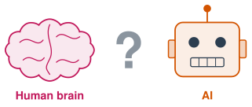

# Welcome to AI and You {.unnumbered}

*A mini-block class with Mr. Ross at Frederick Douglass High School*

{width="420px" fig-align="center" fig-alt="A drawing of a human brain, a question mark, and a robot head labeled AI."}

## 🧭 About the Class

AI is everywhere now. It writes, draws, talks, answers questions, and even pretends to be a friend. Some people say it thinks like a human brain. Is that true? In this class we will find out.

We will see what AI can do, learn the story of how it was built, look at how it works (and how it is a little like the brain in your head), and try it out for real tasks. By the end, you will know how to use AI well, spot it when it is wrong, and decide for yourself what you think about it and the world it is building.

***

## 👋 About Your Teacher

Before teaching, Mr. Ross spent over 15 years working in AI and data science, including time at Wolfram Research (the makers of Mathematica) and nearly a decade helping build a data science team at a Missouri company. He has a background in biology and statistics and still does AI work outside of school. He has been working with these tools since long before ChatGPT existed.

***

## 🎯 What You Will Learn

- How to use AI tools for writing, school, art, and real-life problems.
- The basic story of how AI was built and how it works.
- How AI is and is not like the human brain.
- How to catch AI when it makes things up or gets things wrong.
- How AI is changing creativity, friendship, jobs, and the news.
- What AI might mean for your future, and what you think about that.

***

## 🗺️ The Units

| Unit | Weeks | What we do |
|---|---|---|
| [**1: The Big Question**](chapters/Unit_1/index.qmd) | 1 | Play with AI. Write your first answer: is AI like a human brain? |
| [**2: Where AI Came From**](chapters/Unit_2/index.qmd) | 2-3 | The story of AI from the 1950s to ChatGPT. |
| [**3: Brains and Neural Networks**](chapters/Unit_3/index.qmd) | 4-6 | How brain cells work, and how computers copy the idea. |
| [**4: Using AI Well**](chapters/Unit_4/index.qmd) | 7-11 | Use AI for writing, research, translation, math, and art. Finish a real project. |
| [**5: When AI Gets It Wrong**](chapters/Unit_5/index.qmd) | 12-13 | Catch AI when it is wrong, biased, or fake. |
| [**6: AI in the Real World**](chapters/Unit_6/index.qmd) | 14-15 | Privacy, scams, jobs, school, and the news. |
| [**7: AI and Being Human**](chapters/Unit_7/index.qmd) | 16 | AI friends, AI art, and the hard questions. |
| [**8: The Big Question, Again**](chapters/Unit_8/index.qmd) | 17 | Answer the big question again in a final project. |

***

## 🧩 How Each Lesson Works

Every lesson is 40 minutes, and every lesson includes a hands-on activity.

| | Part | What you do |
|---|---|---|
| 🔥 | **Warm Up** | A quick question or game to start thinking. |
| 👥 | **Learn Together** | New ideas with pictures and examples. |
| 🛠️ | **Try It** | Use a real AI tool or do an activity. |
| 🧠 | **The Big Question** | Is AI like a human brain? Add to your answer. |
| 📺 | **Watch** | A short video. Turn on captions in your language. |
| 🚀 | **Go Further** | Projects and links to explore on your own. |

Each lesson has a **printable sheet** to write on in class.

***

*This book was written by Mr. Ross in collaboration with Claude, an AI assistant made by Anthropic.*
