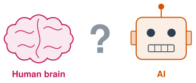

# Welcome to AI and You {.unnumbered}

*A mini-block class with Mr. Ross at Frederick Douglass High School*

:::{.note title="Written with AI"}
Mr. Ross wrote this book in collaboration with **Claude**, an AI assistant made by Anthropic. Mr. Ross planned the class, chose what goes in every lesson, and makes the final decisions. Claude helped write the pages, find and check facts, draw the pictures, and build the demos.

In Unit 3, you will learn how to use AI this way: as a helper, while you stay in charge.
:::

{width="420px" fig-align="center" fig-alt="A drawing of a human brain, a question mark, and a robot head labeled AI."}

## 🧭 About the Class

AI is everywhere now. It writes, draws, talks, answers questions, and even pretends to be a friend. Some people say it thinks like a human brain. Is that true? In this class we will find out.

We will see what AI can do, learn the story of how it was built, look at how it works (and how it is a little like the brain in your head), and try it out for real tasks. By the end, you will know how to use AI well, spot it when it is wrong, and decide for yourself what you think about it and the world it is building.

***

## 👋 About Your Teacher

Before teaching, Mr. Ross spent over 15 years working in AI and data science, including time at Wolfram Research (the makers of Mathematica) and nearly a decade helping build a data science team at a Missouri company. He has a background in biology and statistics and still does AI work outside of school. He has been working with these tools since long before ChatGPT existed.

***

## 🎯 What You Will Learn

- How to use AI tools for writing, school, art, and real-life problems.
- The basic story of how AI was built and how it works.
- How AI is and is not like the human brain.
- How to catch AI when it makes things up or gets things wrong.
- How AI is changing creativity, friendship, jobs, and the news.
- What AI might mean for your future, and what you think about that.

***

## 🗺️ The Units

| Unit | Lessons | What we do |
|---|:---:|---|
| [**1: Where AI Came From**](chapters/Unit_1/index.qmd) | 6 | What is AI? The story of AI from the 1950s to ChatGPT. |
| [**2: Brains and Neural Networks**](chapters/Unit_2/index.qmd) | 9 | How brain cells work, and how computers copy the idea. |
| [**3: Using AI Well**](chapters/Unit_3/index.qmd) | 9 | Use AI for writing, research, translation, math, and art. Finish a real project. |
| [**4: When AI Gets It Wrong**](chapters/Unit_4/index.qmd) | 4 | Catch AI when it is wrong, biased, or fake. |
| [**5: AI in the Real World**](chapters/Unit_5/index.qmd) | 4 | Privacy, scams, jobs, and the news. |
| [**6: AI and Our Future**](chapters/Unit_6/index.qmd) | 6 | AI art, AI friends, hidden costs, rules, and possible futures. |

The [Course Map](course-map.qmd) lists every lesson.

***

## 🧩 How Each Lesson Works

Every lesson is 40 minutes, and every lesson includes a hands-on activity.

| | Part | What you do |
|---|---|---|
| 🔥 | **Warm Up** | A quick question or game to start thinking. |
| 👥 | **Learn Together** | New ideas with pictures and examples. |
| 🛠️ | **Try It** | Use a demo on the page, a real AI tool, or do an activity. |
| 💬 | **Talk About It** | Talk with a partner about a hard question. |
| 📺 | **Watch** | A short video. Turn on captions in your language. |
| 🚀 | **Go Further** | More to do in class on a second day. |
| 🔭 | **Explore More** | Extra pages to read on your own, if you want to learn more. |

Each lesson has a **printable sheet** to write on in class.

The demos on these pages work in any web browser. You do not need an account, and what you type stays on your computer.

